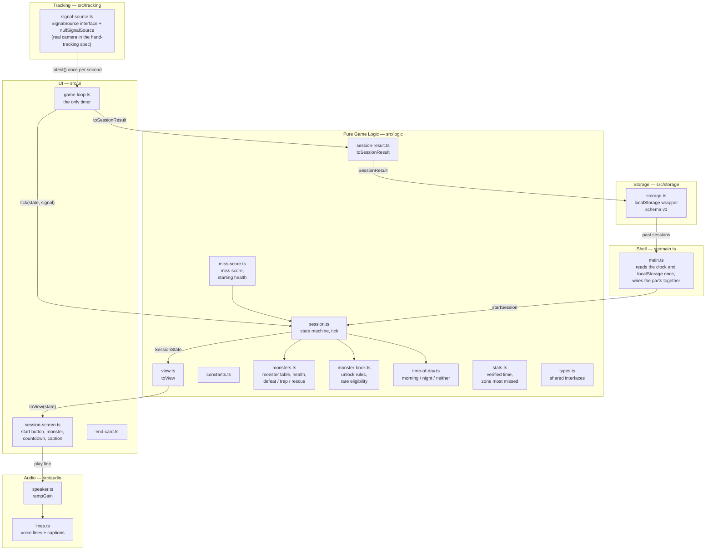
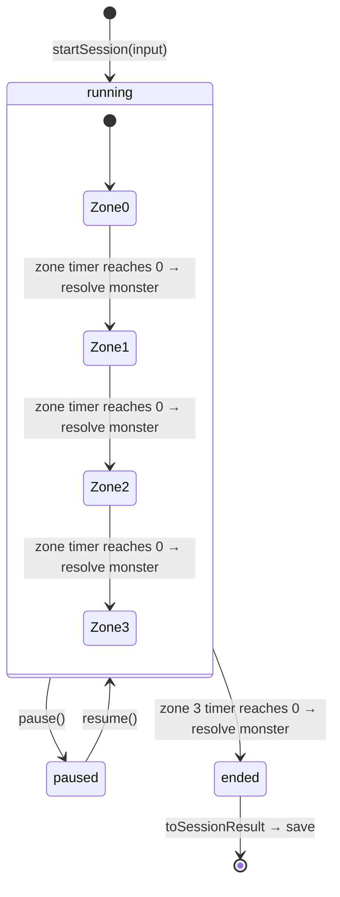

# Design: core-brushing-loop

## 1. Overview

This design covers the pure game logic for a 2-minute brushing session (4 zones × 30 s),
the guided-timer fallback when no camera is available, a plain session screen, a runnable
app (one game loop, one `SignalSource` interface, simple storage), and the property-based
tests that guard the logic.

All game logic lives in pure modules under `/src/logic/` with no DOM or camera access. The
only thing that crosses the boundary from the outside world is one brushing signal per
second, or `null` when the tracker cannot see the child (in guided-timer mode every signal
is `null`). This separation lets every rule be property-tested with fast-check without a
browser or camera.

**Key design decisions (all flagged "Design choice" inline for Dr. Yatin's review):**

- Tick granularity is 1 second.
- `H_MAX = 60`, `DAMAGE_PER_SECOND = 3`: a normal monster is defeated after 20 s of
  matching brushing.
- One tick rule for both modes, with one difference: a `null` signal drains 2 per second in
  camera mode, and every guided-timer second costs the monster `TIMER_ONLY_DAMAGE` (3), so a
  guided-timer monster is defeated at 20 s and its smoke shows for the last 10 s
  (changed 21 Nov 2026, Dr. Yatin).
- Linear kind-proximity scaling from 100% to 60% of `H_MAX`, from the last 7 camera
  sessions.
- Rare eligibility is decided at session start and counts the session that is starting.
- Monsters are chosen by a fixed rule, never at random.
- `src/ui/game-loop.ts` is the only module that owns a timer.
- The camera and tracker sit behind one interface, `SignalSource`.
- Tab hidden pauses the session; more than 60 s hidden drops it.

---

## 2. Architecture



**Data flow:** `main.ts` loads past sessions and calls `startSession`. Once per second of
visible time, `game-loop.ts` asks the `SignalSource` for the latest signal and calls
`tick`. `toView(state)` turns the state into plain values that the screen paints. When the
session ends, `toSessionResult` builds the result and storage saves it.

The "Pure Game Logic" box is the property-testable surface: everything
inside it has no DOM, no camera, no network, and no `Date` dependency. Inputs are plain
data; outputs are plain data. Nothing under `src/logic/` imports from `src/ui/`,
`src/tracking/`, `src/storage/` or `src/audio/`.

---

## 3. Module list

Modules matching `structure.md`. One concept per file, kebab-case names.

| Module | Responsibility |
|--------|---------------|
| `src/logic/types.ts` | Shared TypeScript interfaces: `BrushingSignal`, `Zone`, `MonsterDef`, `MonsterState`, `SessionState`, `StartInput`, `SessionResult`, `ZoneResult`, `MonsterBook`, `MissScores` (derived, never stored), `TimeOfDay`, `SessionMode`. No logic, no DOM. |
| `src/logic/constants.ts` | All constants from section 6 and `ZONE_ORDER`. |
| `src/logic/session.ts` | Session state machine: `startSession`, `isBrushing`, `tick`, `pause`, `resume`. Zone advancement, timer countdown, damage/drain application, defeat/trap/resolve. Pure functions — same input always produces same output, no side effects. |
| `src/logic/session-result.ts` | `toSessionResult(state)`. |
| `src/logic/view.ts` | `toView(state)` → `{ phase, zoneId, countdown, captionLineId, monsterId, healthFraction, smokeFraction }`. Pure; this is what the screen tests check. |
| `src/logic/monsters.ts` | Monster table (12 entries: 8 common, 4 rare), each `{ id, name, rarity, unlockRule }`. `assignMonsters(pastSessions, rareEligible)`: picks one monster per zone by the fixed rule (section 7). `resolveMonster(state)`: applies defeat, trap, or rescue at zone end. |
| `src/logic/monster-book.ts` | `computeMonsterBook(sessions)`: union of all `monstersEarned` across sessions. `isRareEligibleForNewSession(todaysSessions, newTimeOfDay)`: true only when the stored sessions of the day plus the new one include ≥ 1 morning AND ≥ 1 night session. |
| `src/logic/miss-score.ts` | `computeMissScores(sessions)`: per-zone miss score from the last 7 camera sessions, verified zones only. `startingHealth(zone, missScores)`: kind-proximity scaling, rounded, 36 to 60. |
| `src/logic/time-of-day.ts` | `classifyTimeOfDay(hour)`: returns `'morning'`, `'night'`, or `'neither'` from the session start hour (0–23). Pure — no `Date` object needed. |
| `src/logic/stats.ts` | `computeVerifiedTime(sessions)` returns the sum of `secondsBrushed` over the verified zones of camera-mode sessions. Untracked seconds are not counted. Timer-only sessions and unverified zones add 0. So it never exceeds 30 per zone or 120 per session. `zoneMostMissed(sessions)` returns `ZoneId \| null`. It uses ALL stored camera-mode sessions (not the 7-session window of `computeMissScores`) and their verified zones only. The miss of a zone is the average over those verified zones of `max(0, 30 - secondsBrushed - secondsUntracked)`. It returns the zone with the highest average; a tie goes to the first zone in `ZONE_ORDER`. It returns `null` when there is no verified camera data. It does not call `computeMissScores`. Pure. (Parent screen UI is out of scope; only the computation is here.) |
| `src/storage/storage.ts` | `createStorage(backend)` returning `saveSession(result)`, `loadSessions()`, `clearAll()`. `backend` is anything with `getItem`, `setItem`, `removeItem`. No global access inside the module. |
| `src/tracking/signal-source.ts` | The `SignalSource` interface (below) and `nullSignalSource`, which answers `'unavailable'` and `null`. |
| `src/ui/game-loop.ts` | The only timer. Inputs: a clock (`now()`), a scheduler, a `SignalSource`, a visibility source, a wake-lock helper, and callbacks for "state changed", "ended" and "dropped". Emits one tick per whole second of visible elapsed time, catching up if a callback is late. Pauses when hidden; drops the session after 60 s hidden; asks for the wake lock at start and releases it at end or when hidden. |
| `src/ui/session-screen.ts` | Start button, monster over the active zone, countdown, caption. Paints `toView(state)`. No camera preview in this spec. |
| `src/ui/end-card.ts` | The session's four monsters, closing line, one button back to the start screen. |
| `src/audio/lines.ts` | Voice line table: `{ id, text, caption }`. Every line has a caption. Zone announcements and all spoken instructions live here. |
| `src/audio/speaker.ts` | Plays a line: a clip if present, else a local Web Speech voice, else caption only. Contains the pure `rampGain(msSinceStart)` used for the gentle volume ramp. |
| `src/main.ts` | Wiring only. |

```typescript
interface SignalSource {
  start(): Promise<'ready' | 'unavailable'>;  // asks for the camera once
  latest(): BrushingSignal | null;            // signal for the last full second
  stop(): void;                               // stops the camera stream
}
```

---

## 4. TypeScript types

Logic never touches `Date`, `Math.random`, the DOM or storage. `main.ts` reads the clock once and passes plain values in.

All types live in `src/logic/types.ts`. Field names match the requirements verbatim.

```typescript
// ── Brushing signal (req 5.1) ──
// The only thing that crosses from tracking into game logic.
// null in guided-timer mode (req 5.2).
interface BrushingSignal {
  readonly handNearMouth: boolean;
  readonly side: 'left' | 'right' | 'unknown';
  readonly level: 'upper' | 'lower' | 'unknown';
  readonly moving: boolean;
}

// ── Zone (req 3) ──
type Side = 'left' | 'right';
type Level = 'upper' | 'lower';

// Zone identifiers in session order: upper-right → upper-left → lower-left → lower-right.
type ZoneId = 'upper-right' | 'upper-left' | 'lower-left' | 'lower-right';

interface Zone {
  readonly id: ZoneId;
  readonly side: Side;
  readonly level: Level;
  readonly index: number;  // 0–3, position in zone order
  readonly label: string;  // spoken/displayed name, e.g. "upper right"
}

// ── Monster (req 7, 10) ──
type Rarity = 'common' | 'rare';
type MonsterOutcome = 'pending' | 'defeated' | 'fled' | 'trapped';

// Static definition — lives in the src/logic/monsters.ts table (req 7.6, 10.4).
interface MonsterDef {
  readonly id: string;
  readonly name: string;
  readonly rarity: Rarity;
  readonly unlockRule: string;  // human-readable
}

// Per-zone monster state during a session.
interface MonsterState {
  readonly def: MonsterDef;
  readonly zoneId: ZoneId;
  readonly health: number;               // current, clamped to [0, startingHealth]
  readonly startingHealth: number;  // after kind-proximity adjustment
  readonly maxHealth: number;       // H_MAX (normal health)
  readonly outcome: MonsterOutcome;
  readonly defeatedAtElapsed: number | null;  // seconds into the zone when health reached zero; null if it has not
}

// ── Session state (req 2, 5) ──
type SessionMode = 'camera' | 'timer-only';
type TimeOfDay = 'morning' | 'night' | 'neither';

// Full session state, advanced one tick at a time by tick().
interface SessionState {
  readonly mode: SessionMode;
  readonly zones: readonly Zone[];          // 4 zones, ordered per req 3.2
  readonly activeZoneIndex: number;                   // 0–3
  readonly zoneTimeRemaining: number;                  // seconds left in current zone (30 → 0)
  readonly monsters: readonly MonsterState[];         // one per zone
  readonly secondsBrushedPerZone: readonly number[];   // [0,0,0,0], increments when signal matches
  readonly secondsUntrackedPerZone: readonly number[]; // [0,0,0,0], increments when the signal is null
  // Brushed or untracked seconds counted after that zone's monster was defeated; used only for drawing.
  readonly secondsSmokeClearedPerZone: readonly number[];
  readonly ticksDone: number;                         // 0 to 120
  readonly startedAt: number;                 // epoch ms
  readonly date: string;                      // YYYY-MM-DD
  readonly timeOfDay: TimeOfDay;
  readonly phase: 'running' | 'paused' | 'ended';
}

// ── Start input (plain values only) ──
interface StartInput {
  readonly mode: SessionMode;
  readonly startedAt: number;   // epoch ms, read once by main.ts
  readonly date: string;        // YYYY-MM-DD, local, read once by main.ts
  readonly hour: number;        // 0–23, local
  readonly pastSessions: readonly SessionResult[];
}

// ── Session result (req 9) ──
// Per-zone outcome.
interface ZoneResult {
  readonly zoneId: ZoneId;
  readonly monsterId: string;
  readonly secondsBrushed: number;  // matched seconds (camera) or 30 (timer-only)
  readonly secondsUntracked: number;
  readonly verified: boolean;       // true only in camera mode when secondsUntracked ≤ 10
  readonly monsterOutcome: 'defeated' | 'fled' | 'trapped';
}

// Produced when the session ends.
interface SessionResult {
  readonly date: string;          // YYYY-MM-DD
  readonly timeOfDay: TimeOfDay;
  readonly mode: SessionMode;
  readonly zoneResults: readonly ZoneResult[];
  readonly monstersEarned: readonly string[];
  readonly startedAt: number;     // epoch ms
  readonly durationSeconds: number;  // ticks processed; 120 for every completed session
}

// ── Monster Book (req 10) ──
// Derived from all stored sessions (union of monstersEarned), not stored separately.
interface MonsterBook {
  readonly unlockedIds: ReadonlySet<string>;
}

// ── Miss scores (req 14) ──
// Per-zone normalized miss score, [0, 1]. Computed from camera-mode sessions only.
type MissScores = Record<ZoneId, number>;
```

---

## 5. Session state machine

The state machine is the same for both modes and there is one tick rule. In timer-only mode every signal is treated as `null`.



### Tick pseudocode

```
tick(state, signal):
  if state.phase != 'running': return state          // paused or ended: no change
  s = (state.mode == 'timer-only') ? null : signal
  zone, monster = the active zone and its monster
  elapsed = ZONE_DURATION - state.zoneTimeRemaining + 1

  if state.mode == 'timer-only': damage = TIMER_ONLY_DAMAGE (3); untracked[zone] += 1; progress = true
  else if s == null:            damage = UNTRACKED_DRAIN (2); untracked[zone] += 1; progress = true
  else if isBrushing(s, zone):  damage = DAMAGE_PER_SECOND (3); brushed[zone] += 1; progress = true
  else:                         damage = 0; progress = false

  if monster.outcome == 'defeated':
    if progress: smokeCleared[zone] += 1             // drawing only
  else:
    monster.health = max(0, monster.health - damage)
    if monster.health == 0:
      monster.outcome = 'defeated'; monster.defeatedAtElapsed = elapsed

  zoneTimeRemaining -= 1; ticksDone += 1

  if zoneTimeRemaining == 0:
    if monster.outcome == 'pending':
      monster.outcome = (monster.health <= RESCUE_THRESHOLD) ? 'fled' : 'trapped'
    if this was zone 3: phase = 'ended'
    else: activeZoneIndex += 1; zoneTimeRemaining = ZONE_DURATION

  return a NEW state object (the input state is not changed)
```

Health only ever goes down, and by whole numbers.

### `isBrushing(signal, zone)` — req 5.4–5.5, 6.3

```
isBrushing(signal, zone):
  return signal != null
    and signal.handNearMouth == true
    and signal.moving == true
    and signal.side == zone.side          // 'unknown' never matches
    and (REQUIRE_LEVEL_MATCH == false or signal.level == zone.level)   // 'unknown' never matches when checked (req 5.7)
```

When any checked field is `'unknown'`, the signal does not match (req 6.3). The zone timer still
runs (req 6.1). No nag is shown (req 6.2).

`pause(state)`: running → paused, otherwise unchanged. `resume(state)`: paused →
running, otherwise unchanged. Both return a new state. (req 2.6)

### `toSessionResult(state)` — req 9.1–9.3

- Only valid when `phase == 'ended'`.
- Timer-only: each zone has `secondsBrushed = 30`, `secondsUntracked = 0`,
  `verified = false`.
- Camera: `secondsBrushed` and `secondsUntracked` are the counted values;
  `verified = (secondsUntracked <= UNTRACKED_LIMIT)`. (req 9.3)
- `monstersEarned` = the ids of all four monsters (req 10.1, 10.2).
- `durationSeconds = ticksDone`.

### `startSession(input: StartInput)` — req 2.1, 3.2, 14.2

```
startSession(input):
  zones       = ZONE_ORDER.map(makeZone)
  timeOfDay   = classifyTimeOfDay(input.hour)
  today       = input.pastSessions.filter(s => s.date == input.date)
  rare        = isRareEligibleForNewSession(today, timeOfDay)
  defs        = assignMonsters(input.pastSessions, rare)        // fixed rule, no randomness
  missScores  = computeMissScores(input.pastSessions)
  health(z)   = input.mode == 'timer-only' ? H_MAX : startingHealth(z, missScores)
  monsters    = zones.map(z => makeMonster(defs[z.index], z, health(z)))
  return { mode, zones, activeZoneIndex: 0, zoneTimeRemaining: 30, monsters,
           secondsBrushedPerZone: [0,0,0,0], secondsUntrackedPerZone: [0,0,0,0],
           secondsSmokeClearedPerZone: [0,0,0,0], ticksDone: 0,
           startedAt: input.startedAt, date: input.date, timeOfDay, phase: 'running' }
```

> **Design choice:** The logic processes 1-second ticks. Per-frame camera signals (20+ fps)
> are aggregated by the tracking layer (the rule is defined in the `hand-tracking` spec) into one signal per second before being passed to
> `tick`. This keeps the logic simple and testable (120 ticks per session, not 2400). The
> UI may interpolate the countdown and monster health between ticks for smoothness — that
> is a rendering concern, not a logic one. Confirmed by Dr. Yatin 2026-11-15.

---

## 6. Health maths

### Constants

| Constant | Value | Meaning |
|----------|-------|---------|
| `ZONE_DURATION` | 30 s | Seconds per zone (req 2.1) |
| `ZONE_COUNT` | 4 | Zones per session |
| `SESSION_DURATION` | 120 s | Total session (req 2.1) |
| `H_MAX` | 60 | Normal monster health (max) |
| `DAMAGE_PER_SECOND` | 3 | Camera-mode damage per second of correct brushing (normal monster defeated after 20 s: `H_MAX / DAMAGE_PER_SECOND = 60 / 3 = 20`) |
| `KIND_FLOOR_RATIO` | 0.6 | Kind-proximity floor: starting health ≥ 60% of `H_MAX` (req 14.2) |
| `KIND_FLOOR` | 36 | `KIND_FLOOR_RATIO × H_MAX` |
| `RESCUE_THRESHOLD` | 9 | 15% of `H_MAX`; monster at ≤ 9 health at zone end is rescued (req 14.3) |
| `UNTRACKED_DRAIN` | 2 | Health lost per second when the signal is `null` in a camera-mode session (req 7.7); `H_MAX / ZONE_DURATION` |
| `TIMER_ONLY_DAMAGE` | 3 | Health lost per second in guided-timer mode (req 8.5, 8.6); equal to `DAMAGE_PER_SECOND`; a guided-timer monster is defeated after `H_MAX / TIMER_ONLY_DAMAGE = 20` s (added 21 Nov 2026) |
| `UNTRACKED_LIMIT` | 10 | A camera-mode zone with more untracked seconds than this is unverified (req 9.3) |
| `MISS_WINDOW` | 7 | Number of most recent camera-mode sessions used for miss scores (req 14.1) |
| `REQUIRE_LEVEL_MATCH` | false | `false` since 21 Nov 2026 by Dr. Yatin's decision (level check failed). When false, level is ignored (req 5.7) |
| `REQUIRE_SIDE_MATCH` | false | `false` since 21 Nov 2026 by Dr. Yatin's decision (side check failed). When false, side is ignored (req 5.7) |

> **Design choice:** `H_MAX = 60` and `DAMAGE_PER_SECOND = 3` so that a normal-strength
> monster is defeated after exactly 20 seconds of matching brushing (`60 / 3 = 20`).
> Starting health is rounded to a whole number and every change is −2 or −3, so health is
> always a whole number. Approved: defeat after 20 s of matching brushing. The 20 s leaves
> slack for seconds the tracker misses.

### Normal health (req 7.1)

Each zone monster's `maxHealth = H_MAX = 60`. Before kind-proximity adjustment, starting
health equals `maxHealth`. A child who brushes correctly for 20 seconds deals
`20 × 3 = 60` damage and defeats the monster.

### Camera-mode per-second damage (req 7.2)

When `isBrushing(signal, activeZone)` is true, the active monster loses
`DAMAGE_PER_SECOND = 3` health per second.

| Seconds brushed correctly | Damage | Remaining health | Outcome |
|---------------------------|--------|-----------------|---------|
| 20 | 60 | 0 | Defeated |
| 17 | 51 | 9 | Fled (rescued: 9 ≤ 9) |
| 16 | 48 | 12 | Trapped (12 > 9) |
| 0 | 0 | 60 | Trapped |

### Untracked drain (req 7.7, 8.5)

- When the signal is `null` in a camera-mode session, the active monster loses
  `UNTRACKED_DRAIN = 2` per second. It is subtracted each tick, like camera damage.
- Timer-only mode: every signal is `null` and every monster starts at 60. Each second costs
  `TIMER_ONLY_DAMAGE = 3`, so health is `60 − 3 × elapsed` and reaches 0 at 20 s. The smoke
  then shows for the last 10 s of the zone (req 7.8, 8.5). Changed 21 Nov 2026 by Dr. Yatin;
  before that the drain was 2 per second and defeat came at exactly 30 s.
- Camera mode: a second the tracker cannot see costs the monster 2 instead of 3. Mixed
  example: 12 untracked seconds (−24) and 12 matched seconds (−36) defeat a normal
  monster.
- A camera-mode zone with more than 10 untracked seconds is saved as unverified.

### Kind-proximity starting health (req 14)

**Step 1 — Miss score per zone** (req 14.1, 13.9):

```
recent        = the MISS_WINDOW (7) most recent camera-mode sessions, by startedAt
For each session s in recent, each zone z whose result is verified:
  miss(s, z) = max(0, 30 - secondsBrushed - secondsUntracked)
n(z)          = number of verified results for z in recent
missScore(z)  = n(z) > 0 ? Σ miss(s, z) / (30 × n(z)) : 0
```

`missScore(z) ∈ [0, 1]`. Timer-only sessions, unverified zones and sessions older than the
7 most recent contribute nothing. A zone the
child always brushes fully has `missScore = 0`; a zone never brushed has `missScore = 1`.

**Step 2 — Starting health** (req 14.2):

```
startingHealth(z) = clamp(round(60 × (1 − 0.4 × missScore(z))), 36, 60)
```

Not applied in timer-only mode (starting health is always 60).

| Miss score | Starting health | % of normal |
|------------|-----------------|-------------|
| 0.0 (never missed) | 60 | 100% |
| 0.25 | 54 | 90% |
| 0.5 | 48 | 80% |
| 1.0 (always missed) | 36 | 60% (floor) |

Range: `[36, 60]` = `[60% × H_MAX, H_MAX]`. The monster is never already defeated (req 14.2).

> **Design choice:** Linear scaling from 100% to 60% of `H_MAX` as miss score goes from 0
> to 1. This is the simplest transparent mapping. A curved (eased) mapping could make the
> first few misses matter more, but linear is easiest to explain to a parent and to test.
> Linear curve
> confirmed by Dr. Yatin 2026-11-15.

### 15% rescue rule (req 14.3, 13.8)

At zone end (`zoneTimeRemaining == 0`), if the monster is still `'pending'`:

- `health ≤ RESCUE_THRESHOLD (9)` → **fled** ('flees into smoke'; counts as beaten).
- `health > RESCUE_THRESHOLD` → **trapped**.

In timer-only mode health is 0 at zone end (the monster is defeated at 20 s), so the
rescue never applies.

With kind proximity (starting health = 36), a child needs to brush only
`ceil((36 - 9) / 3) = 9` seconds correctly to defeat the monster (with rescue), instead of
17 seconds at full health. That is the kindness: often-missed zones need less brushing to
win.

### After a monster is beaten: smoke (req 7.8)

- When a monster is defeated before its zone ends, the zone keeps running and the screen
  shows smoke over the zone.
- `smokeFraction = 1 − secondsSmokeCleared / max(1, ZONE_DURATION − defeatedAtElapsed)`,
  clamped to [0, 1]. It is worked out for drawing only.
- The line "Keep brushing! Brush the smoke away!" is spoken and captioned once.
- Nothing is won or lost: no outcome, stored value or message depends on the smoke.
- In timer-only mode `defeatedAtElapsed` is 20, so the smoke runs for `max(1, 30 − 20) = 10`
  seconds. Every timer second counts as progress (the tick pseudocode), so `smokeFraction`
  falls from 1 to 0 over those 10 seconds.

---

## 7. Morning / night classification (req 10.5)

```typescript
// src/logic/time-of-day.ts

function classifyTimeOfDay(hour: number): TimeOfDay {
  if (hour >= 4 && hour <= 11) return 'morning';   // 04:00–11:59
  if (hour >= 17 && hour <= 23) return 'night';    // 17:00–23:59
  return 'neither';                                 // 00:00–03:59 or 12:00–16:59
}
```

Input is the session start hour (0–23) in local time. Pure — no `Date` object dependency,
so tests pass any hour directly.

The date and time of day are fixed when the session starts. A session that crosses
midnight keeps its start date.

### Rare eligibility (req 10.6–10.8)

```typescript
// src/logic/monster-book.ts
function isRareEligibleForNewSession(
  todaysSessions: readonly SessionResult[],   // stored sessions with today's date
  newTimeOfDay: TimeOfDay,                    // the session about to start
): boolean {
  const times = [...todaysSessions.map(s => s.timeOfDay), newTimeOfDay];
  return times.includes('morning') && times.includes('night');
}
```

Sessions classified `'neither'` count as normal sessions (saved, monsters earned) but do
not contribute to rare eligibility (req 10.8).

> **Design choice:** Rare eligibility is decided when the session starts and counts the
> session that is starting. So tonight's session is rare-eligible when a morning session
> was saved earlier today. (Corrected 2026-11-15: the earlier version needed a night
> session to be stored already, which could not be true at the first night session.)

### Monster assignment (req 10.9, 10.10)

```
assignMonsters(pastSessions, rareEligible):
  owned    = union of monstersEarned over pastSessions
  commons  = the 8 common monsters in table order
  start    = (pastSessions.length × 4) mod 8
  rotated  = commons from position start, wrapping round
  ordered  = [commons not owned, in table order] followed by [rotated, owned only]
  if rareEligible:
    rare   = first rare in table order not owned, else first rare in table order
    return [ordered[0], ordered[1], ordered[2], rare]      // rare on the last zone
  return [ordered[0], ordered[1], ordered[2], ordered[3]]
```

No randomness. The same past sessions always give the same four monsters.

Table order (req 10.4):

| # | Name | Rarity |
|---|------|--------|
| 1 | Plaque Puff | common |
| 2 | Sugar Sprite | common |
| 3 | Gummy Gloop | common |
| 4 | Fuzzlefang | common |
| 5 | Crumb Goblin | common |
| 6 | Sticky Wisp | common |
| 7 | Molar Mumbler | common |
| 8 | Tartar Tot | common |
| 9 | Midnight Molar Ghoul | rare |
| 10 | Dawn Drool Dragon | rare |
| 11 | Moonlit Mint Phantom | rare |
| 12 | Twilight Toffee Wraith | rare |

---

## 8. Storage schema

```typescript
// src/storage/storage.ts

interface StorageData {
  readonly version: 1;
  readonly sessions: SessionResult[];
}
```

Stored sessions are `SessionResult` values (section 4). Storage imports its types from
`src/logic/types.ts`; logic never imports from storage.

- localStorage key `foamtom:v1`.
- If stored data is missing, unreadable, or has a different `version`, the loader returns
  no sessions. No migration code in v1.
- Monster Book and miss scores are derived from `sessions` each time. Nothing else is
  stored (req 9.5, 14.7).
- `clearAll()` removes the key.

---

## 9. Error handling

| Condition | Behaviour | Requirement |
|-----------|-----------|-------------|
| **Camera permission refused / unavailable** (no device, API missing) | Switch to timer-only mode. No prompt, no nag, no retry. Session runs fully. A page not served over HTTPS counts as unavailable. | 8.1, 8.3, kid-safety |
| **Camera not ready within 8 s of the start tap** (permission box left open, slow model load) | The session starts in timer-only mode. No second request in that session. | 8.1 |
| **Poor light / no face / child out of frame** | The signal is `null` for those seconds. The tick rule drains 2 per second and counts them as untracked. A zone with more than 10 untracked seconds is saved as unverified. Nothing is said to the child. | 6.3, 9.3 |
| **Tab hidden** (`document.hidden`) | Camera stream stops. Session pauses (`pause`). On return within 60 s it resumes from the same second. After more than 60 s hidden the session is dropped, not saved, and the app shows the start screen. | 2.6, 2.7, 11.6 |
| **`localStorage` full or blocked** | Save and load are wrapped in try/catch. On failure the game plays on and nothing is saved. No in-memory copy, no message to the child. | 9.4, kid-safety |
| **Screen wake lock refused or not supported** | Carry on silently. | 15.4 |

> **Design choice (tab hidden):** The zone timer pauses when the tab is hidden because the
> child cannot see the screen. This is distinct from req 2.5, which covers the child not
> brushing (the timer must not pause for that). Tab-hidden is a visibility event: the
> child left the screen, so the timer pauses and resumes on return. Approved by Dr. Yatin
> 2026-11-14. A 60 s limit was added on 2026-11-15.

---

## 10. Session screen (plain) (req 11, 15)

A plain, functional screen. Haunted-mirror art, CSS frame, fog, candle flicker, and
cracked-glass effects are out of scope for this spec.

- **Start screen:** one large button with an icon, a spoken line and a caption. Its tap
  unlocks sound.
- **Session:** one monster over the active zone, the countdown, the zone caption, smoke
  after a defeat. Everything painted comes from `toView(state)`.
- **End card:** the four monsters, a closing line, one button back to the start screen.
- **No camera preview** in this spec (hand-tracking spec).
- **Layout:** for portrait; usable in landscape and on desktop; no rotate block. Touch
  targets ≥ 48 px. Colour is never the only signal.
- **Content-Security-Policy:** the entry page carries one allowing same-origin only
  (req 12.8).
- **Privacy:** No frame, image, video, landmark, or derived measurement is sent over the
  network, saved, or logged. No screenshot, recording, or share features. (req 11.7–11.8)

---

## 11. Testing strategy

Tests live in `/tests/` and use Vitest. Tests on pure logic are fast-check property tests,
except tests 1 and 14, which check every possible input instead of sampling. Tests 15 to 17
use fakes or read source files. No browser or camera is needed.

| # | Test name | Req | Input | Assertion |
|---|---|---|---|---|
| 1 | `isBrushingTruthTable` | 5.4–5.7 | Every signal (2 × 3 × 3 × 2 = 36) × every zone (4), plus `null` | True only when hand near, moving, side matches and level matches. With `REQUIRE_LEVEL_MATCH` false, level is ignored. `null` is never brushing. |
| 2 | `healthChangesOnlyByTheRule` | 13.1 | 120 signals-or-null, either mode, any past sessions | Each tick: active monster changes by −3 (match, or any timer-only second), −2 (`null` in camera mode), or 0 (stopping at 0 if less than that is left), never below 0; no other monster changes; health is a whole number; never increases. |
| 3 | `sessionIsExactly120Ticks` | 13.2, 13.7 | 120 signals-or-null, either mode, any past sessions | Running after each of ticks 1–119 with `activeZoneIndex == floor(ticksDone / 30)`; ended after tick 120; tick 121 returns an equal state; `durationSeconds == 120`. Ticks sent while paused change nothing. |
| 4 | `timerOnlyDefeatsEveryMonsterAt20` | 8.5, 8.6, 7.8 | Timer-only session, any past sessions | Every monster starts at 60 and loses 3 per tick; it is defeated on exactly the 20th tick of its zone (`defeatedAtElapsed` 20) and not before; it stays defeated to the zone end; the smoke is showing from tick 20 to tick 30 and `smokeFraction` reaches 0 at tick 30; `TIMER_ONLY_DAMAGE` equals `DAMAGE_PER_SECOND`; result has 30 brushed, 0 untracked, unverified for every zone. (Was `timerOnlyDefeatsEveryMonsterAt30`, changed by Dr. Yatin 21 Nov 2026.) |
| 5 | `rescueAtOrBelow9` | 13.8 | Monster with any whole health 1–60 at zone end | ≤ 9 → `fled`; > 9 → `trapped`. |
| 6 | `resultInvariants` | 9.1–9.3, 10.1, 10.2 | 120 signals-or-null, camera mode | Per zone: brushed + untracked ≤ 30; verified exactly when untracked ≤ 10; `monstersEarned` holds all four ids. |
| 7 | `smokeChangesNothingThatCounts` | 7.8 | Two signal sequences that differ only after a monster is defeated in its zone | Same outcome and same `monstersEarned`; `smokeFraction` stays within [0, 1]. |
| 8 | `monsterTableAndAssignment` | 10.4, 10.9, 10.10 | Any past sessions, rareEligible true/false | 12 monsters = 8 common + 4 rare; four different monsters; no rare unless eligible; when eligible exactly one rare, on the last zone; same input gives the same answer. |
| 9 | `rareNeedsMorningAndNightCountingNewSession` | 13.3 | Any stored sessions for a day + any new time of day | Eligible exactly when stored + new include a morning and a night. |
| 10 | `missScoreSources` | 13.9 | Any mix of sessions | Only verified zones of the 7 most recent camera sessions matter; adding timer-only sessions, unverified zones or older sessions changes nothing; every score in [0, 1]. |
| 11 | `startingHealthBounds` | 13.6 | Any past sessions | Whole number, 36 ≤ health ≤ 60. |
| 12 | `statsCeiling` | 13.4 | Any sessions | Verified time ≤ 30 per zone and ≤ 120 per session; timer-only sessions and unverified zones add 0. |
| 13 | `storageRoundTrip` | 13.5, 9.5, 9.6 | Any sessions, `Map`-backed fake backend | Load after save deep-equals the input; the stored JSON has only the allowed keys; a throwing backend does not throw out of save or load. |
| 14 | `timeOfDayAllHours` | 10.5 | Hours 0–23 | Matches the stated ranges. |
| 15 | `gameLoopExactTicks` | 13.12, 2.6, 2.7, 15.4 | Fake clock; late and bunched callbacks; hidden spans | 120 visible seconds → exactly 120 ticks; hidden time → none; > 60 s hidden → dropped, nothing saved; wake lock asked once and released. |
| 16 | `privacyGuard` | 13.10 | Files under `/src/` | As written in requirement 13.10. |
| 17 | `wordingGuard` | 13.11, 4.3, 6.2 | `src/audio/lines.ts` | As written in requirement 13.11. |
| 18 | `viewMatchesState` | 11.3–11.5 | Any state reached by ticking | `toView` countdown equals `zoneTimeRemaining`; `zoneId` is the active zone; `healthFraction` in [0, 1]. |
| 19 | `rampGainIsGentle` | 4.4 | Times 0–5000 ms | Starts at 0; never rises faster than the set step; never exceeds the set level. |

> Test 3 counts ticks; it never reads a constant back. Test 4 pins the timer-only rule:
> 60 − 3 × 20 = 0.

### Test helpers

**Mock `localStorage`:** A `Map`-backed object with `getItem`, `setItem` and `removeItem`,
passed to `createStorage`. Used by test 13. No real browser storage needed.

**Fake clock and scheduler for `game-loop`:** Time moves only when the test moves it.
Used by test 15.

**Signal arbitrary:**

```typescript
const signalArb = fc.record({
  handNearMouth: fc.boolean(),
  side: fc.constantFrom('left', 'right', 'unknown'),
  level: fc.constantFrom('upper', 'lower', 'unknown'),
  moving: fc.boolean(),
});
// Nullable for timer mode: fc.option(signalArb, { nil: null })
// Per session: fc.array(fc.option(signalArb, { nil: null }), { minLength: 120, maxLength: 120 })
```

**`sessionResultArb`:** builds only valid sessions.

- Exactly four zone results, one per zone, in zone order.
- `secondsBrushed` and `secondsUntracked` are whole numbers with a sum ≤ 30.
- Timer-only sessions: 30, 0 and `verified: false`.
- Camera sessions: `verified` equals `secondsUntracked <= 10`.
- `monsterOutcome` is one of `'defeated' | 'fled' | 'trapped'`.
- `monsterId` is drawn from the monster table, and `monstersEarned` equals the four
  `monsterId`s.
