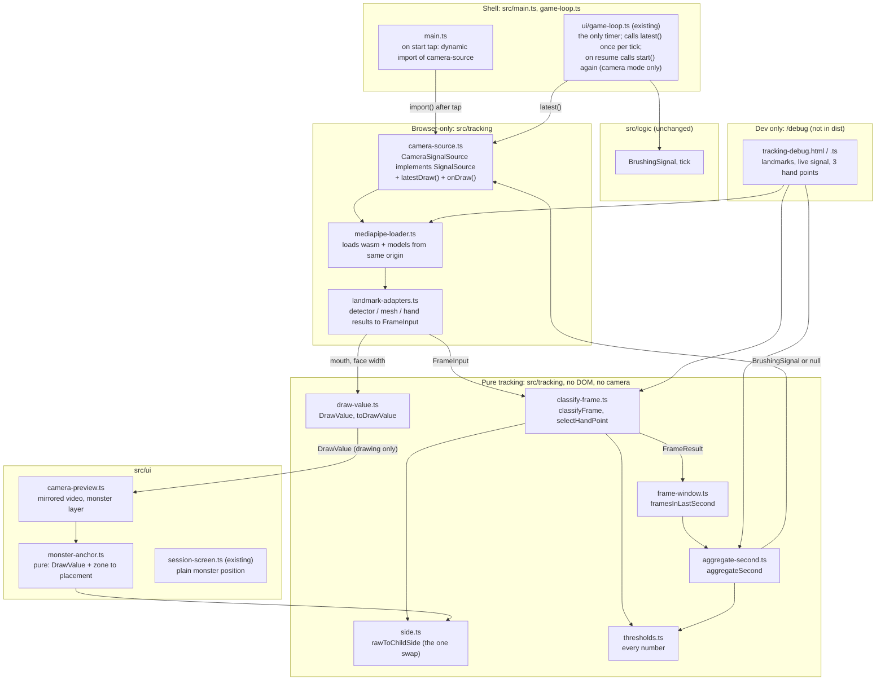
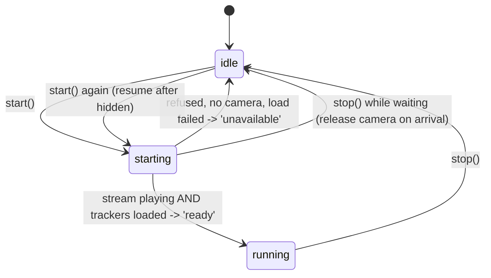

# Design: hand-tracking

## 1. Overview

This design covers how the game sees the child: a feasibility test that Dr. Yatin runs first,
the pure classification that turns face and hand landmark numbers into the one-per-second
brushing signal, the real camera `SignalSource`, the mirrored live preview with the monster
on the cheek, and the tests that guard all of it.

This spec only produces the signal. It reuses, and does not redefine, these things from
`core-brushing-loop`: `BrushingSignal` (`src/logic/types.ts`), the `SignalSource` interface
and `nullSignalSource` (`src/tracking/signal-source.ts`), `SessionResult`, the tick rule, the
8-second start limit and fixed mode (`game-loop.ts`), `REQUIRE_LEVEL_MATCH`, and the privacy
guard test. Nothing under `src/logic/` changes. One small change to `src/ui/game-loop.ts` is
needed (section 6.3, "Restart on resume").

Everything decided by data is a pure function in `src/tracking/` with a named test. Only
`camera-source.ts` and the debug page touch the browser.

**Key design decisions (each flagged "Design choice" inline):**

- Face geometry is model-neutral: `classifyFrame` receives a mouth point and two face-edge
  points, so a small face detector or the full face mesh can feed it.
- The hand point is the palm centre by default; the feasibility test compares it with the
  wrist and the fingertips.
- All distances are in face widths, measured along the face's own axes (so head tilt and
  distance from the camera do not matter).
- `side` is decided by one conversion function, `rawToChildSide`. Nothing else swaps left and
  right, including the monster placement.
- `latest()` aggregates the frames of the last 1000 ms at the moment the game loop asks. The
  tracker owns no timer and no one-second bucket clock.
- `start()` answers `'ready'` only when the stream plays and the models are loaded. A model
  that fails to load gives `'unavailable'`, so the session is honestly timer-only.
- The debug page is a separate dev-only entry in `/debug/`, left out of the production build
  by a test on a real build.

---

## 2. Architecture



**Data flow.** After the start tap, `main.ts` imports `camera-source.ts`. The loop calls
`start()`. The source opens the front camera and loads the models in parallel. A video-frame
callback (not a timer) hands each frame to MediaPipe, at most every `TRACK_MIN_INTERVAL_MS`.
The adapters turn the results into plain numbers (`FrameInput`). `classifyFrame` makes a
`FrameResult`, which goes into a short in-memory list. Once per second the loop calls
`latest()`. The source takes the frames of the last 1000 ms, calls `aggregateSecond`, empties
the list, and returns the signal. The same frame also produces a `DrawValue`, which goes only
to the preview.

The "Pure tracking" box takes plain numbers and returns plain data. It has no DOM, no camera,
no clock, no randomness. Nothing under `src/logic/` imports from `src/ui/`, `src/tracking/`,
`src/storage/` or `src/audio/` (unchanged; this spec adds no file there).

> **Design choice (frame callback is not a timer):** `steering/tech.md` says exactly one
> module owns a timer. The camera source is driven by `requestVideoFrameCallback` (fallback
> `requestAnimationFrame`), which fire when a frame is presented. They are not an interval or
> a timeout. A guard test fails if `setInterval` or `setTimeout` appears under `src/tracking/`
> or `/debug/`. If a reviewer reads a frame callback as a timer, the alternative is a faster
> `Scheduler.every` in `game-loop.ts` (about 100 ms), which costs more battery. Not chosen.

---

## 3. Module list

One concept per file, kebab-case names (`structure.md`).

| Module | Responsibility | Req |
|--------|----------------|-----|
| `src/tracking/side.ts` | `rawToChildSide(raw: 'raw-left' \| 'raw-right'): Side`. The only place in the code base where left and right are swapped. | 2.1, 2.2, 2.4 |
| `src/tracking/thresholds.ts` | Every number used by `classifyFrame`, `aggregateSecond`, the frame window and the frame rate limit, each with a comment (what, unit). Also `HAND_POINT` and `FACE_MODEL`, and the three MediaPipe hand landmark index constants `PALM_LANDMARKS`, `WRIST_LANDMARK` and `FINGERTIP_LANDMARKS` (section 5.5). | 3.7, 1.4, 4.2, 10.5 |
| `src/tracking/types.ts` | `Point`, `FaceInput`, `HandInput`, `FrameInput`, `FrameResult`, `HandPointKind`. Plain data, no logic. Imports `Side`, `Level` and `BrushingSignal` from `src/logic/types.ts`. | 3.1, 4.1 |
| `src/tracking/classify-frame.ts` | `classifyFrame(input, handPoint?)`, `selectHandPoint(hand, kind)`, `pickLargestFace(faces)`. Pure. | 3, 5 |
| `src/tracking/aggregate-second.ts` | `aggregateSecond(frames)`. Pure. | 4 |
| `src/tracking/frame-window.ts` | `framesInLastSecond(timed, nowMs)`: keeps frames from the last 1000 ms. Pure; time is an argument. | 4.7, 6.4 |
| `src/tracking/draw-value.ts` | `DrawValue` and `toDrawValue(face, aspect)`. The one extra value for drawing. | 8.3 |
| `src/tracking/landmark-adapters.ts` | Turns MediaPipe result objects into `FaceInput[]` and `HandInput[]`. Detector, mesh and hand adapters. Pure (takes plain objects), so it is fixture-tested. | 5, 6.2 |
| `src/tracking/mediapipe-loader.ts` | Browser only. Creates the MediaPipe tasks from `/models/` on the same origin; `close()` releases them. | 6.2, 6.5 |
| `src/tracking/camera-source.ts` | Browser only. `createCameraSignalSource(deps)` returns `CameraSignalSource`: the `SignalSource` plus `latestDraw()` and `onDraw()`. Stream, frame callback, lifecycle. | 6, 7 |
| `src/ui/camera-preview.ts` | Mirrored `<video>` (CSS), monster layer, placement from `monsterAnchor`. | 8 |
| `src/ui/monster-anchor.ts` | `monsterAnchor(draw, zone)`: pure placement and size. | 8.2, 8.4 |
| `src/ui/game-loop.ts` (edit) | On resume in a camera session, call `source.start()` again without waiting. | 7.3, 7.4 |
| `debug/tracking-debug.html`, `debug/tracking-debug.ts`, `debug/debug-draw.ts` | The debug page. Not linked, not in `dist/`. | 1 |
| `docs/review/TRACKING-TEST-RESULTS.md` | Dr. Yatin's results (words only). Layout in section 7. | 1.5 to 1.13, 10.4 |
| `scripts/copy-mediapipe-wasm.mjs` | Dev-time script: copies the WASM files from `node_modules/@mediapipe/tasks-vision/wasm/` into `public/models/wasm/` before `dev` and `build`. Not under `src/`. | 6.2 |
| `scripts/measure-assets.mjs` | Dev-time script: prints the byte size of every file in `public/models/`. | 10.1 |
| `scripts/strip-mediapipe-logging.mjs` | Pure `stripMediapipeLogging(code)`: makes MediaPipe's usage logger send nothing; throws if the expected code is missing. Used by `vite.config.ts` for build and dev pre-bundling (section 10.1). | 9.6 |

The camera source is loaded with `import('./tracking/camera-source')` from `main.ts` inside
the start-button handler, so the title screen loads none of the camera code, the models or
the WASM (req 6.3).

New dependency: `@mediapipe/tasks-vision` (bundled into the lazy camera chunk; no runtime
request to any third party). MIT licence of the project is unaffected; the model files are
Apache-2.0 and ship with a `public/models/NOTICE.txt` naming their source.

---

## 4. TypeScript types

`BrushingSignal`, `Side`, `Level` come from `src/logic/types.ts` and are not redefined.

```typescript
// src/tracking/types.ts

// A point in normalised image coordinates: x and y are each 0 to 1 of the image width / height.
interface Point { readonly x: number; readonly y: number }

// Model-neutral face. Two edge points and the mouth centre; the edge points are NOT labelled
// left or right, so mirroring the input cannot change which is which (req 11.4b).
interface FaceInput {
  readonly mouth: Point;      // centre of the mouth
  readonly edgeA: Point;      // one side of the face at about eye-to-mouth height (ear point or cheek edge)
  readonly edgeB: Point;      // the other side
}

// One hand: the 21 MediaPipe hand landmarks, in the library's order (0 wrist, 4 thumb tip, 8, 12, 16, 20 fingertips,
// 5, 9, 13, 17 knuckles at the base of the fingers).
interface HandInput { readonly landmarks: readonly Point[] }

// What one camera frame gives the classifier. Plain numbers only (req 3.1).
interface FrameInput {
  readonly aspect: number;                  // image width / image height, so x and y use one unit (req 3.2)
  readonly faces: readonly FaceInput[];     // 0 or more
  readonly hands: readonly HandInput[];     // 0 to 2
}

type HandPointKind = 'palm' | 'wrist' | 'fingertips';

// What one frame says. Lives in memory for at most one second (req 4.7).
interface FrameResult {
  readonly faceSeen: boolean;
  readonly handNearMouth: boolean;
  readonly side: 'left' | 'right' | 'unknown';     // always 'unknown' when handNearMouth is false (req 3.6)
  readonly level: 'upper' | 'lower' | 'unknown';   // always 'unknown' when handNearMouth is false (req 3.6)
  // Hand point relative to the mouth, in face widths, along the face's own axes
  // (x: toward the face edge that is on the raw right, y: toward the chin). null unless handNearMouth.
  readonly handRel: Point | null;
}

// Drawing only (req 8.3).
interface DrawValue {
  readonly mouth: Point;       // raw image coordinates, 0 to 1
  readonly faceWidth: number;  // as a fraction of image width
  readonly roll: number;       // radians; angle of the face axis, so the monster follows a tilted head
}

type TimedFrame = { readonly t: number; readonly frame: FrameResult }; // t in ms from an injected clock
```

---

## 5. Behaviour

### 5.1 Left and right (req 2)

```typescript
// src/tracking/side.ts
function rawToChildSide(raw: 'raw-left' | 'raw-right'): Side {
  return raw === 'raw-right' ? 'left' : 'right';
}
```

The camera frame is not mirrored, so the child's own left is on the raw right. This is the
only swap (req 2.2). `classifyFrame` calls it. `monsterAnchor` also calls it, to find which
raw direction is the child's left cheek, so it needs no second swap. The preview is flipped
by CSS only; pixels, landmarks and the canvas the classifier reads are never flipped (req
2.3). It has the first test in the suite (req 2.4, 11.1).

### 5.2 Face and hand selection (req 5)

- **One face (5.1).** `pickLargestFace(faces)` returns the face with the largest edge distance
  in face-width units of the image (`distance(edgeA, edgeB)` with x scaled by `aspect`). A tie
  goes to the first. Other faces are dropped before anything else is computed. No face, or a
  face with zero width, gives `faceSeen: false`.
- **One hand (5.2).** Each hand gets a hand point (below). The hand whose point is nearest the
  mouth centre is used; the other is ignored whichever hand holds the brush. MediaPipe's
  handedness label is not used, so there is nothing to mirror twice.
- **No hand (5.4).** `handNearMouth: false`.
- **Resting hand (5.5).** A hand farther than `NEAR_MOUTH_FACE_WIDTHS` is never chosen while a
  nearer hand exists, so it cannot change the result.
- **Both hands near (5.3).** If two hands are each within `NEAR_MOUTH_FACE_WIDTHS`, the frame
  has `handNearMouth: true`, `side: 'unknown'`, `level: 'unknown'`, `handRel` of the nearer
  hand. It never guesses.

> **Design choice (hand point, Decision 2):** `selectHandPoint(hand, kind)` returns one of
> three points: `palm` = mean of landmarks 0, 5, 9, 13, 17; `wrist` = landmark 0;
> `fingertips` = mean of landmarks 4, 8, 12, 16, 20. `selectHandPoint` reads these indices
> from the exported constants `PALM_LANDMARKS`, `WRIST_LANDMARK` and `FINGERTIP_LANDMARKS` in
> `thresholds.ts` (section 5.5), so `classify-frame.ts` holds no landmark number. The constant `HAND_POINT` is `'palm'`
> to start with. A child holds the brush handle in a fist, so the palm sits between wrist and
> fingertips and is the steadiest point when fingers curl. The debug page shows all three
> readings at once so one brushing session compares them (section 7). Moving `HAND_POINT` to
> another value after the test is a one-line change in `thresholds.ts`, made only with Dr.
> Yatin's say (req 1.13).

### 5.3 `classifyFrame(input, handPoint = HAND_POINT): FrameResult` (req 3)

All maths use the chosen face's axes, so head tilt and distance do not matter (req 3.2).

```
classifyFrame(input, kind):
  face = pickLargestFace(input.faces)
  if face == null or width(face) == 0: return { faceSeen:false, handNearMouth:false, side:'unknown', level:'unknown', handRel:null }

  # work in one unit: x is multiplied by aspect, y is not
  a, b = edgeA, edgeB in that unit; if a.x > b.x swap them          # a is raw-left, b is raw-right; no labels are read
  W    = distance(a, b)                                            # face width
  u    = (b - a) / W                                               # unit vector toward the raw right
  v    = (-u.y, u.x)                                               # unit vector toward the chin
  hands = input.hands -> {point = selectHandPoint(h, kind) in the same unit, d = distance(point, mouth) / W}
  if no hands: return faceSeen, handNearMouth:false, ...
  near  = hands sorted by d, nearest first
  if near[0].d > NEAR_MOUTH_FACE_WIDTHS: return faceSeen, handNearMouth:false, side/level 'unknown', handRel:null
  off   = near[0].point - mouth
  rel   = ( dot(off, u) / W , dot(off, v) / W )                    # handRel
  if near.length >= 2 and near[1].d <= NEAR_MOUTH_FACE_WIDTHS:
        return faceSeen, handNearMouth:true, side:'unknown', level:'unknown', handRel:rel
  side  = |rel.x| < SIDE_DEAD_ZONE  ? 'unknown' : rawToChildSide(rel.x > 0 ? 'raw-right' : 'raw-left')
  level = |rel.y| < LEVEL_DEAD_ZONE ? 'unknown' : (rel.y > 0 ? 'lower' : 'upper')
  return { faceSeen:true, handNearMouth:true, side, level, handRel:rel }
```

- `handNearMouth` is true exactly when the chosen hand point is at most
  `NEAR_MOUTH_FACE_WIDTHS` from the mouth centre (req 3.3, 11.4d). The boundary is inclusive.
- A dead zone is the distance from the centre line (or mouth height) to each edge of the
  dead band, so the band is twice that wide. A hand exactly on the edge is classified, not
  `unknown` (strict `<`). A test pins this reading of req 3.4 and 3.5.
- `upper` and `lower` mean "the hand is above / below the mouth centre line, as the face sees
  it". The function never says anything about individual teeth (req 3.8). Its output type
  has no field that could.

### 5.4 `aggregateSecond(frames: readonly FrameResult[]): BrushingSignal | null` (req 4)

```
n = frames.length
if n < MIN_FRAMES_PER_SECOND: return null                       # 4.2
seen = count(frames where faceSeen)
if seen * 2 < n: return null                                    # 4.3 (exactly half is enough)
majority(pred) = count(frames where pred) * 2 > n               # strictly more than half (4.4)
handNearMouth = majority(f.handNearMouth)                       # strict majority of ALL frames
near  = frames where handNearMouth                              # side and level count only these
m     = near.length
majorityNear(pred) = count(near where pred) * 2 > m             # strictly more than half of the near frames
side  = m == 0 ? 'unknown' : majorityNear(f.side == 'left') ? 'left'  : majorityNear(f.side == 'right') ? 'right' : 'unknown'
level = m == 0 ? 'unknown' : majorityNear(f.level == 'upper') ? 'upper' : majorityNear(f.level == 'lower') ? 'lower' : 'unknown'
moving = travel(frames) > MOVING_MIN_TRAVEL                     # 4.5
return { handNearMouth, side, level, moving }
```

- `travel(frames)` is the sum, over each pair of neighbouring frames that both have `handRel`,
  of the distance between the two `handRel` points, counting only steps of at least
  `MOVE_JITTER_STEP`. It is in face widths (req 4.5, 3.2). Path length is used, not the
  distance between first and last position, because a brushing stroke goes back and forth.
  Because `handRel` is measured on the face's own axes, moving the head moves the hand and
  mouth together and adds no travel.
- `side` and `level` are decided by strict majority among the frames where `handNearMouth`
  is true (only those frames are counted). They are `unknown` when no side or level holds
  more than half of those frames, and `unknown` when no frame has the hand near the mouth.
  Reason: core 6.3 drains an unclear signal 0 but a `null` signal 2, so dead-zone frames
  must not cancel clear readings. A test checks this (req 11.4f).
- No clock, no randomness (req 4.6). The array order is the order of the frames.
- The result for one second is built from frames of that second only. After `latest()` has
  used them they are removed (req 4.7, section 6).

### 5.5 Thresholds (req 3.7, Decision 3)

All in `src/tracking/thresholds.ts`. These are **starting values**, set from reasoning and
not yet tried on a face; Dr. Yatin and the developer tune them on the debug page (by
editing this one file) after the feasibility test begins. None is a dental rule or a number
a parent sees, except `MOVING_MIN_TRAVEL`, which Dr. Yatin set on 21 Nov 2026 as a clinical decision (Decision 4 in section 14).

| Constant | Start | Unit | Meaning |
|----------|-------|------|---------|
| `NEAR_MOUTH_FACE_WIDTHS` | 1.1 | face widths | Hand point within this of the mouth centre counts as at the mouth (tuned 21 Nov 2026 on the debug page; was 0.7) |
| `SIDE_DEAD_ZONE` | 0.10 | face widths | Sideways distance from the mouth centre line inside which `side` is `unknown` |
| `LEVEL_DEAD_ZONE` | 0.10 | face widths | Distance above or below mouth height inside which `level` is `unknown` |
| `MIN_FRAMES_PER_SECOND` | 5 | frames | Fewer frames in a second gives `null` (req 4.2) |
| `MIN_FACE_FRACTION` | 0.5 | fraction of frames | Face seen in fewer than this gives `null` (req 4.3) |
| `MOVING_MIN_TRAVEL` | 0.20 | face widths per second | Hand path length above this counts as moving (changed 21 Nov 2026 by Dr. Yatin from 0.30, so gentle short strokes count; Decision 4) |
| `MOVE_JITTER_STEP` | 0.01 | face widths | A step between two frames smaller than this is camera noise and adds no travel |
| `WINDOW_MS` | 1000 | ms | Length of the window `latest()` looks at |
| `TRACK_MIN_INTERVAL_MS` | 100 | ms | Least time between two frames sent to MediaPipe (about 10 per second; at least 5 are needed) |
| `HAND_POINT` | `'palm'` | kind | Which hand point is used (section 5.2) |
| `FACE_MODEL` | `'detector'` | kind | Which face model feeds `FaceInput` (section 8) |
| `PALM_LANDMARKS` | `[0, 5, 9, 13, 17]` | hand landmark indices | Landmarks averaged for the `palm` hand point. Follows the MediaPipe hand landmark order. Fixed by the library, not tuned |
| `WRIST_LANDMARK` | `0` | hand landmark index | Landmark used for the `wrist` hand point. Follows the MediaPipe hand landmark order. Fixed by the library, not tuned |
| `FINGERTIP_LANDMARKS` | `[4, 8, 12, 16, 20]` | hand landmark indices | Landmarks averaged for the `fingertips` hand point. Follows the MediaPipe hand landmark order. Fixed by the library, not tuned |

`MIN_FRAMES_PER_SECOND` is the value 5 that req 4.2 names. `MIN_FACE_FRACTION` is 0.5 as in
req 4.3. A test fails if any of these constants is not exported from `thresholds.ts`, or if
a bare numeric literal other than 0, 1 and 2 appears in `classify-frame.ts` or
`aggregate-second.ts`.

### 5.6 Frame window (req 4.7, 6.4)

`framesInLastSecond(timed, nowMs)` returns the `FrameResult`s whose `t` is in
`(nowMs - WINDOW_MS, nowMs]`, in order. A stalled tracker has no frames in the window, so
`aggregateSecond` returns `null` by its own rule (fewer than 5 frames). No separate "stale"
rule is needed.

### 5.7 Draw value (req 8.3)

`toDrawValue(face, aspect)` returns `{ mouth, faceWidth, roll }` from the chosen face. It
exists so the UI knows where to draw. It is built per frame, handed to the preview, and
replaced by the next one. It is never stored, logged, sent or given to `src/logic/`.


---

## 6. The camera SignalSource (req 6, 7)

```typescript
// src/tracking/camera-source.ts (browser only)
interface CameraSignalSource extends SignalSource {   // SignalSource is unchanged
  latestDraw(): DrawValue | null;                      // drawing only (req 8.3)
  onDraw(listener: (value: DrawValue | null) => void): () => void;
  attachVideo(video: HTMLVideoElement): void;          // the preview shows this stream
}
interface CameraDeps {
  now(): number;                                       // injected clock, for frame times only
  getUserMedia(c: MediaStreamConstraints): Promise<MediaStream>;
  loadTrackers(): Promise<Trackers>;                   // mediapipe-loader; may reject
}
```

`CameraDeps` are injected so the lifecycle can be tested with fakes and no camera.

### 6.1 States



- `start()` asks `getUserMedia({ video: { facingMode: 'user' }, audio: false })` and
  `loadTrackers()` **in parallel**, so model loading overlaps the permission box. It answers
  `'ready'` only when the stream is playing and both trackers exist, and `'unavailable'` on
  any failure or refusal. It never rejects. (req 6.1, 7.1)
- Permission is asked once per session by the first `start()`. A refused permission answers
  `'unavailable'`, shows nothing, and is not asked again in that session (req 7.1; the
  loop already fixes the mode to timer-only, core req 8.3).
- `stop()` stops every track of the stream, calls `close()` on the trackers, cancels the
  pending frame callback, empties the frame list and the draw value. Safe to call twice (req
  6.5, 7.2).
- If `stop()` is called while `start()` waits, a generation counter is bumped. When the
  camera or trackers arrive, the start sees that its generation is old, releases them at
  once and answers `'unavailable'` (req 6.5, 6.6). This is also what happens after the loop's
  8-second limit, since the loop calls `stop()` then (req 6.6).
- `latest()` returns `null` unless the state is `running`. Otherwise it returns
  `aggregateSecond(framesInLastSecond(frames, now()))` and then empties the frame list (req
  4.7, 6.4, 7.4). While restarting the state is `starting`, so it returns `null`.
- Nothing in the source writes to the console or any storage. Rejections are caught and
  turned into `'unavailable'` without keeping the error text (req 9.1, 9.2).

### 6.2 Frame pump

When running, the source asks the video for `requestVideoFrameCallback` (fallback
`requestAnimationFrame`). On each callback with timestamp `t`:

```
if t - lastSentT < TRACK_MIN_INTERVAL_MS: ask for the next callback; return
lastSentT = t
faces  = adaptFaces(faceTracker.detectForVideo(video, t))
hands  = adaptHands(handTracker.detectForVideo(video, t))
input  = { aspect: video.videoWidth / video.videoHeight, faces, hands }
result = classifyFrame(input)
frames.push({ t: now(), frame: result }); drop entries older than WINDOW_MS
draw   = faces non-empty ? toDrawValue(largestFace, aspect) : null
notify onDraw listeners with draw (overwrites the previous value)
ask for the next callback
```

The frame image is read only by MediaPipe inside the browser. The code never copies it to a
canvas that is exported, never calls `toDataURL`, `toBlob`, `MediaRecorder` or `captureStream`
(req 9.2). The `frames` list holds at most about one second of `FrameResult`s.

If `detectForVideo` throws, that frame is skipped. Too few frames in the second then gives
`null` by the normal rule.

> **Design choice (rate limit, req 10.5):** the tracker sends a frame to MediaPipe at most
> every 100 ms. The preview video itself plays at the camera's own rate, so the picture stays
> smooth. If a phone still falls below 20 frames per second in the game, `TRACK_MIN_INTERVAL_MS`
> is the one number to raise. 5 frames per second are enough for the rules of requirement 4.

### 6.3 Restart on resume (req 7.2, 7.3, 7.4)

`game-loop.ts` already calls `source.stop()` when the tab is hidden, and releases the wake
lock. It does not start the source again on return. It needs one added line: in
`onVisibility(false)`, after the 60-second check passes, `if (state.mode === 'camera') void
source.start();`. The result is ignored: if the answer is `'unavailable'` (the browser asked
again and the child said no, or the restart failed), `latest()` keeps returning `null`, the
tick rule drains 2 per second, and the mode does not change. The loop's game-loop test (core
test 15) gains one case: resume in camera mode calls `start()` once; resume in timer-only
mode does not.

Restart creates the trackers again (the model files come from the browser's own HTTP cache).
For a few seconds `latest()` is `null`. Those seconds count as untracked, which the core rules
already handle. A zone with more than 10 such seconds is saved as unverified. No message is
shown (req 7.5).

> **Design choice:** a restart does not keep the trackers alive while hidden. Req 6.5 says
> `stop()` releases the tracker, and holding a GPU model while the screen is off wastes
> battery. The cost is a few untracked seconds after a tab switch.

### 6.4 The 8-second limit and what "ready" means (req 6.6)

The 8-second limit is the loop's (`START_TIMEOUT_MS` in `game-loop.ts`; not redefined here).
Camera permission, stream start and loading all the model and WASM bytes must finish inside
it. The sizes in section 8 decide whether that is realistic on a slow connection. If it is
not met, the session is timer-only, which is a correct, fully working game (core req 8.1).

> **Design choice:** `'ready'` waits for the trackers, not only the camera. The alternative,
> answering `'ready'` when the stream plays and loading models afterwards, gives sessions
> labelled "camera" in which every second is `null`. That puts a wrong mode label in storage.

---

## 7. Feasibility test (req 1)

### 7.1 Debug page (req 1.1 to 1.4)

Files: `debug/tracking-debug.html`, `debug/tracking-debug.ts`, `debug/debug-draw.ts`. They sit
outside `src/` so the production build never reaches them.

- **Run it.** `npm run dev`, then open `/debug/tracking-debug.html`. A camera needs a secure
  context: a laptop webcam works at `localhost`. For a phone, connect it by USB and run
  `adb reverse tcp:5173 tcp:5173`, then open `localhost:5173/debug/tracking-debug.html` on the
  phone (its own `localhost` counts as secure). No new dependency and no certificate.
- **Show.** The video, mirrored with CSS; the face points and hand points drawn on a
  canvas laid over it in the same mirrored box; and the live signal in large text as the
  four fields and the word `null` (req 1.1). The signal updates each frame, computed as
  `aggregateSecond(framesInLastSecond(frames, now))` with a window that is not emptied. For
  the hand-point comparison it also shows `side` and `level` read from each of the three hand
  points (`classifyFrame(input, 'palm' | 'wrist' | 'fingertips')`), next to each other.
- **Same functions (req 1.4).** The page imports `classifyFrame`, `aggregateSecond` and
  `thresholds.ts` from `src/tracking/`. It has no thresholds of its own and no inputs that
  change a threshold. The page also accepts `?face=detector` or `?face=mesh`, to compare the
  two face models in one sitting; this chooses a model, not a number.
- **Obeys privacy (req 1.3).** No `console.`, no storage, no network calls beyond the same-origin
  model files, no canvas export. The stream stops on `visibilitychange` to hidden. The
  guard tests of section 12 scan `debug/` as well as `src/`.
- **Not in the game (req 1.2).** No file under `src/` and not `index.html` mentions the debug
  page. `vite.config.ts` sets `build.rollupOptions.input` to `index.html` only. The debug page
  has a fixed marker text, `FOAMTOM-TRACKING-DEBUG`, in its title. Test `distHasNoDebugPage`
  builds the site into a temporary folder and fails if any built file contains the marker, or
  has a name containing `tracking-debug` or `debug-draw`.

### 7.2 Results file layout (req 1.5 to 1.13, 10.4; Decision 8)

`docs/review/TRACKING-TEST-RESULTS.md`. Words and the letters below only: no images, no
screenshots, no landmark values (req 1.5). Reading codes: **R** the signal read the right
value, **W** it read the wrong value, **U** it read `unknown`, **N** the signal was `null`.
U and N both count as not right. Many N while brushing means try `FACE_MODEL = 'mesh'`.
Every
table has a Date column and a Note column.

1. **Set-up.** Device, browser, face model used (`detector` or `mesh`), `HAND_POINT`, date.
2. **Hand-point comparison.** One row per hand point (palm, wrist, fingertips): surfaces
   passing the side check out of 12, surfaces passing the level check out of 12, note. Filled
   from the three readouts of tables 3 and 4.
3. **Side check (req 1.6, 1.9a).** One row per (brush hand, zone, surface): 2 hands x 4 zones
   x 3 surfaces = 24 rows. Columns: Date | Brush hand | Zone | Surface (outer, chewing,
   inner) | Palm (3 codes, e.g. `RRW`) | Wrist | Fingertips | Result for `HAND_POINT`
   (pass if at least 2 R) | Note.
4. **Level check (req 1.7, 1.9a).** Same 24 rows and columns, reading `level`.
5. **Other checks.** Columns: Date | Check | Case | Pass or Fail | Note. Rows:
   mirror flip (1.8: signal says `left` AND hand on the left of the mirrored preview, two
   separate rows); hand resting on sink edge; hand touching cheek (1.9b); both hands near the
   mouth (1.9c: pass is `side` `unknown`); second person behind the child (1.10); lights
   dimmed until the face is lost (1.11: pass is `null`).
6. **Counts and decision.** Surfaces passing the side check, out of 24 and out of the 12 of
   each brush hand; the same for level; then two lines, "Side check: pass or fail" and "Level
   check: pass or fail", each with Dr. Yatin's initials and date.
7. **Speed (req 10.4, 10.5).** Device model, Android and Chrome versions, then two separate
   lines. (a) Picture and drawing: frames per second seen with the camera on (20 frames per
   second in req 10.4 means the picture and the drawing), date, pass or fail (20 or more
   passes). (b) Tracking rate: frames per second the tracker handles, on its own line; it
   must give at least 5 frames in a normal second (req 10.5), pass or fail. Note.
8. **Asset sizes (req 10.1).** Copy of the table in section 8, as measured by
   `scripts/measure-assets.mjs`.

Pure helpers in `src/tracking/test-results.ts`: `surfacePasses(codes)` (true when at least 2
of 3 codes are `R`) and `countPasses(rows)`. They are used by the layout test and make rule
1.12 and 1.13 a function with a named test. The check on the file itself is
`resultsFileIsWordsOnly` (section 12).

### 7.3 Decision rule (req 1.12 to 1.14)

- A surface passes when `surfacePasses` is true for its three readings, separately for side
  and for level.
- Level fails: Dr. Yatin sets `REQUIRE_LEVEL_MATCH` to `false` in `src/logic/constants.ts`
  (core req 5.7). No code changes it.
- Side fails: work on this spec stops, and Dr. Yatin decides. No thresholds are tuned around
  a failed side check.
- **How many of the surfaces must pass** is decided in section 14 (Decisions, 19 Nov 2026,
  item 1): there is no automatic overall pass count. The results file records the counts,
  and Dr. Yatin writes the overall side and level verdicts himself.
- `tasks.md` starts with the feasibility test. It may build only the parts of requirements
  2 to 4 and 6 that the debug page needs: `side.ts`, `types.ts`, `thresholds.ts`,
  `classify-frame.ts`, `aggregate-second.ts`, `frame-window.ts`, `landmark-adapters.ts`,
  `mediapipe-loader.ts` and the page itself. `camera-source.ts` (the lifecycle), the
  preview and the monster placement wait for the results (req 1.14).


---

## 8. Models, files and size (req 6.2, 6.3, 10)

### 8.1 What is loaded

MediaPipe Tasks Vision runs in the browser. Package: `@mediapipe/tasks-vision`. Files served
from this site:

| Path (under `public/models/`) | What | Used when |
|-------------------------------|------|-----------|
| `wasm/` (copied from the npm package by `scripts/copy-mediapipe-wasm.mjs`; git-ignored) | WASM runtime and its loader script | always, after the tap |
| `hand_landmarker.task` | hand landmarks, up to 2 hands | always, after the tap |
| `face_detector.tflite` (short-range BlazeFace) | face box, 6 face points including the mouth centre and both ear points | `FACE_MODEL = 'detector'` (default) |
| `face_landmarker.task` | 478-point face mesh | only if `FACE_MODEL = 'mesh'`; also on the debug page for comparison |

The model files are downloaded once by the developer from the MediaPipe model page, checked
into `public/models/`, and listed with their source and Apache-2.0 licence in
`public/models/NOTICE.txt`. No build step fetches them, so the build never depends on a
third-party host. The WASM files are copied from `node_modules` by a `predev` and `prebuild`
npm script. Nothing under `src/` contains a URL; `mediapipe-loader.ts` builds paths from
Vite's `import.meta.env.BASE_URL`, so sub-path hosting on GitHub Pages works (core req 15.6).

> **Design choice (smallest model, req 10.2):** the default face source is the face
> detector, not the face mesh. The detector gives the mouth centre and two ear points, which
> is all `FaceInput` needs. The mesh is kept as the fallback if the feasibility test shows the
> detector's mouth point is too unsteady. The production build ships and loads only the model
> named by `FACE_MODEL`. **These model names, file formats and point orders are from the
> author's knowledge of MediaPipe and have not been checked against the current MediaPipe
> documentation in this design run. The first task SHALL check them against the documentation
> of the installed package version and correct this section and `landmark-adapters.ts`
> before building on them (req 10.2).**

### 8.2 Real sizes (req 10.1)

**Not yet measured.** No model file or WASM file is in the repository at the time of
writing (`public/models/` holds only `.gitkeep`), and this design run had no network access.
Recording a size from memory is forbidden by req 10.1, so the cells below are left to be
filled by the first task. `node scripts/measure-assets.mjs` prints the bytes of every file in
`public/models/` (recursively, including `wasm/`), and the table is copied into section 8 of
`docs/review/TRACKING-TEST-RESULTS.md`.

| File | Measured size in bytes | Date measured |
|------|------------------------|---------------|
| `wasm/` (each file listed separately) | to be measured | |
| `hand_landmarker.task` | to be measured | |
| `face_detector.tflite` | to be measured | |
| `face_landmarker.task` | to be measured | |
| Total loaded in camera mode (wasm + hand + chosen face model) | to be measured | |

### 8.3 First load and lazy loading (req 6.3, 10.3)

- The title screen loads `index.html`, the entry script, CSS and audio lines. None of the
  camera code, model or WASM is in that set. `main.ts` loads the camera source with a dynamic
  `import()` inside the start-button handler. The `@mediapipe/tasks-vision` package is only
  imported from `mediapipe-loader.ts`, so it lands in the lazy chunk.
- Test `cameraCodeIsLazy` builds with `build.manifest: true` and fails if the entry chunk's
  static `imports` reach the chunk that holds `camera-source` or `tasks-vision`.
- Test `firstLoadUnder5MB` sums the bytes of every file in the built `dist/` except
  `models/` and the lazy camera chunk, and fails above 5,000,000. (5 MB read as 5,000,000
  bytes, which is the stricter reading.)
- Manual check: open the title screen with the browser's network panel open. No `.task`,
  `.tflite` or `.wasm` request appears until the start button is tapped.

### 8.4 Speed (req 10.4, 10.5)

Manual, on a real mid-range 2022 Android phone in Chrome, recorded in the results file
(section 7.2, item 7). Pass is 20 frames per second or more with the camera on. In req 10.4 the 20 frames per
second mean the picture and the drawing. The tracking rate is recorded on its own line in
the results file and must give at least 5 frames in a normal second (req 10.5).
If it falls
short, in order: raise `TRACK_MIN_INTERVAL_MS`; try the other delegate (the loader asks for
the GPU delegate first and falls back to the CPU one if creation fails); try the face
detector instead of the mesh. The session clock never waits for the tracker (core req 2.4)
because the loop reads `latest()` and never blocks on it.

---

## 9. Preview and monster position (req 8)

### 9.1 Preview (req 8.1, 8.5 to 8.7)

`camera-preview.ts` is used only when the session mode is `camera`. It builds a stage `div`
holding the `<video>` (with `playsinline`, `muted`) and a monster layer above it. The stage is
mirrored for display with a CSS class (`transform: scaleX(-1)`). The video, the landmark
values and the classifier's input are never mirrored (req 2.3). The monster element sits
inside the mirrored stage, with a second `scaleX(-1)` on the monster itself so its art is not
back to front. The preview offers no screenshot, recording or share control (req 8.7). It is
laid out for portrait, usable in landscape and on desktop, with touch targets of at least 48
px (req 8.5). In guided-timer mode `camera-preview.ts` is not created and the plain session
screen is unchanged (req 8.6).

### 9.2 Monster placement: `monsterAnchor(draw, zone)` (req 8.2, 8.4)

```typescript
// src/ui/monster-anchor.ts: pure
interface Anchor { readonly x: number; readonly y: number; readonly size: number; readonly rotate: number }
function monsterAnchor(draw: DrawValue | null, zone: Zone): Anchor | null   // null = use the plain screen position
```

- `null` in gives `null` out. The caller then shows the monster where the plain session
  screen puts it, with no message. The monster does not stay at the last cheek position when
  the face is lost, because `latestDraw()` is cleared when no face is seen and by `stop()`
  (req 8.4).
- Otherwise, in raw image coordinates inside the stage:
  `dir = rawToChildSide('raw-right') === zone.side ? +1 : -1` (so `dir` comes from the one
  conversion function; no second swap exists). The monster centre is the mouth, moved
  `CHEEK_OFFSET * faceWidth` along the face axis in direction `dir` and
  `LEVEL_LIFT * faceWidth` toward the chin for a lower zone or the other way for an upper
  zone. `size = MONSTER_SIZE * faceWidth`. `rotate = roll`. The result is clamped so the whole
  monster stays inside the stage.
- Because the stage is mirrored, the child's own left cheek appears on the left of the screen
  (req 8.2). Starting values: `CHEEK_OFFSET = 0.45`, `LEVEL_LIFT = 0.15`, `MONSTER_SIZE =
  0.40`; they are named constants at the top of `monster-anchor.ts`, and they are drawing
  choices only. `mirror-and-screens` may restyle them.
- A CSS `transition` on position smooths per-frame jitter. It is a CSS animation, not a timer.
- `main.ts` subscribes the preview to `onDraw` and paints the anchor. The zone and health
  still come from `toView(state)`; the preview only changes where the monster is drawn.

---

## 10. Privacy of tracking data (req 9)

- **In the browser only (9.1).** Frames go from the camera to the `<video>` element to
  MediaPipe, all in the page. `FrameResult`, `FaceInput` and `DrawValue` live in memory for at
  most one second and are never written anywhere.
- **No logging, no export (9.2).** Nothing under `src/tracking/` or `debug/` uses `console.`,
  `toDataURL`, `toBlob`, `MediaRecorder` or `captureStream`. Caught errors are not printed.
- **No third-party request (9.3).** Model, WASM loader and WASM binary are all under
  `/models/` on this origin, reached by relative paths built from `BASE_URL`.
- **Content-Security-Policy (9.3).** The current policy in `index.html` is
  `default-src 'self'; script-src 'self'; style-src 'self'; img-src 'self'; media-src 'self';
  connect-src 'self'`. Starting a WebAssembly module under a CSP normally needs
  `'wasm-unsafe-eval'` in `script-src`. That is the one keyword to add, and it allows only
  WebAssembly compilation, not `eval` of strings, and no third-party host. **Not yet verified
  in a browser:** the first task checks in Chrome whether the tasks run with exactly this
  one change (watching for CSP errors for workers, `blob:` URLs or `media-src`, since a
  camera stream assigned to `srcObject` is expected not to need `media-src`). If MediaPipe
  needs any other relaxation (for example `blob:` or `unsafe-eval`), work stops and Dr. Yatin
  decides (req 9.4). The test `cspIsStillSameOrigin` parses the policy in `index.html` and
  fails if any directive names a host, `*`, `data:`, `'unsafe-inline'` or `'unsafe-eval'`.
- **Core privacy guard (9.4).** The scan of `src/` is unchanged and keeps passing: `src/`
  holds no `fetch(` (MediaPipe fetches the model files itself from the paths given), no
  `http://` or `https://`, no `Math.random` under `src/logic/`. If MediaPipe cannot run
  without an exception to this guard, work stops and Dr. Yatin decides.
- **Second guard (9.5).** `trackingPrivacyGuard` fails if any file under `src/tracking/` or
  `debug/` contains `console.`, `setInterval` or `setTimeout`, and fails if `DrawValue` or
  `draw-value` is imported from any file under `src/logic/` or `src/storage/`.
- **Camera stops (kid-safety).** `stop()` is called by the loop at session end and when the
  tab is hidden (existing behaviour, req 7.2). The debug page does the same on its own.

### 10.1 Switching off MediaPipe usage logging (req 9.6)

**Finding (21 Nov 2026, Decision 3).** `@mediapipe/tasks-vision` 1.2.3 creates a usage logger
(class `xh` in `vision_bundle.mjs`) for every task. Every 60 s and on close it POSTs protobuf
usage statistics to `https://odml.pa.googleapis.com/v1/log`. The CSP blocked it, so nothing was
sent. The CSP stays as the second guard; this section removes the call at the source.

**Pin.** `package.json` lists `"@mediapipe/tasks-vision": "1.2.3"` (no caret), because the
removal matches that version's code. `package-lock.json` already records 1.2.3.

**The function.** `stripMediapipeLogging(code: string): string` is a pure function in
`scripts/strip-mediapipe-logging.mjs`. Reasons for the place: `scripts/` is where the other
build-time helpers live (`copy-mediapipe-wasm.mjs`), `check-task.sh` already allows it, and
the privacy guard that scans `src/` would otherwise trip on the endpoint text the function has
to name. It takes the text of `vision_bundle.mjs` and returns it with the logger's send step
replaced so that the logger makes **no request at all**: no `fetch`, no `sendBeacon`, no XHR,
and no request to another address. The logger object itself stays, so the code that creates
it, starts its 60-second cycle and closes it still runs and the tasks behave as before.
Detection (landmarks, running modes, `detectForVideo`) is not touched. The function has
no clock, no randomness and no file access.

- It finds the logger's send step by the stable parts of the code (the endpoint text and the
  request call next to it), not by the minified names (`xh` changes with every MediaPipe
  build). The task that writes it reads the real 1.2.3 code first (read only) and builds the
  test fixture from the shape of that code.
- If the pattern is not found exactly where expected, it **throws** an `Error` whose message
  names the package, the version it expects (1.2.3) and says what to do ("MediaPipe code
  changed: the usage-logging removal no longer matches. Check
  `scripts/strip-mediapipe-logging.mjs` before updating the package."). It never returns the
  input unchanged. A file that has no endpoint text at all also throws, so the plugin only
  passes the one bundle file to it.
- After a successful strip the result contains no `odml.pa.googleapis.com`.

**Where it runs.** Both paths go through `vite.config.ts`, which imports the function:

| Path | Hook | Why |
|------|------|-----|
| `npm run build` | A small Vite plugin with `name: 'strip-mediapipe-logging'`, `enforce: 'pre'` and a `transform(code, id)` that calls the function only when `id` is the `vision_bundle.mjs` file of `@mediapipe/tasks-vision` | The bundle is rolled into the lazy camera chunk |
| `npm run dev` (game and `/debug/tracking-debug.html`) | A plugin of the same function passed in `optimizeDeps`, so Vite's pre-bundled copy of the package is stripped, not only the build copy. Vite 8 pre-bundles with Rolldown, so the option is `optimizeDeps.rolldownOptions.plugins`; the task checks the exact name in the installed Vite's types and uses that | Dev serves the pre-bundled copy from `node_modules/.vite`, which a `transform` hook does not see |

Both hooks call the same function. If the build hook throws, `vite build` fails and prints
the message. If the pre-bundle hook throws, `npm run dev` fails to start the dependency and
prints it.

> **Design choice (cache):** Vite keeps the pre-bundle in `node_modules/.vite` and may reuse
> an old copy made before the plugin existed. The manual check therefore starts by deleting
> that cache folder (it holds only generated files). The plugin is also listed in the
> `optimizeDeps` config, which Vite includes in its cache key.

> **Design choice (why not a fake `fetch`):** wrapping `fetch` or `sendBeacon` globally would
> also hide real mistakes in our own code and would not remove the endpoint text from
> `dist/`. Editing the bundle text removes both. Patching `node_modules` (a `postinstall`
> edit) is not allowed by req 9.6, and a new package such as `patch-package` is not allowed
> either.

**Tests.**

- `stripsLoggingCall` (`tests/strip-mediapipe-logging.test.ts`): a fixture string shaped like
  the real logger code goes in; the output has no `odml.pa.googleapis.com`, no send call
  (`fetch`, `sendBeacon`, `XMLHttpRequest`), and still contains the lines around it, so the
  logger is still created and closed. A second case runs the output with a fake `fetch`,
  fake `navigator.sendBeacon` and fake `XMLHttpRequest` and asserts none is called, and that
  no request goes to any other address either.
- `failsWhenPatternMissing` (same file): text without the logger throws with a message
  naming `1.2.3`; text with the endpoint but a changed send step throws; the input is never
  returned unchanged.
- `noMediapipeTelemetryInDist` (added to `tests/build-output.test.ts`): the real production
  build (the same temporary build the other tests use) has no built file containing
  `odml.pa.googleapis.com`, and `package.json` pins the package to exactly `1.2.3`.
- Existing guards still pass: `privacyGuard` (the endpoint text lives in `scripts/`, outside
  `src/`), `trackingPrivacyGuard`, `cspIsStillSameOrigin` (the CSP is not loosened or
  tightened by this change).
- Manual: task 12.7 (dev server, Network panel and console).

---

## 11. Error handling

| Condition | Behaviour | Req |
|-----------|-----------|-----|
| Permission refused, no camera, not a secure context | `start()` answers `'unavailable'`; timer-only for the session; nothing shown, never asked again | 7.1, 6.1 |
| Models or WASM fail to load, or blocked by CSP | `start()` answers `'unavailable'`; timer-only | 6.1 |
| Camera plays but loading takes more than 8 s | The loop falls back to timer-only and calls `stop()`; the late camera is released on arrival | 6.5, 6.6 |
| GPU delegate cannot be created | Loader retries with the CPU delegate; if that fails too, `'unavailable'` | 8.4 |
| No face, or face too small to measure | Frame has `faceSeen: false`; if fewer than half the frames in a second see a face, `latest()` is `null`; nothing shown | 4.3, 6.4, 7.5 |
| Too dark to track | Same as no face. Seconds counted as untracked by the core rules | 6.4 |
| Second face behind the child | Largest face only | 5.1 |
| Two hands near the mouth | `side` and `level` `unknown` for that frame | 5.3 |
| One tracker frame throws | That frame is skipped | 6.2 |
| Tracker slower than 5 frames in a second | `latest()` is `null` for that second | 4.2, 10.5 |
| Tab hidden | Loop calls `stop()`: tracks stopped, trackers closed, frames and draw value cleared | 7.2 |
| Tab visible again within 60 s | Loop calls `start()`; `latest()` is `null` until it is `'ready'`; no new prompt where the browser allows; a refusal or failure leaves `null` for the rest of the session and the mode stays | 7.3, 7.4 |
| `stop()` while `start()` waits | Generation counter: camera and trackers are released as soon as they arrive | 6.5 |
| Face lost during a camera session | Monster goes to the plain-screen position, no message | 8.4 |
| Results file holds an image or landmark-like numbers | `resultsFileIsWordsOnly` fails (it never skips: the first task creates the file as an empty template, so the test always runs) | 1.5, 1.14 |
| MediaPipe needs a CSP or guard exception | Work stops; Dr. Yatin decides | 9.4 |
| MediaPipe's logger code is not found (package updated) | `stripMediapipeLogging` throws; `vite build` or `npm run dev` fails with a message naming version 1.2.3; nothing ships | 9.6 |


---

## 12. Testing strategy

Tests live in `/tests/` and use Vitest. Property tests use fast-check. No test needs a camera
or a real person's data. Fixtures are plain numbers written by hand in
`tests/fixtures/tracking/*.ts`.

| # | Test name | Req | Input | Assertion |
|---|---|---|---|---|
| 1 | `rawToChildSideFixture` (first test in the suite) | 2.1, 2.2, 2.4, 11.1 | Hand on the raw right and on the raw left of a hand-written face | `'raw-right'` gives `left`; `'raw-left'` gives `right`; and `classifyFrame` on those fixtures reads `left` and `right` |
| 2 | `classifyFrameFixtures` | 3.1, 3.3 to 3.6, 5.4, 11.2 | Hand-written frames: hand at each cheek, above, below, far away, no hand, no face | Each gives the stated `FrameResult`; `side` and `level` are `unknown` whenever `handNearMouth` is false |
| 3 | `distanceIndependence` | 3.2, 11.4a | Any face and hand arrangement, any scale factor > 0, any aspect | Same `FrameResult` (with `handRel` equal within 1e-9) |
| 4 | `mirrorSymmetry` | 2.2, 11.4b | Any frame; every `x` replaced by `1 - x` in every landmark | `left` and `right` swap in `side`; `handNearMouth`, `level` and `faceSeen` unchanged |
| 5 | `rotationIndependence` | 3.2 | Any frame turned by any angle about the mouth, in a square image | Same `handNearMouth`, `side` and `level` (head tilt does not matter) |
| 6 | `deadZones` | 3.4, 3.5, 11.4c | Hand at generated offsets, including exactly on each dead-zone edge | Inside (strict `<`) gives `unknown`; on the edge and beyond gives the side or level |
| 7 | `nearMouthExact` | 3.3, 11.4d | Hand at generated distances, including exactly `NEAR_MOUTH_FACE_WIDTHS` | `handNearMouth` is true exactly when distance is at most the constant |
| 8 | `aggregateNullRules` | 4.2, 4.3, 11.4e | Any list of frames | Fewer than 5 frames gives `null`; face seen in fewer than half gives `null`; otherwise never `null` |
| 9 | `aggregateMajority` | 4.4, 11.4f | Any list of frames | `handNearMouth` equals the value held by strictly more than half of all frames, else `false`. `side` and `level` equal the value held by strictly more than half of the frames where `handNearMouth` is true, else `unknown`; `unknown` when no frame has the hand near the mouth. Dead-zone frames among the near frames count in the near-frame total, so they can stop a majority, but frames with the hand away never do |
| 10 | `aggregateMoving` | 4.5, 11.4g | Hand paths: still, jitter below `MOVE_JITTER_STEP`, strokes of known length | Still or jitter-only gives `moving` false; path above `MOVING_MIN_TRAVEL` gives true; head moves with the hand add nothing |
| 11 | `aggregateIsDeterministic` | 4.6 | Any frames, called twice and with the array copied | Equal results; the input array is not changed |
| 12 | `secondFaceIgnored` | 5.1, 11.4h | A frame plus a second, smaller face anywhere | Same `FrameResult` |
| 13 | `twoHandsRule` | 5.2, 5.3, 5.5, 11.4i | One hand near, other hand anywhere farther; then both near | Near hand decides whatever the other does; both near gives `handNearMouth` true and `side`, `level` `unknown` |
| 14 | `signalShape` | 3.8, 4.1, 11.4j | Any frames | Output is `null` or has exactly the four keys of `BrushingSignal`, with only allowed values; `FrameResult` has no field naming a tooth |
| 15 | `thresholdsInOneFile` | 3.7, 1.4 | Source of `classify-frame.ts`, `aggregate-second.ts`, `frame-window.ts`, `debug/` | Every constant in section 5.5 is exported from `thresholds.ts`, including `HAND_POINT`, `FACE_MODEL`, `PALM_LANDMARKS`, `WRIST_LANDMARK` and `FINGERTIP_LANDMARKS`; no numeric literal other than 0, 1, 2 in those files; `debug/` has no threshold of its own |
| 16 | `framesInLastSecond` | 4.7, 6.4 | Timed frames and a time | Keeps exactly the frames in `(now - 1000, now]`; empty when the tracker stalled; `aggregateSecond` of that is `null` |
| 17 | `landmarkAdapters` | 5.1, 5.2, 6.2 | Hand-written MediaPipe-shaped result objects | Face detector, mesh and hand results become the expected `FaceInput` and `HandInput`; empty results give empty lists |
| 18 | `handPointKinds` | 5.2 (Decision 2) | Hand-written 21-point hands | `palm`, `wrist`, `fingertips` return the means stated in section 5.2 |
| 19 | `onlyOneLeftRightSwap` | 2.2 | Source of `src/` and `debug/` | `'raw-left'` and `'raw-right'` appear only in `side.ts` and as arguments in `classify-frame.ts` and `monster-anchor.ts`; no `? 'left' : 'right'` or `? 'right' : 'left'` outside `side.ts` |
| 20 | `cameraSourceLifecycle` | 6.1, 6.4 to 6.6, 7.1 to 7.4 | `createCameraSignalSource` with fake `getUserMedia`, `loadTrackers`, `now` | Refusal, failed load, or no camera gives `'unavailable'` with no second `getUserMedia`; `stop()` stops every fake track and closes the trackers; `stop()` during `start()` releases on arrival; `latest()` is `null` before `ready`, after `stop()` and during a restart; a restart after `stop()` works; `latest()` empties the frames |
| 21 | `gameLoopResumeRestart` | 7.3, 7.4 | Fake clock, hidden then visible, camera and timer-only modes | Camera mode: `start()` called once on resume; timer-only: not called; dropped session (over 60 s): not called; mode unchanged when it answers `'unavailable'` |
| 22 | `monsterAnchorPlacement` | 8.2, 8.4 | Any `DrawValue`, each zone | `null` in gives `null` out; `left` zones sit on the raw side that `rawToChildSide` calls `left`; upper above lower; the anchor stays inside the stage; scales with `faceWidth` |
| 23 | `trackingPrivacyGuard` | 9.2, 9.5, 1.3 | Files under `src/tracking/`, `debug/`, imports under `src/logic/` and `src/storage/` | No `console.`, `toDataURL`, `toBlob`, `MediaRecorder`, `captureStream`, `setInterval`, `setTimeout`; `DrawValue` / `draw-value` is not imported from `src/logic/` or `src/storage/` |
| 24 | `privacyGuard` (core, unchanged) | 9.4, 11.5 | Files under `src/` | Still passes with the camera code present; this spec does not edit it |
| 25 | `cspIsStillSameOrigin` | 9.3 | `index.html` policy | No host, `*`, `data:`, `'unsafe-inline'` or `'unsafe-eval'`; the only addition to the core policy is `'wasm-unsafe-eval'` in `script-src` |
| 26 | `distHasNoDebugPage` | 1.2, 11.6 | A real production build into a temporary folder | No built file holds `FOAMTOM-TRACKING-DEBUG` or has a name with `tracking-debug` or `debug-draw`; `index.html` and `src/` do not mention the page |
| 27 | `cameraCodeIsLazy` | 6.3 | The same build, with a manifest | The entry chunk's static imports do not reach `camera-source` or `tasks-vision` |
| 28 | `firstLoadUnder5MB` | 10.3 | The same build | Bytes of `dist/` excluding `models/` and the lazy camera chunk are under 5,000,000 |
| 29 | `fixturesAreHandWritten` | 11.3 | Files in `tests/fixtures/tracking/` | Only `.ts` files; each starts with a `// hand-written` line; each exports only names listed in the tests; no file holds more than 200 numeric literals; no JSON-like capture |
| 30 | `surfacePasses` | 1.12, 1.13 | Any three codes from `R`, `W`, `U`, `N` | True exactly when at least two are `R` (`N` counts as not right) |
| 31 | `resultsFileIsWordsOnly` | 1.5 | `docs/review/TRACKING-TEST-RESULTS.md` (never skipped: the first task creates it as an empty template, headings and empty tables, no readings, so the test always runs) | No image syntax, no `data:`, no number with three or more decimals; every table row has a date; reading cells use only `R`, `W`, `U`, `N` |
| 32 | `debugUsesSharedFunctions` | 1.4 | Imports of `debug/tracking-debug.ts` | Imports `classifyFrame`, `aggregateSecond` and `thresholds.ts` from `src/tracking/` and defines none of its own |
| 33 | `stripsLoggingCall` | 9.6 | A fixture string shaped like the 1.2.3 logger | Output has no `odml.pa.googleapis.com` and no send call; the logger is still created and closed; with fake `fetch`, `sendBeacon` and `XMLHttpRequest` none is called |
| 34 | `failsWhenPatternMissing` | 9.6 | Text without the logger; text with the endpoint but a changed send step | Throws with a message naming 1.2.3; never returns the input unchanged |
| 35 | `noMediapipeTelemetryInDist` (in `build-output`) | 9.6 | A real production build; `package.json` | No built file contains `odml.pa.googleapis.com`; `@mediapipe/tasks-vision` is pinned to exactly `1.2.3` |

Test helpers: a `frameArb` that builds a valid `FrameInput` from a face centre, face width, tilt
and hand offsets in face widths (so every property states its input in the unit the rule
uses); a `frameResultArb`; fake `CameraDeps`; and the fake clock of the core `game-loop` test.

**Manual checks** are listed in the table below with what to look at. They run on the debug
page and on a real phone.

---

## 13. Requirement → design element → test

| Req | Design element | Test |
|-----|----------------|------|
| 1.1 | Debug page: mirrored video, landmarks, live four fields or "null" (7.1) | manual: open the debug page; the four fields and `null` show in large text and change as you move |
| 1.2 | `vite.config.ts` input is `index.html`; `/debug/` outside `src/`; marker text (7.1) | `distHasNoDebugPage` |
| 1.3 | Debug page rules; guards scan `debug/` (7.1, 10) | `trackingPrivacyGuard`; manual: network panel shows only same-origin requests; hide the tab and the camera light goes off |
| 1.4 | Page imports shared functions and `thresholds.ts` (7.1) | `debugUsesSharedFunctions`, `thresholdsInOneFile` |
| 1.5 | Results file layout (7.2) | `resultsFileIsWordsOnly` |
| 1.6 | Side table, 4 zones x 3 surfaces (7.2) | manual: Dr. Yatin brushes each case and records codes |
| 1.7 | Level table, same 12 cases (7.2) | manual: same session; read `level` |
| 1.8 | Other-checks rows for mirror flip (7.2) | manual: raise the left hand; signal says `left` and the hand is on the left of the preview |
| 1.9 | Both brush hands in tables 3 and 4; other-checks rows for resting hand, cheek, both hands (7.2) | manual: signal follows the hand at the mouth; two hands near gives `unknown` (also `twoHandsRule`) |
| 1.10 | Other-checks row for second person (7.2, 5.1) | manual: second person steps in; signal unchanged (also `secondFaceIgnored`) |
| 1.11 | Other-checks row for dim light (7.2, 6.4) | manual: dim the lights; signal becomes `null` |
| 1.12 | `surfacePasses`; `REQUIRE_LEVEL_MATCH` set by Dr. Yatin only (7.3) | `surfacePasses`; manual: Dr. Yatin writes the level verdict |
| 1.13 | `surfacePasses`; work stops on side failure (7.3) | `surfacePasses`; manual: Dr. Yatin writes the side verdict |
| 1.14 | First task is the feasibility test; page-only module list (7.3) | manual: results file exists and is dated before any task for 5 to 8 starts |
| 2.1 | `rawToChildSide`; classification on child's own side (5.1) | `rawToChildSideFixture`, `mirrorSymmetry` |
| 2.2 | `side.ts` is the only swap; anchor uses it (5.1, 9.2) | `onlyOneLeftRightSwap` |
| 2.3 | CSS mirror on the stage only (9.1) | `onlyOneLeftRightSwap`; manual: view the preview, text and the raw numbers on the debug page are not flipped |
| 2.4 | First test in the suite (12) | `rawToChildSideFixture` |
| 3.1 | `classifyFrame` pure (5.3) | `classifyFrameFixtures` |
| 3.2 | Face-width units on the face's own axes (5.3) | `distanceIndependence`, `rotationIndependence` |
| 3.3 | `handNearMouth` rule (5.3) | `nearMouthExact` |
| 3.4 | Side dead zone (5.3) | `deadZones` |
| 3.5 | Level dead zone (5.3) | `deadZones` |
| 3.6 | `side` and `level` `unknown` unless hand near; `faceSeen` (4, 5.3) | `classifyFrameFixtures` |
| 3.7 | `thresholds.ts` (5.5) | `thresholdsInOneFile` |
| 3.8 | Output types have no tooth field (4, 5.3) | `signalShape` |
| 4.1 | `aggregateSecond` (5.4) | `signalShape` |
| 4.2 | Fewer than `MIN_FRAMES_PER_SECOND` gives `null` (5.4) | `aggregateNullRules` |
| 4.3 | Face seen in fewer than half gives `null` (5.4) | `aggregateNullRules` |
| 4.4 | Strict majority per field (5.4) | `aggregateMajority` |
| 4.5 | Path length against `MOVING_MIN_TRAVEL` (5.4) | `aggregateMoving` |
| 4.6 | No clock or randomness in `aggregateSecond` (5.4) | `aggregateIsDeterministic` |
| 4.7 | `latest()` empties the frames; 1000 ms window (5.6, 6.1) | `framesInLastSecond`, `cameraSourceLifecycle` |
| 5.1 | `pickLargestFace` (5.2) | `secondFaceIgnored`, `landmarkAdapters` |
| 5.2 | Nearest of up to 2 hands; hand point choice (5.2) | `twoHandsRule`, `handPointKinds`, `landmarkAdapters` |
| 5.3 | Both near gives `unknown` for side and level (5.2) | `twoHandsRule` |
| 5.4 | No hand gives `handNearMouth` false (5.2) | `classifyFrameFixtures` |
| 5.5 | Far hand never chosen over a nearer one (5.2) | `twoHandsRule` |
| 6.1 | `CameraSignalSource` implements the unchanged interface (6) | `cameraSourceLifecycle` |
| 6.2 | MediaPipe from `/models/`, same origin (8.1) | `cspIsStillSameOrigin`, `privacyGuard`; manual: network panel shows model and wasm requests to this origin only |
| 6.3 | Dynamic `import()` after the tap (3, 8.3) | `cameraCodeIsLazy`; manual: title screen requests no model or wasm |
| 6.4 | `latest()` is `null` unless running and 5 frames exist (6.1, 5.6) | `cameraSourceLifecycle`, `framesInLastSecond` |
| 6.5 | `stop()` stops tracks, closes trackers; generation counter (6.1) | `cameraSourceLifecycle` |
| 6.6 | Loop's 8 s limit calls `stop()`; late camera released (6.1, 6.4) | `cameraSourceLifecycle`; core `gameLoopExactTicks` for the limit |
| 6.7 | Only the signal and `DrawValue` leave the source (3, 5.7) | `trackingPrivacyGuard` |
| 7.1 | One ask per session; refusal gives `'unavailable'`, no retry (6.1) | `cameraSourceLifecycle` |
| 7.2 | `stop()` on session end and hidden (6.1, 10) | `cameraSourceLifecycle`; manual: camera light off when a session ends |
| 7.3 | Loop calls `start()` on resume in camera mode (6.3) | `gameLoopResumeRestart`; manual: switch tab and return; no second prompt in Chrome |
| 7.4 | State `starting` makes `latest()` `null` (6.1, 6.3) | `cameraSourceLifecycle`, `gameLoopResumeRestart` |
| 7.5 | No UI path for camera, light or position messages (6.3, 11) | manual: dim the light mid-session; nothing is shown or said (core `wordingGuard` covers the lines) |
| 8.1 | `camera-preview.ts` in camera mode (9.1) | manual: start a camera session; a mirrored live picture shows |
| 8.2 | `monsterAnchor` (9.2) | `monsterAnchorPlacement`; manual: upper-right zone puts the monster on the child's right cheek, which shows on the right of the screen |
| 8.3 | `DrawValue` (5.7, 4) | `trackingPrivacyGuard` |
| 8.4 | `null` anchor gives plain position; draw value cleared on face loss (9.2) | `monsterAnchorPlacement`; manual: cover the face; the monster returns to the plain position with no message |
| 8.5 | Portrait first, landscape and desktop usable, 48 px targets (9.1) | manual: use one-handed in portrait; rotate; open on desktop; measure targets in dev tools |
| 8.6 | No preview in guided-timer mode (9.1) | manual: refuse the camera; the plain screen shows, no preview |
| 8.7 | No capture controls; no export calls (9.1, 10) | `trackingPrivacyGuard`; manual: preview has no screenshot, record or share button |
| 9.1 | Browser-only flow; in-memory values (10) | `privacyGuard`, `trackingPrivacyGuard`; manual: network panel shows no request carrying camera data |
| 9.2 | No console or export calls (10) | `trackingPrivacyGuard` |
| 9.3 | Same-origin files; CSP with one added keyword (10) | `cspIsStillSameOrigin`; manual: no third-party request in the network panel |
| 9.4 | Core guard unchanged; stop and ask on any exception (10) | `privacyGuard` |
| 9.5 | Second guard test (10) | `trackingPrivacyGuard` |
| 9.6 | Pinned package; `stripMediapipeLogging` in a Vite plugin for build and dev pre-bundling; CSP stays as second guard (10.1) | `stripsLoggingCall`, `failsWhenPatternMissing`, `noMediapipeTelemetryInDist`; manual: dev Network panel and console (task 12.7) |
| 10.1 | Size table and `measure-assets.mjs` (8.2) | manual: run the script; table in design and results file match the output |
| 10.2 | Face detector by default; docs check as first task (8.1) | manual: check model names and point order against the documentation of the installed version |
| 10.3 | Lazy loading; first-load budget (8.3) | `cameraCodeIsLazy`, `firstLoadUnder5MB` |
| 10.4 | Speed check recorded in results file (8.4, 7.2) | manual: on a 2022 mid-range Android phone in Chrome, read the frame rate; 20 or more passes |
| 10.5 | `TRACK_MIN_INTERVAL_MS`; loop never waits (6.2, 8.4) | `framesInLastSecond`, `aggregateNullRules`; core `gameLoopExactTicks` |
| 11.1 | First fixture test (12) | `rawToChildSideFixture` |
| 11.2 | Unit and property tests on both functions (12) | tests 2 to 14 |
| 11.3 | Hand-written fixtures (12) | `fixturesAreHandWritten` |
| 11.4 (a to j) | Tests 3, 4, 6, 7, 8, 9, 10, 12, 13, 14 in section 12 | `distanceIndependence`, `mirrorSymmetry`, `deadZones`, `nearMouthExact`, `aggregateNullRules`, `aggregateMajority`, `aggregateMoving`, `secondFaceIgnored`, `twoHandsRule`, `signalShape` |
| 11.5 | Core guard and tracking guard both run (10) | `privacyGuard`, `trackingPrivacyGuard` |
| 11.6 | Real build checked for the debug page (7.1) | `distHasNoDebugPage` |

---

## 14. Decisions, 19 Nov 2026

Dr. Yatin approved these after the design review (`docs/review/DESIGN-REVIEW-hand-tracking.md`).

1. **No automatic overall pass count (req 1.12, 1.13, 1.14).** The results file records
   counts. Dr. Yatin writes the overall side and level verdicts himself. A surface passes at
   2 of 3 right readings.
2. **Changing the hand point after the test (req 1.13).** `HAND_POINT` may change from
   `palm` to `wrist` or `fingertips` if that point passes where the palm fails, with Dr.
   Yatin's yes.
3. **CSP and privacy guard (req 9.3, 9.4).** Adding only `'wasm-unsafe-eval'` to
   `script-src` is allowed. Any other CSP relaxation (`blob:`, `'unsafe-eval'`, a host) or
   any exception to the privacy guard stops work, and Dr. Yatin decides.

No dental wording and no number a parent will see is set in this spec. The thresholds in
section 5.5 are starting values for tuning on the debug page, and are not dental rules.


---

## 15. Decision 4, 21 Nov 2026 (evening)

Dr. Yatin set `MOVING_MIN_TRAVEL` from 0.3 to 0.2 face widths per second (section 5.5; core
spec Decision 2026-11-21 evening). Measured on his laptop: brisk brushing 85% of seconds
counted, gentle brushing as in the game 69% (13% lost as "near mouth but not moving"), real
game play 37-47%. Camera speed was about 7.5 frames per second in both the game and the debug
page, so speed was not the cause. Gentle, short strokes are correct technique and must count.
`MOVE_JITTER_STEP` (0.01) is unchanged. Test 10 (`aggregateMoving`) and the tests that pin
0.3 are updated in `mirror-and-screens` task 48; no new behaviour is added.
