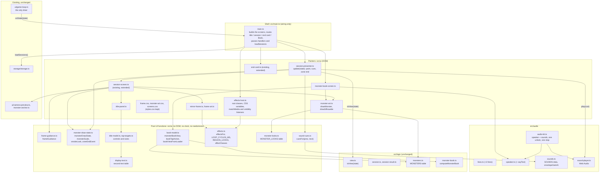

# Design: mirror-and-screens

## 1. Overview

This design covers how the game looks and sounds: the title screen with its Monster Book and
parent buttons, the haunted-mirror frame that tells the child which part of the mouth to
brush, twelve monster drawings and their smoke, the Monster Book screen, the end card, the
soft sounds, and the comfort and access rules.

Since 21 Nov 2026 the camera checks only that the child is brushing at the mouth and moving
(`REQUIRE_SIDE_MATCH` and `REQUIRE_LEVEL_MATCH` are both `false`). The frame glow, the monster
position and the spoken line are the only ways the game says **which** zone to brush. The
frame is therefore part of how the app works, which is what the Costume Contest asks for.

This spec changes only how things look and sound. It reuses, and does not redefine, these
things from `core-brushing-loop` and `hand-tracking`: `BrushingSignal`, `SignalSource`,
`SessionResult`, `SessionState`, `View` and `toView`, the tick rule, every constant in
`src/logic/constants.ts`, the storage schema `foamtom:v1`, `GAIN_LEVEL`, `GAIN_STEP_PER_MS` and
`rampGain` (`src/audio/speaker.ts`), `drawMonster`'s signature, `monsterAnchor`, the 15-second
start limit, and the CSP in `index.html`. Nothing under `src/logic/` changes, with one
exception: the timer-only monster rule of core requirement 8.5 (task 42, requirement 16.4,
Decision 8 of 21 Nov 2026), which touches `src/logic/constants.ts` and `src/logic/session.ts`
only. `game-loop.ts` does not change.

Everything decided by data is a pure function with a named test (req 15, 16.2). The screens
only paint what those functions return (req 16.3). Nothing drawn or played reads the camera
(req 13.4).

**Key design decisions (each flagged "Design choice" inline):**

- Four new pure functions, as the requirements name them: `frameGuidance`, `monsterDrawState`,
  `monsterBookView`, `effectsFor`. They live in `src/ui/`, import from `src/logic/` only, and
  nothing in `src/logic/` imports them (req 16.2).
- The zone-end outcome reaches the drawing code through a small pure helper,
  `zoneEndEvent(prev, next)`, that compares two `SessionState` values. `toView` does not change
  (req 6.1).
- The frame is one component used in both modes. It is never inside the mirrored element
  (req 3.3, 4.4).
- Looping effects are CSS animations whose durations come from one table, applied to the page
  with `style.setProperty`, so a test can read the table (req 11.2, 15.5).
- Sounds are plain data (an envelope and a pitch) played with the Web Audio clock. No timer
  (req 10.5, 13.3).
- The twelve monster names are spoken from `monsters.ts` through a new `sayText` method added
  next to the existing `Speaker` interface, which is not changed (req 7.4; Decision 3).
- No new test environment. The project has no DOM library, so screens are split into a pure
  model (tested) and a thin painter (checked by source scan and by hand), like
  `camera-preview.ts` today.
- No new words. Every text the child or parent sees or hears is one of the 19 approved lines
  (req 14.1).
- **Fixes of 21 Nov 2026 (section 5.11, 5.12; Decision 8):** two new pure files, `isHit` in
  `src/ui/hit-feedback.ts` and the leaving gate in `src/ui/leaving-gate.ts`; the flinch is a
  CSS class swap, the gate is a two-field state moved by paints and by `animationend`, and
  neither uses a timer. `MIN_MONSTER_SCALE` becomes 0.2. The smoke changes in CSS only.
  Timer-only monsters are defeated at 20 s (core 8.5).
- Every design element carries its requirement's mark, **needed for the video** or **later**
  (section 1.1), so the task list can build everything the video needs first (deadline 4 Dec
  2026).

### 1.1 Build marks

Marks come from the requirements' priority table. A design element, module, test and table
row below carries the mark of the requirement it meets. Where one file serves both kinds, the
mark is given per part.

| Req | Subject | Mark |
|-----|---------|------|
| 1 | Title screen | needed for the video |
| 2 | Parent entry point | later |
| 3 | The frame is the guidance | needed for the video |
| 4 | Haunted-mirror look, both modes | needed for the video |
| 5 | Monster drawings | needed for the video |
| 6 | Monster states and smoke | needed for the video |
| 7 | Monster Book screen | needed for the video |
| 8 | Rare-monster invitation | later |
| 9 | End card | needed for the video |
| 10 | Sound | needed for the video |
| 11 | Comfort: motion, flashing, targets, colour | needed for the video |
| 12 | Landscape and desktop | later |
| 13 | Original assets, privacy, CSP, no new timers | needed for the video |
| 14 | Wording of new lines | needed for the video |
| 15 | Tests | needed for the video |
| 16 | Looks and sounds only | needed for the video |

**What "later" costs.** The three "later" requirements are additive. They can be left out of
the first build without changing any "needed for the video" element:

- Req 2: the `parent` control. `titleControls(false)` is what the video build uses, and
  `main.ts` passes no `onOpenParent`.
- Req 8: the rare invitation. The `invite` flag and `showRareInvitation` are two lines of the
  pure function and are built with it, but the painted caption, the `rare-invite` line and the
  `say-line` tap are later. Until then a rare silhouette tap does nothing, like a common one.
- Req 12: the landscape ring size, the Book's `auto-fit` reflow, and the `:focus-visible` rules
  for the new button classes. (The existing `.big-button` focus rule is not new.)

---

## 2. Architecture



**Data flow.** The loop calls `onState(state)` once per tick (unchanged). `main.ts` hands the
state to `session-presenter.ts`. The presenter keeps the previous state and calls three pure
functions: `toView(state)` for the picture, `zoneEndEvent(prev, state)` for a monster that just
left, and `cuesFor(prev, state)` for sounds. It passes the results to `session-screen.ts` and
the sound player. The screen asks `frameGuidance(view)` for the frame and `monsterDrawState(view,
null)` for the monster, and paints. In one `paint` call the glow, the spoken line and the
monster all change together (req 3.6).

The "Pure UI functions" box takes plain values and returns plain data. It has no DOM, no
clock, no randomness (req 6.7, 16.2). Nothing under `src/logic/` imports from `src/ui/`,
`src/tracking/`, `src/storage/` or `src/audio/` (unchanged; this spec adds no file under
`src/logic/`).

> **Design choice (where the pure functions live):** `src/ui/`, next to the code that uses
> them, because `structure.md` puts "mirror frame, monsters, screens" there and the
> requirements let them import from `src/logic/`. The alternative, a new `src/present/`
> folder, adds a folder for six small files. Not chosen.

---

## 3. Module list

One concept per file, kebab-case (`structure.md`). "New" files are added by this spec.
"Changed" files keep every export and every existing test passing (req 15.10).

Every row has a mark (section 1.1). "Mark" is the mark of the requirements in the last column.

| Module | Status | Mark | Responsibility | Req |
|--------|--------|------|----------------|-----|
| `src/ui/frame-guidance.ts` | new, pure | needed for the video | `frameGuidance(input)`, `ZONE_REGION` table, `REGION_ORDER`. | 3.2, 3.3, 3.4, 3.5, 3.7 to 3.9, 15.1 |
| `src/ui/effects.ts` | new, pure | needed for the video | `effectsFor(prefersReducedMotion)`, `effectClasses(effects)`, `LOOP_CYCLES_MS`, `MIN_CYCLE_MS`, `REGION_LOOKS`, `ONE_SHOT_MS`, `FRAME_METRICS`. (`FRAME_METRICS.ringLandscapePx` is later, req 12.1.) Task 45 adds `ONE_SHOT_MS.hit` (300) and the effect `hitMotion` (off under reduced motion, class `fx-no-hit`). | 11.2, 11.3, 11.9, 15.4, 15.5 |
| `src/ui/hit-feedback.ts` | new (task 45), pure | needed for the video | `isHit(prevView, view)`, `hitClassFor(hit, effects, parity)`: the two class names that are swapped. | 6.9, 6.10, 11.9, 15.11 |
| `src/ui/leaving-gate.ts` | new (task 43), pure | needed for the video | `LeavingGate`, `GATE_OPEN`, `MAX_LEAVING_PAINTS` (2), `gateOnPaint`, `gateOnAnimationEnd`, `gateOpen`, `nextMonsterVisible`. | 6.13, 15.12 |
| `src/ui/monster-draw-state.ts` | new, pure | needed for the video | `monsterDrawState(view, endOutcome)`, `monsterScale`, `smokeLook`, `MIN_MONSTER_SCALE` (moved from `session-screen.ts`; 0.2 since task 44), `zoneEndEvent(prev, next)`. | 6.1 to 6.7, 6.11, 15.2 |
| `src/ui/sound-cues.ts` | new, pure | needed for the video | `cuesFor(prev, next)`: which sounds a state change calls for, each with a start delay. | 10.4, 10.6 |
| `src/ui/monster-looks.ts` | new, pure | needed for the video | `MONSTER_LOOKS`: one row per monster, shape features only. `shapeKey(look)`. | 5.1 to 5.4 |
| `src/ui/book-model.ts` | new, pure | needed for the video; `invite` flag and `say-line` action are later (req 8) | `monsterBookView(sessions)`, `bookViewFromLoader(load)`, `bookTapAction(entry)`. | 7.2 to 7.6, 8, 15.3 |
| `src/ui/book-speech.ts` | new | needed for the video; the `say-line` branch is later (req 8) | `createBookSpeech(speaker)`: runs a tap action on a speaker. No DOM. | 7.4, 7.5, 8.1, 15.9 |
| `src/ui/title-model.ts` | new, pure | needed for the video; the `parent` control is later (req 2) | `titleControls(hasParentHandler)`: the controls of the title screen, their text ids and sizes. | 1.1, 1.2, 1.8, 2.2, 10.11 |
| `src/ui/tap-targets.ts` | new, pure | needed for the video | `TAP_TARGETS`: size in px of every tappable thing. | 1.6, 1.8, 2.2, 7.7, 9.3, 11.4 |
| `src/ui/display-text.ts` | new, pure | needed for the video; the `grown-ups` row is later (req 2) | `DISPLAY_TEXT`: the second text table (shown text and names for screen readers). | 1.3, 14.1, 14.4 |
| `src/ui/end-lines.ts` | new | needed for the video | `END_LINE_IDS = ['end', 'end-close']`, `speakEnd(speaker)`. | 9.2, 15.9 |
| `src/ui/session-presenter.ts` | new | needed for the video | `createSessionPresenter(deps)`: `update(state)`, `reset()`. Keeps the previous state; calls the pure functions and the painters. | 3.6, 6.3, 10.4 |
| `src/ui/mirror-frame.ts` | new | needed for the video | The frame element: four corner regions, fog, cracks, a `glass` slot. `paint(guidance)`. | 3, 4 |
| `src/ui/frame-art.ts` | new | needed for the video | Builds the crack drawing (SVG namespace) and the candle pieces. | 4.1, 4.2, 13.2 |
| `src/ui/monster-art.ts` | new | needed for the video | `drawMonster(def)` (moved here; `session-screen.ts` re-exports it) and `drawSilhouette(rarity)`. | 5, 6.4, 7.5 |
| `src/ui/title-panel.ts` | new | needed for the video; the parent control is later (req 2) | The title panel: name, start button, Monster Book button, privacy line, parent control. | 1, 2 |
| `src/ui/monster-book-screen.ts` | new | needed for the video; the rare invitation caption is later (req 8) | The Book screen: grid, back button, caption, rare invitation. `open()` reads sessions. | 7, 8 |
| `src/ui/effects-host.ts` | new | needed for the video | `startEffects(deps)`: sets CSS variables from the tables, puts effect classes on the root, listens for reduced-motion and tab-hidden changes. | 11.2, 11.3, 13.3 |
| `src/ui/frame.css`, `monster-art.css`, `screens.css` | new | needed for the video; the landscape rules, `auto-fit` reflow and new `:focus-visible` rules inside them are later (req 12) | Frame, monster art, and title / end card / Book styles. `screens.css` also defines `--caption-fg` and `--caption-bg` and restyles `.caption` with them (it loads after `styles.css`). Linked from `index.html`. | 3, 4, 5, 7, 11, 12 |
| `src/audio/sounds.ts` | new, pure | needed for the video | `SOUNDS` data, `envelopeGainAt(spec, ms)`, `EFFECT_PEAK_GAIN`, `CUE_GAP_MS`. | 10.2 to 10.5 |
| `src/audio/sound-player.ts` | new | needed for the video | `createSoundPlayer()`: `unlock()`, `play(id, delayMs)`, `stop()`. Web Audio, no timer. | 10.1, 10.7, 10.8 |
| `src/audio/audio-kit.ts` | new | needed for the video | `createAudioKit()`: one speaker and one player; one `unlock()` and one `stop()` for both. | 10.7, 7.9 |
| `src/audio/lines.ts` | changed | needed for the video; `rare-invite` is later (req 8) | Adds two lines: `end-close`, `rare-invite`. The seven existing lines are not touched. | 9.2, 8.1, 14.2, 14.3 |
| `src/audio/speaker.ts` | changed | needed for the video | Adds `TextSpeaker { sayText(text) }` and returns `Speaker & TextSpeaker` from `createBrowserSpeaker`. `Speaker`, `silentSpeaker`, `rampGain`, constants unchanged. | 7.4 |
| `src/ui/session-screen.ts` | changed | needed for the video | Uses `title-panel`, `mirror-frame`, `monster-art`; `paint(view, zoneEnd?)` gets an optional second argument; `showStart()` also paints the frame as `off`. Class names `.zone`, `.zone--active`, `.big-button`, `.caption` stay. | 3, 4, 6 |
| `src/ui/end-card.ts` | changed | needed for the video | Two lines, two buttons, outcome classes, `unhide()`. | 9 |
| `src/main.ts` | changed | needed for the video; the optional parent handler is later (req 2) | Wiring only: effects host, audio kit, presenter, Book routing, optional parent handler. Its scheduler adapter is not touched. | 7.8, 2.1 |
| `src/ui/styles.css`, `index.html` | changed | needed for the video | `styles.css` is only added to (rules that `camera-preview.test.ts` reads stay as they are). `index.html` gets three `<link>` lines in the same form as the existing one. The CSP is not touched. | 13.2 |
| `src/ui/camera-preview.ts`, `monster-anchor.ts`, `game-loop.ts`, everything else under `src/logic/`, `src/tracking/`, `src/storage/` | unchanged | needed for the video | | 16.1 |
| `src/logic/constants.ts`, `src/logic/session.ts` | changed once (task 42) | needed for the video | Core 8.5 and 8.6 only: adds `TIMER_ONLY_DAMAGE` and uses it in `tick` for timer-only mode. Nothing else under `src/logic/` changes. | 16.4 |

> **Design choice (`drawMonster` moves, its export stays):** `monster-art.ts` holds the code;
> `session-screen.ts` keeps `export { drawMonster } from './monster-art'`, so `end-card.ts` and
> any caller keep their import (req 5.6).

---

## 4. TypeScript types

`View`, `ZoneId`, `Zone`, `MonsterDef`, `MonsterOutcome`, `Rarity`, `SessionState`,
`SessionResult` come from `src/logic/` and are not redefined. `Speaker` comes from
`src/audio/speaker.ts` and is not changed.

```typescript
// ── src/ui/frame-guidance.ts ──
type FrameRegion = 'top-left' | 'top-right' | 'bottom-left' | 'bottom-right';
type RegionLevel = 'active' | 'dim' | 'off';           // off: no session is running (req 3.9)

interface RegionLook {                                  // from REGION_LOOKS in effects.ts
  readonly glowOpacity: number;      // 0 to 1: brightness
  readonly glowSizePx: number;       // size of the glow: not hue
  readonly flame: boolean;           // the lit-candle ornament: not hue
  readonly flickerAmplitude: number; // 0 to 1: size of the brightness change, never its speed
}
interface RegionState { readonly region: FrameRegion; readonly level: RegionLevel; readonly look: RegionLook }
interface FrameGuidance {
  readonly regions: readonly RegionState[];             // always 4, in REGION_ORDER
  readonly activeRegion: FrameRegion | null;
  readonly flickering: boolean;                         // false when paused or off
}
// The argument type allows only the two fields that may matter (req 3.8).
type GuidanceInput = Pick<View, 'phase' | 'zoneId'> | null;   // null: no session running

// ── src/ui/monster-draw-state.ts ──
type MonsterDrawState = 'sitting' | 'shrinking' | 'defeated' | 'gone' | 'fled' | 'trapped';
type ZoneEndOutcome = 'defeated' | 'fled' | 'trapped';
interface ZoneEnd { readonly zoneId: ZoneId; readonly monsterId: string; readonly outcome: ZoneEndOutcome }
interface SmokeLook { readonly puffs: 0 | 1 | 2 | 3; readonly scale: number; readonly opacity: number }

// ── src/ui/effects.ts ──
interface Effects {
  // moving effects: off under reduced motion
  readonly flicker: boolean; readonly fogDrift: boolean; readonly smokeDrift: boolean;
  readonly leavingMotion: boolean;   // false: a monster that leaves only fades
  readonly bookMotion: boolean;      // the end-card "going into the Book" movement
  readonly hitMotion: boolean;       // the hit flinch (task 45, req 6.9, 11.9); class fx-no-hit
  // states: always on (req 11.3)
  readonly glow: true; readonly ornament: true; readonly sizeChange: true; readonly smokeThinning: true;
}
type LoopId = 'flameActive' | 'glowActive' | 'glowDim' | 'fogDrift' | 'smokeDrift';

// ── src/ui/hit-feedback.ts (task 45) ──
// isHit is true only when both views exist, zoneId and monsterId are equal and
// healthFraction is lower in `view` than in `prevView`.
type HitView = Pick<View, 'zoneId' | 'monsterId' | 'healthFraction'>;
type HitClass = 'monster--hit-a' | 'monster--hit-b';   // two identical animations with different names

// ── src/ui/leaving-gate.ts (task 43) ──
interface LeavingGate { readonly leaving: boolean; readonly paintsSinceEnd: number }

// ── src/ui/monster-looks.ts ──
type BodyShape = 'round' | 'tall' | 'wide' | 'drop';
type EarShape = 'none' | 'round' | 'points' | 'horns';
type ExtraShape = 'none' | 'tail' | 'tuft' | 'wings' | 'bumps' | 'wisps';
type MouthShape = 'smile' | 'oh' | 'tongue' | 'wavy';        // no teeth in any value (req 5.3)
type CrestShape = 'none' | 'moon' | 'sun' | 'halo' | 'crown';
interface MonsterLook {
  readonly body: BodyShape; readonly ears: EarShape; readonly eyes: 1 | 2 | 3;
  readonly extra: ExtraShape; readonly mouth: MouthShape;
  readonly crest: CrestShape;   // rare only
  readonly star: boolean;       // rare only
}                               // no colour field: colour is in monster-art.css

// ── src/ui/book-model.ts ──
interface BookEntry {
  readonly id: string;
  readonly rare: boolean;
  readonly owned: boolean;
  readonly name: string | null;     // null when not owned (req 7.5)
  readonly invite: boolean;         // rare and not owned (req 8.1)
}
interface BookView { readonly entries: readonly BookEntry[]; readonly showRareInvitation: boolean }
type BookTapAction =
  | { readonly kind: 'say-name'; readonly text: string }     // owned
  | { readonly kind: 'say-line'; readonly lineId: 'rare-invite' }  // rare, not owned
  | { readonly kind: 'none' };                                // common, not owned

// ── src/ui/title-model.ts, tap-targets.ts, display-text.ts ──
type TapTargetId = 'start' | 'titleBook' | 'parent' | 'bookCell' | 'bookBack' | 'endDone' | 'endBook';
interface TapTarget { readonly minWidthPx: number; readonly minHeightPx: number }
type DisplayTextId = 'privacy' | 'book-title' | 'back' | 'grown-ups' | 'not-met';
interface DisplayText { readonly id: DisplayTextId; readonly text: string; readonly kind: 'shown' | 'name-only' }
interface TitleControl {
  readonly id: 'start' | 'book' | 'parent';
  readonly size: 'large' | 'small' | 'quiet';
  readonly target: TapTargetId;
  readonly textId: DisplayTextId | 'start-line';   // 'start-line' is the existing spoken line
  readonly icon: true;
}

// ── src/audio/sounds.ts ──
type SoundId = 'zone-start' | 'defeat' | 'flee' | 'trapped' | 'end';
interface SoundVoice { readonly wave: 'sine' | 'triangle'; readonly fromHz: number; readonly toHz: number; readonly level: number }
interface SoundSpec {
  readonly id: SoundId;
  readonly voices: readonly SoundVoice[];     // summed; the levels add up to 1 or less
  readonly peakGain: number;                  // at most EFFECT_PEAK_GAIN
  readonly attackMs: number; readonly holdMs: number; readonly releaseMs: number;
}
interface TextSpeaker { sayText(text: string): void }          // src/audio/speaker.ts
// A cue is a sound and a start delay on the audio clock (not a timer). From src/ui/sound-cues.ts.
interface SoundCue { readonly id: SoundId; readonly delayMs: number }
interface Sounds { unlock(): void; play(id: SoundId, delayMs?: number): void; stop(): void }
```

---

## 5. Behaviour

### 5.1 The frame is the guidance (req 3) — needed for the video

**Regions and mapping (req 3.2, 3.3).** The frame has four regions at the four corners of the
play area, in screen terms with the child's own left on the left of the screen.

```typescript
// src/ui/frame-guidance.ts. The only zone-to-region table. No swap, no negation.
const ZONE_REGION: Record<ZoneId, FrameRegion> = {
  'upper-left':  'top-left',
  'upper-right': 'top-right',
  'lower-left':  'bottom-left',
  'lower-right': 'bottom-right',
};
const REGION_ORDER: readonly FrameRegion[] = ['top-left', 'top-right', 'bottom-left', 'bottom-right'];
```

`rawToChildSide` in `src/tracking/side.ts` stays the only left/right swap in the code base. The
preview is mirrored by CSS and the child's left cheek already appears on the left of the
screen, so the frame needs no swap. The frame has no transform. It is **never inside** the
mirrored stage (the `.preview--mirrored` element). In a camera session the mirrored stage
sits inside the frame's `glass` slot, so the frame is its parent and is not flipped. No frame
file contains `scaleX` (req 3.3).

The existing `onlyOneLeftRightSwap` test (`tests/tracking-source-rules.test.ts`) scans every
`.ts`, `.html` and `.css` file under `src/`, including the new ones. It fails on `'raw-left'`
or `'raw-right'` outside `side.ts`, and on any inline `? 'left' : 'right'` or `? 'right' :
'left'`. New files therefore choose a side only through tables (`ZONE_REGION`,
`MONSTER_LOOKS`) and never through a left/right ternary.

**`frameGuidance(input)` (req 3.4 to 3.9, 3.8).**

```
frameGuidance(input):
  if input == null or input.phase == 'ended':
      return { regions: all four 'off', activeRegion: null, flickering: false }
  active = ZONE_REGION[input.zoneId]
  regions = REGION_ORDER.map(r => r == active ? 'active' : 'dim')      # look from REGION_LOOKS[level]
  flickering = (input.phase == 'running')                               # paused: lit, not flickering (3.9)
  return { regions, activeRegion: active, flickering }
```

The function reads `phase` and `zoneId` only. Its argument type is `Pick<View, 'phase' |
'zoneId'>`, so the health, the smoke, the caption, the signal and the mode cannot reach it
(req 3.8). Because `zoneId` does not change after a monster is defeated, the glow stays on the
zone until the zone ends (req 3.7).

**Looks (req 3.4, 3.5).** `REGION_LOOKS` in `effects.ts`, starting values:

| Level | `glowOpacity` | `glowSizePx` | `flame` | `flickerAmplitude` |
|-------|---------------|--------------|---------|--------------------|
| `active` | 0.9 | 72 | true | 0.20 |
| `dim` | 0.25 | 24 | false | 0.05 |
| `off` | 0 | 0 | false | 0 |

The active region differs from a dim one in brightness, size of glow and the lit-candle
ornament, none of which is a hue (req 3.5). "Flicker more" is the larger `flickerAmplitude`;
the cycle is never shorter (section 5.8).

> **Design choice:** the glow layer sits **behind** the glass content (`z-index` below the
> preview and the grid), so it is seen only in the frame ring and outside it, and can never
> cover the preview, the monster, the countdown or the caption (req 3.10). The ring is 32 px
> wide (20 px in short landscape) so a 32 px candle fits in each corner. `FRAME_METRICS` holds
> these starting values.

**Painting (req 3.6, 4.3, 4.4).** `mirror-frame.ts` builds:

```
div.mirror-frame
  div.mirror-frame__deco  [aria-hidden="true"]       (req 11.8)
     div.frame-fog          (drifting fog, behind the glass)
     div.frame-region.frame-region--top-left ... (x4: glow layer + candle stick + flame, flame only when look.flame)
     svg.frame-cracks       (drawn cracks, inside the ring only)
  div.mirror-frame__glass                              (the play area slot)
```

`session-screen.ts` puts `preview.element` in the glass in a camera session and the plain
`mouth` grid in a timer-only session (req 4.3, 4.4). `attachPreview` therefore moves the
preview into `glass` instead of inserting it before `mouth`. In a camera session the `mouth`
grid stays below the frame as it is today, so the existing behaviour is kept. The same
component and the same `frameGuidance` run in both modes. `MirrorFrame.paint(guidance)` sets
classes (`frame-region--active`, `--dim`, `--off`, `--flicker`) and the three look values as CSS
variables with `element.style.setProperty`. It makes no decision. `showStart()` paints the
frame as `off` (`frameGuidance(null)`), so a new session never starts with a lit region.

**Same moment (req 3.6).** `SessionScreen.paint(view, zoneEnd?)` is one synchronous function.
In it, in this order: `frame.paint(frameGuidance(view))`, the caption and `speaker.say(...)`,
`showMonster(...)`. The glow and the spoken line change in the same task of the event loop,
so they move together. The monster moves with them, except that after a zone end it waits
for the leaving copy to go (section 5.12, req 6.13): then it appears on the `animationend`
of the copy or at the second paint after the zone end, whichever comes first. The only thing
that differs for the glow is the CSS fade (0.4 s, `ONE_SHOT_MS.glowMove`), which is a
transition and not a timer.

**When no region glows (req 3.9).** The frame exists only inside the session panel. The title
screen, end card and Book never show it. `frameGuidance(null)` and the `ended` phase give four
`off` regions, which the tests use to pin the rule.

### 5.2 Look and mood (req 4) — needed for the video

- **Effects (req 4.1).** Candle flicker (flame and glow, CSS keyframes on opacity), drifting fog
  (a slow CSS `transform` on a layer behind the glass), cracked glass (a fixed drawing). All
  CSS or an SVG built with `createElementNS`, the one SVG exception of core req 13.10 (req 13.2).
- **Cute-spooky (req 4.2).** The cracks are a short, regular, star-shaped pattern in the ring
  corners with thin strokes at about 35% opacity, so they read as pattern and not as a broken
  screen. No face, figure or shape in the fog: it is two soft blurred ellipses. No dark flash,
  no shake: the only moving properties are `opacity` and `transform: translate` at small
  distances.
- **Fog and cracks behind the text (req 4.5).** The fog layer is under the glass content. The
  caption and countdown sit outside the frame element and on opaque plates (section 5.8). Fog
  never reaches the face in the preview or the monster, because the preview is opaque above it.
- **Fade in (req 4.6).** Each of the frame, fog, cracks and the screens has a one-shot CSS
  fade (`opacity` 0 to 1 over `ONE_SHOT_MS.fadeIn` = 600 ms) that plays whenever its parent
  stops being `hidden`.
- **Speed (req 4.7).** All effects are CSS on compositor properties (`opacity`, `transform`), no
  `filter`, no `backdrop-filter`, no `mix-blend-mode`. The check is manual on the 2022 Android
  phone with effects on; the result goes into `docs/review/TRACKING-TEST-RESULTS.md`, section 7,
  as a dated row in words.

### 5.3 Monster drawings (req 5) — needed for the video

`MONSTER_LOOKS: Record<monsterId, MonsterLook>` in `monster-looks.ts` is the one table of
shapes. Starting values (shapes only; colours stay in CSS and are not a feature):

| Monster | body | ears | eyes | extra | mouth | crest | star |
|---------|------|------|------|-------|-------|-------|------|
| `plaque-puff` | round | round | 2 | none | smile | none | no |
| `sugar-sprite` | drop | points | 2 | wings | oh | none | no |
| `gummy-gloop` | wide | none | 2 | bumps | wavy | none | no |
| `fuzzlefang` | round | points | 2 | tuft | tongue | none | no |
| `crumb-goblin` | tall | points | 2 | none | smile | none | no |
| `sticky-wisp` | drop | none | 1 | wisps | oh | none | no |
| `molar-mumbler` | wide | round | 3 | none | wavy | none | no |
| `tartar-tot` | round | horns | 1 | tail | smile | none | no |
| `midnight-molar-ghoul` | tall | horns | 2 | none | wavy | moon | yes |
| `dawn-drool-dragon` | wide | horns | 2 | tail | tongue | sun | yes |
| `moonlit-mint-phantom` | drop | none | 2 | wisps | smile | halo | yes |
| `twilight-toffee-wraith` | tall | none | 3 | wisps | oh | crown | yes |

- **Different shapes (req 5.2).** `shapeKey(look)` joins `body, ears, eyes, extra, crest`. The
  twelve keys are pairwise different. No colour field exists in a look, so a pair cannot differ
  "by colour alone".
- **Cute (req 5.3).** Eyes are large round circles with a small highlight. `mouth` has four
  values and none is a tooth shape. There is no value for blood, wounds, drips, fangs or
  bulging eyes. `fuzzlefang` has a tongue, no fangs. See section 10.
- **Rare marks (req 5.4).** Every rare monster has the star and a crest (a different
  silhouette detail). No common monster has either.
- **Made in code (req 5.5, 13.1).** `drawMonster(def)` builds the element from the look: class
  names `monster--body-tall`, `monster--ears-horns`, `monster--eyes-3`, `monster--extra-tail`,
  `monster--mouth-smile`, `monster--crest-moon`, plus the existing `monster--<id>` colour class.
  Every size in `monster-art.css` is a multiple of one variable `--u` (default `1px`), so a Book
  cell sets `--u: 0.8px` and the cheek sets its own, and the drawing reads at both sizes.
- **Signature (req 5.6).** `drawMonster(def: MonsterDef): HTMLElement`, `role="img"`,
  `aria-label` = the monster's name. As today.

### 5.4 Monster states and smoke (req 6) — needed for the video

**`monsterDrawState(view, endOutcome)` (req 6.1, 6.2, 6.7).**

```
monsterDrawState(view, endOutcome):
  if endOutcome != null: return endOutcome            # 'defeated' | 'fled' | 'trapped'
  h = view.healthFraction
  if h >= 1: return 'sitting'
  if h > 0:  return 'shrinking'
  return view.smokeFraction > 0 ? 'defeated' : 'gone'
```

Total and deterministic: every `(view, endOutcome)` gives exactly one state. No DOM, no clock,
no randomness.

```
monsterScale(h)  = MIN_MONSTER_SCALE + (1 - MIN_MONSTER_SCALE) * clamp01(h)       # 0.2 to 1; never below the floor
smokeLook(f)     = f <= 0 ? { puffs: 0, scale: 0, opacity: 0 }
                         : { puffs: ceil(3 * f), scale: 0.6 + 0.4 * f, opacity: 0.35 + 0.65 * f }
```

`MIN_MONSTER_SCALE` is 0.2 since 21 Nov 2026 (task 44; it was 0.35, the value `session-screen.ts`
had at first). The monster is still never below the floor, so it does not vanish before it is
defeated. The smoke thins in the number of
puffs (3, 2, 1), in their size and in their opacity (req 6.5). It carries no text, score,
colour change or sound (req 6.6): only `smokeLook` and `monsterDrawState` read `smokeFraction`, and `monsterDrawState` reads it only to tell `defeated` from `gone`.

**Zone end (req 6.1, 6.3).** `toView` describes the active zone only, so the outcome of a zone
that just ended is not in the view. A pure helper compares two states:

```
zoneEndEvent(prev, next):
  if prev == null or next.phase == 'paused' or prev.phase == 'paused': return null
  endedIndex = null
  if next.activeZoneIndex > prev.activeZoneIndex: endedIndex = prev.activeZoneIndex
  else if prev.phase != 'ended' and next.phase == 'ended': endedIndex = prev.activeZoneIndex
  if endedIndex == null: return null
  m = next.monsters[endedIndex]
  if m.outcome == 'pending': return null                 # cannot happen; no event rather than a wrong one
  return { zoneId: m.zoneId, monsterId: m.def.id, outcome: m.outcome }
```

`session-presenter.ts` passes the event to `screen.paint(view, zoneEnd)`. The screen then
draws a **leaving copy** of that monster and, in the same call, moves the glow, caption and
stage to the next zone, but does not yet show the next zone's monster (section 5.12, req
6.3, 6.13). The copy is a one-shot CSS animation (`ONE_SHOT_MS.leave` = 1400 ms) on an extra element that is
removed by its `animationend` event. It is not a timer, and it changes nothing in
`SessionState`, so it cannot delay, pause or shorten the zone (core req 2.5).

**Where the copy is drawn.** The live monster sits in the `stage`, and `paint` moves the stage
to the next zone in the same call, so a copy inside the stage would jump with it. The copy is
therefore put where the monster was:

- Timer-only: in the grid cell of the zone that ended (`cells.get(event.zoneId)`).
- Camera: in a `leave layer` (an absolutely positioned child of the mirrored stage, so it gets
  the same flip back as the monster slot). `paint` copies the slot's current inline `left`,
  `top`, `width` and `transform` strings onto the copy before it moves the stage. These are
  placement strings the preview already wrote; no `DrawValue` is read. When the slot is at the
  plain position, the copy goes into the grid cell as in timer-only mode.

| State | Picture | Req |
|-------|---------|-----|
| `sitting` | Monster at full size on the zone. | 6.2 |
| `shrinking` | Same monster, size from `monsterScale`. | 6.2 |
| `defeated` | Monster hidden, smoke puffs from `smokeLook`. At zone end the leaving copy puffs into smoke once. | 6.2, 6.3 |
| `gone` | Nothing on the zone. | 6.2 |
| `fled` | Leaving copy slips sideways and fades into a puff. | 6.2, 6.3 |
| `trapped` | Leaving copy sits in a small glass bubble and waves or sleeps (two classes, `trapped-wave`, `trapped-sleep`, chosen by the zone index parity so no randomness), then fades. The face stays happy: same eyes and mouth, no tears, no frown. | 6.2, 6.3, 6.4 |

Under `effectsFor(true)` the leaving copy only fades (no sideways movement, no wave). It is
still drawn, so the state shows (req 11.3).

> **Design choice (last zone):** the session screen stops painting at phase `ended`, and the
> end card takes over. The fourth monster's outcome is shown by the end card (section 5.6),
> not by a leaving copy on the session screen. All four outcomes therefore appear in the same
> way on the end card. It costs one rule: `zoneEndEvent` still returns the fourth event (the
> tests count four), and the presenter does not paint it.

**Cleanup without a timer.** At most one leaving copy exists. It is removed when its animation
ends, on the second paint after the zone end (section 5.12), when the next zone-end event
arrives, on `pause`, on `ended`, and in `showStart()`. A copy cannot be stuck on screen if
`animationend` never arrives (hidden tab, reduced motion). Removing the copy opens the leaving
gate, and the next zone's monster appears.

### 5.5 Title screen and parent entry (req 1, 2) — req 1 needed for the video; req 2 (the parent control) later

`title-model.ts` returns the controls as data; `title-panel.ts` paints them.

```typescript
titleControls(hasParentHandler: boolean): TitleControl[]
// [ { id:'start',  size:'large', target:'start',     textId:'start-line', icon:true },
//   { id:'book',   size:'small', target:'titleBook', textId:'book-title', icon:true },
//   (hasParentHandler) { id:'parent', size:'quiet', target:'parent', textId:'grown-ups', icon:true } ]
```

- **One large button (req 1.1, 1.2).** The start button keeps its icon, its label "Brush!", its
  caption and the spoken `start` line. Its tap calls `speaker.unlock()`, `speaker.say('start')`
  and the existing `onStart`. The `start` line does not change. It is the only `large` control
  (req 1.1).
- **Monster Book button (req 1.8, 7.8, 7.9).** `small`, with an icon, the visible label "Monster
  Book" and an accessible name. Its tap calls `speaker.unlock()` and the `onOpenBook` handler
  passed in by `main.ts`. It does not call `onStart`, loads no camera code and starts no session.
- **Privacy line (req 1.3).** `DISPLAY_TEXT['privacy']` is "The camera stays on this phone.
  Nothing is saved or sent." It is a `<p>`, visible, never spoken. It lives in `display-text.ts`
  and not in `lines.ts`, because the core wording guard forbids "camera" there. The new guard
  covers the file (section 6).
- **Nothing asked (req 1.4, 1.5).** The panel has no form, no `beforeinstallprompt` handler and
  no camera call. It imports nothing from `src/tracking/` and makes no request. It loads
  nothing lazily.
- **Fits (req 1.6).** Start, Book button and privacy line are visible without scrolling at
  360 x 640. That layout is checked by hand (manual). The sizes are in `TAP_TARGETS`.
- **No pressure (req 1.7).** No countdown, no animation faster than the table, no sound before
  the first tap (the player has no context until `unlock()`), no text about earlier sessions.
- **Parent control (req 2).** `main.ts` passes `onOpenParent` only when the `parent-screen`
  spec provides one. With a handler, the control is a small `quiet` button that holds the icon
  (a padlock-free grown-up silhouette made in CSS) and the visible word "Grown-ups" after it, in
  a text size and colour quieter than the Monster Book button's (decision of 23 Nov 2026).
  The accessible name stays "Grown-ups"; the icon stays `aria-hidden`, so it is not read twice.
  `DISPLAY_TEXT['grown-ups']` has kind `shown`. It is absent from the
  session screen and the end card because only the title panel creates it (req 2.3). This spec
  builds no gate (req 2.1).
- **No mute (req 10.11).** `titleControls` has no such control, and no file adds one.

`TAP_TARGETS` starting values (px, minimum width and height):

| Id | Width | Height | Note |
|----|-------|--------|------|
| `start` | 160 | 72 | Equal to the existing `.big-button` rule. |
| `titleBook` | 128 | 52 | Smaller than `start` in both. |
| `parent` | 48 | 48 | Smaller and quieter than both. |
| `bookCell` | 72 | 72 | |
| `bookBack` | 96 | 48 | |
| `endDone` | 160 | 72 | The existing end-card button. |
| `endBook` | 128 | 56 | |

The painter applies each pair with `style.minWidth` and `style.minHeight`.

### 5.6 End card (req 9) — needed for the video

- **Content (req 9.1).** The four monsters of the session, each drawn with `drawMonster`, and
  each item carries a class for its outcome (`end-card__item--defeated`, `--fled`, `--trapped`).
  The outcomes come from `state.monsters[i].outcome`, passed as an optional second argument:
  `show(defs, outcomes?)`. Each item plays a one-shot "into the Book" movement
  (`ONE_SHOT_MS.intoBook`); the fled and trapped ones look like the defeated ones except for
  their small leaving style (section 5.4). Trapped ones are friendly (req 6.4). All four go
  into the Book (core req 10.2).
- **Lines (req 9.2).** `END_LINE_IDS = ['end', 'end-close']`. `speakEnd(speaker)` calls
  `speaker.say('end')`, then `speaker.say('end-close')`. `say` queues speech after what is
  already being said, so the lines do not overlap. Both captions are shown together, `end`
  first, so no timer is needed to swap them. `end` is not changed. The new line is
  "Two minutes. Every corner." (approved line 2). A test pins that `CLIP_LINE_IDS` holds
  neither id: a clip would not queue, and it would then be cut by the next `say`.
- **Buttons (req 9.3).** Exactly two: a big "Done" button (the existing one, back to the title
  screen) and a smaller "Monster Book" button. Each has an icon, a label and an accessible
  name, and the sizes are in `TAP_TARGETS`. Both are visible at 360 x 640 (manual).
- **No urging (req 9.4).** The card has only those two buttons and the two captions. A test
  scans `end-card.ts` and `display-text.ts` for the urging words (section 6).
- **Timing (req 9.5).** The card is shown from `onEnded`, after `endCameraRun()` has stopped
  the camera (existing order in `main.ts`).
- **Sound.** `show` plays the `end` sound after `speaker.stop()` (existing order), so the stop
  does not cut it.
- **Coming back from the Book.** The Book is opened over a hidden end card. A new
  `EndCard.unhide()` shows it again without speaking or playing anything.

### 5.7 Monster Book screen (req 7, 8) — req 7 needed for the video; req 8 (the rare invitation) later

**`monsterBookView(sessions)` (req 7.1, 7.2, 8.1, 8.3, 15.3).**

```
monsterBookView(sessions):
  owned = computeMonsterBook(sessions).unlockedIds          # the only rule for "owned" (7.2)
  entries = MONSTERS.map(m => {
      id: m.id, rare: m.rarity == 'rare', owned: owned.has(m.id),
      name: owned.has(m.id) ? m.name : null,
      invite: m.rarity == 'rare' and not owned.has(m.id) })
  return { entries, showRareInvitation: entries.some(e => e.invite) }
```

Always 12 entries in table order, 8 common then 4 rare. It reads nothing but each session's
`monstersEarned`, so dates, times of day and session order cannot change it.

**`bookViewFromLoader(load)` (req 7.6).** `try { monsterBookView(load()) } catch { monsterBookView([]) }`.
`open()` calls it every time the Book opens, with `() => storage.loadSessions()` from `main.ts`.
The Book stores nothing and shows no message when reading fails (twelve silhouettes).

**`bookTapAction(entry)` (req 7.4, 7.5, 8.1).**

```
owned                 -> { kind: 'say-name', text: entry.name }
rare and not owned    -> { kind: 'say-line', lineId: 'rare-invite' }
common and not owned  -> { kind: 'none' }
```

`createBookSpeech(speaker)` runs the action. For `say-name` it calls `speaker.stop()` and then
`speaker.sayText(name)`; for `say-line` it calls `speaker.stop()` and then
`speaker.say('rare-invite')`. A new tap therefore replaces what is being said and never queues
(req 7.4). `sayText` in `speaker.ts` cancels, picks a local voice with `pickLocalVoice`, and
speaks. With no local voice it does nothing and the caption is the only output (core req
12.9). The caption area under the grid shows the same words (`aria-live="polite"`).

**Screen (req 7.3, 7.5, 7.7, 7.8, 7.10, 8).**

```
section.book
  header: back button (icon + "Back") , h1 "Monster Book"
  div.book__commons   (8 cells)
  div.book__rares     (4 cells, then the rare invitation caption when showRareInvitation)
  p.book__caption     (aria-live)
```

- An owned cell is a `<button>` with the monster's drawing and its name as visible text (req
  7.3), accessible name = the name.
- A not-owned cell shows `drawSilhouette(rarity)`: one friendly blob, same for every common
  one, so it reveals nothing. No padlock, no cross, no grey "lost" look, no number, no
  countdown (req 7.5). A rare silhouette carries the star and a small crest shape (req 5.4).
  Its accessible name is "Not met yet" and it shows no name. A rare silhouette is a `<button>`
  (it speaks the invitation); a common silhouette is a non-interactive `div role="img"`.
- **Invitation (req 8.1 to 8.4).** One line, "Brush morning AND night.", shown as visible text
  under the four rare cells while `showRareInvitation`, and spoken on a rare-silhouette tap. It
  is the same whatever the sessions say about today: `monsterBookView` has no date input. It is
  hidden when all four rare monsters are owned. It states the rule in the words the rule uses
  and changes nothing about the rule (core req 10.6).
- **Empty caption (req 7.11).** `.book__caption:empty` is transparent (the plate colour applies
  only when the element has text); height stays reserved by `min-height`.
- **Back (req 7.7).** One button, icon + "Back", sized from `TAP_TARGETS.bookBack`. `main.ts`
  remembers where the Book was opened from (`'title'` or `'end'`) and the handler returns
  there: `screen.showStart()` or `endCard.unhide()`.
- **Opened from (req 7.8, 7.9).** The title Monster Book button and the end-card button both
  call `speaker.unlock()` in their tap, then `openBook(from)`.
- **No camera, no frame (req 7.10).** `monster-book-screen.ts` imports nothing from
  `src/tracking/`, creates no frame and has no network call.
- **Reflow (req 12.2).** The two grids use `grid-template-columns: repeat(auto-fit,
  minmax(72px, 1fr))`; the screen scrolls (`overflow-y: auto`) when the content is taller than
  the window.

### 5.8 Sound (req 10) — needed for the video

**Data (req 10.2, 10.3, 10.5).** `SOUNDS` holds one `SoundSpec` per `SoundId`. All values are
starting values, tuned by ear:

| Id | Voices (wave, from Hz to Hz) | Peak gain | Attack / hold / release ms | When |
|----|------------------------------|-----------|----------------------------|------|
| `zone-start` | sine 520 to 660 | 0.20 | 160 / 60 / 500 | a new zone becomes active |
| `defeat` | triangle 440 to 700 (level 0.7) + sine 880 to 880 (0.3) | 0.25 | 190 / 40 / 420 | a monster is defeated |
| `flee` | sine 600 to 360 | 0.20 | 160 / 40 / 520 | a monster flees |
| `trapped` | sine 330 to 330 (0.6) + sine 495 to 495 (0.4) | 0.20 | 200 / 120 / 600 | a monster is trapped |
| `end` | sine 392 to 392 (0.5) + sine 523 to 523 (0.5) | 0.22 | 200 / 200 / 700 | the end card opens |

```typescript
const EFFECT_PEAK_GAIN = 0.25;       // less than GAIN_LEVEL (0.8), so effects stay under the voice
envelopeGainAt(spec, ms):            // piecewise linear
  ms <= 0 -> 0;  0..attack -> peak * ms / attack;  hold -> peak;  release -> peak * (1 - t/release);  after -> 0
```

The steepest rise of any sound is `peakGain / attackMs`. It must not exceed `GAIN_STEP_PER_MS`
(0.8 / 600, about 0.00133 per ms), which is why every attack is at least 160 ms and the sounds
are soft swells, not clicks. `GAIN_LEVEL` and `GAIN_STEP_PER_MS` are imported from
`speaker.ts`, not copied. Pitches stay between 200 Hz and 1000 Hz and the voices are sine or
triangle waves, so there is no shrill or scream-like sound (req 10.4).

**Which sounds, when (`cuesFor(prev, next)`, req 10.4, 10.6).**

```
CUE_GAP_MS = 450                                         # in sounds.ts

cuesFor(prev, next):                                     # returns SoundCue[]
  if next.phase == 'ended': return []                    # the end card plays 'end' itself
  cues = []
  for i in 0..3:  if prev != null and prev.monsters[i].outcome != next.monsters[i].outcome:
      cues.push( { id: {defeated:'defeat', fled:'flee', trapped:'trapped'}[next.monsters[i].outcome], delayMs: 0 } )
  if prev == null or next.activeZoneIndex > prev.activeZoneIndex:
      cues.push( { id: 'zone-start', delayMs: cues.length > 0 ? CUE_GAP_MS : 0 } )
  return cues
```

A monster defeated mid-zone gives `defeat` once, when it is defeated, and nothing again at zone
end, because its outcome does not change then. Fled and trapped sounds come at zone end. Since
21 Nov 2026 a timer-only monster is defeated at 20 s (core 8.5), so its `defeat` cue comes
ten seconds before the next `zone-start`, and the two no longer share a tick. A fled or
trapped outcome (camera mode) still changes on the zone-end tick together with the next
`zone-start`, so that `zone-start` starts `CUE_GAP_MS` later, on the audio
clock, so the two never overlap and no timer is used. Cues depend only on outcomes and the zone
index, never on the signal or on brushing speed. Every cue is paired with a change on screen
(req 10.6): `defeat` with the smoke or the leaving copy, `flee` and `trapped` with the leaving
copy, `zone-start` with the glow and the monster, `end` with the end card.

> **Design choice (last zone):** the fourth zone's own zone-end cue is not played. At that
> tick the phase is `ended`, the session screen has stopped painting and `main.ts` calls
> `speaker.stop()`, which would cut it. The fourth monster's outcome is shown by the end card,
> and the `end` sound is the one sound for that moment. A monster of the fourth zone that is
> defeated before the last second still gives its `defeat` cue.

**Player (req 10.1, 10.7, 10.8).** `createSoundPlayer()` creates its `AudioContext` in
`unlock()`, called from the start tap, the title Monster Book tap and the end-card Book tap. It
is silent until then (req 10.7, 1.7). `play(id, delayMs = 0)` builds one `GainNode` whose gain follows a
curve sampled from `envelopeGainAt` every 20 ms of sound time with `setValueCurveAtTime`, and one
oscillator per voice with `frequency.setValueAtTime` and `linearRampToValueAtTime`, all started
at `context.currentTime + delayMs / 1000` and stopped on the audio clock. No `setTimeout`, no `setInterval`. The same approach as the
existing `rampCurve()` in `speaker.ts`. `stop()` stops every live oscillator. Everything is in
`try/catch`; when audio fails, the game carries on silently with every caption shown.

`audio-kit.ts` returns `{ speaker, sounds }` where `speaker.unlock()` and `speaker.stop()` also
call the player's. So the existing `speaker.stop()` calls (pause, session end, drop, back to
start) already stop every sound (req 10.7), and no screen needs a second call. There is no
background music (req 10.10) and no mute control (req 10.11). All sounds are synthesised, so
no audio file ships and there is no third-party sound. If a recorded file is ever added, it
must be named in `public/assets/NOTICE.txt` (req 10.1).

### 5.9 Comfort, motion and access (req 11, 12) — req 11 needed for the video; req 12 later

**Loop cycles (req 11.2).** One table, in `effects.ts`:

```typescript
const MIN_CYCLE_MS = 334;                         // three flashes a second is the limit
const LOOP_CYCLES_MS: Record<LoopId, number> = {
  flameActive: 1700,   // candle flame at the active region
  glowActive:  2200,   // glow at the active region
  glowDim:     3600,   // glow at the other three
  fogDrift:   30000,
  smokeDrift:  2800,
};
```

`effects-host.ts` writes each one as `--cycle-<id>` on the page root with `style.setProperty`
(`--cycle-flame-active: 1700ms`, and so on). Every CSS rule with `infinite` takes its duration
from `var(--cycle-…)`, never from a literal, so the table and the CSS cannot drift apart. The
flicker is a change of `opacity` between about 0.75 and 1 on keyframes of uneven spacing, never
between light and dark (req 11.2). One-shot durations (`ONE_SHOT_MS`: `fadeIn` 600, `glowMove`
400, `leave` 1400, `intoBook` 1200, and from task 45 `hit` 300) are not loops and may be below the limit only if they do
not repeat; none is.

**Reduced motion (req 11.3).**

```typescript
effectsFor(reduced) = {
  flicker: !reduced, fogDrift: !reduced, smokeDrift: !reduced, leavingMotion: !reduced, bookMotion: !reduced,
  hitMotion: !reduced,                      // added by task 45 (req 6.9, 11.9)
  glow: true, ornament: true, sizeChange: true, smokeThinning: true,
}
effectClasses(e) = [ !e.flicker && 'fx-no-flicker', !e.fogDrift && 'fx-no-fog', !e.smokeDrift && 'fx-no-smoke-drift',
                     !e.leavingMotion && 'fx-no-leaving', !e.bookMotion && 'fx-no-book',
                     !e.hitMotion && 'fx-no-hit' ].filter(Boolean)
```

`startEffects({ root, matchMedia, visibility })` reads `matchMedia('(prefers-reduced-motion:
reduce)')`, applies the classes, and listens to its `change` event, so the page follows the
setting while it is open. If `matchMedia` is missing it uses `effectsFor(false)`. Under a
`fx-no-*` class the matching CSS rule sets `animation: none`. The state rules (lit region,
ornament, monster size, smoke puffs) do not depend on those classes. The existing
`@media (prefers-reduced-motion: reduce)` block in `styles.css` stays.

**Tab hidden (req 13.3).** `startEffects` also listens to `visibilitychange` and puts
`fx-paused` on the root while the document is hidden (`animation-play-state: paused`). An event
listener is not a timer.

**Touch targets (req 11.4).** Section 5.5, `TAP_TARGETS`. Every entry is at least 48 x 48.

**Colour never alone (req 11.5).** Active zone: brightness, glow size and flame (section 5.1).
Rare: star and crest (5.3). Owned: drawing and name against a plain silhouette (5.7). Smoke:
puff count and size, not only opacity (5.4).

**One-handed portrait (req 11.6).** Controls are at the thumb's reach: start, Book and the end
buttons are in the lower half; the layout is a single column; checked by hand.

**Captions (req 11.7).** Captions sit on an opaque plate. `styles.css` has no caption variables
today (the body is `#f4eefc` on `#1c1530`), so `screens.css` defines `--caption-fg` and
`--caption-bg` as 6-digit hex colours on `:root` and restyles `.caption` with them. It loads
after `styles.css`, so `styles.css` is not edited. A test computes their contrast ratio and
requires at least 4.5. Because the plate is opaque and outside the frame, fog and cracks cannot
change it.

**Screen readers (req 11.8).** The whole `mirror-frame__deco` element is `aria-hidden="true"`.
The caption (`aria-live="polite"`, existing) is what a screen reader reads.

**Landscape and desktop (req 12).** The frame is `width: min(100%, 480px)` and its ring shrinks
in short landscape (`FRAME_METRICS.ringLandscapePx`); the preview keeps `max-height: 60dvh`.
Nothing blocks rotation. Every control is a `<button>` with a `:focus-visible` outline (the
existing `.big-button` outline pattern, applied to `.small-button`, `.book-cell`, `.icon-button`),
so mouse and keyboard work (req 12.3). Layout and focus are checked by hand; a test checks that
every interactive class has a `:focus-visible` rule.

### 5.10 Assets, privacy, CSP, no timers (req 13) — needed for the video

- **Original assets (req 13.1).** Drawings and the frame are CSS and an SVG built in code.
  Sounds are synthesised. No font file, no `@font-face`, no `url(` in the new CSS, no ``,
  no icon pack. Icons on buttons are characters from the system font, as the existing
  `\u25B6` and `\u2302`, or CSS shapes.
- **CSP (req 13.2).** Styles come from the three new stylesheets (same origin) and from
  `element.style` / `setProperty`. No `style=""` attribute, no `<style>` element, no
  `innerHTML` with styles. The SVG uses `createElementNS('http://www.w3.org/2000/svg', …)`. The
  policy in `index.html` is not edited and `csp.test.ts` is not touched.
- **No new timers (req 13.3).** Frame, fog, flicker, smoke and end-card movement are CSS
  animations and transitions. This design uses no `requestAnimationFrame` either. No new file
  calls `setInterval` or `setTimeout`. Event listeners (`animationend`, `change`,
  `visibilitychange`) are not timers. `game-loop.ts` stays the only module that owns a timer;
  `main.ts` keeps its existing scheduler adapter and gets no second one.
- **Nothing reads the camera (req 13.4).** The new files never import `src/tracking/`. Frame,
  monster states and Book take only `View`, `SessionState` (for the outcome) and
  `SessionResult[]`. `DrawValue` stays inside `camera-preview.ts`, `monster-anchor.ts` and
  `main.ts`.
- **No storage, network, cookie or log (req 13.5).** The Book calls the existing
  `loadSessions`; nothing calls `saveSession`, `localStorage` or `console`. The privacy guard
  and tracking guard scan every new file because they scan `src/` as a whole.
- **Size (req 13.6).** The additions are source and CSS only, and nothing is lazy-loaded that was
  not before. `firstLoadUnder5MB` and `cameraCodeIsLazy` stay as they are.

### 5.11 Hit feedback, clearer shrink, smoke change (req 6.9 to 6.12, 11.9) — needed for the video

Dr. Yatin's camera session of 21 Nov 2026 (Decision 8) showed the shrink is small per second
and is hidden by the size jitter of the anchor as the face moves. The fix is a short flinch on
each tick that lowers the monster's health, a lower size floor, and a small smoke change.

**`isHit(prevView, view)` (pure, `src/ui/hit-feedback.ts`).**

```
isHit(prev, view):
  if prev == null or view == null: return false
  if prev.zoneId != view.zoneId or prev.monsterId != view.monsterId: return false
  return view.healthFraction < prev.healthFraction
```

It takes the three `View` fields it needs and nothing else. A zone change is never a hit,
because the zone id differs. Equal or higher health is not a hit. Because a tick lowers
health at most once, at most one hit happens per tick, so at most one a second (req 11.9).

**Painting the flinch.** `session-screen.ts` keeps the last view it painted (cleared in
`showStart()`, on `ended` and on reset). In each `paint(view, zoneEnd?)` it calls
`isHit(lastView, view)` and, when the monster is shown (the gate of section 5.12 is open and
the draw state is `sitting` or `shrinking`) and `effects.hitMotion` is true, swaps the class
on the live monster element:

```
hitClassFor(hit, effects, flip):   # flip alternates on every hit
  if not hit or not effects.hitMotion: return null
  return flip ? 'monster--hit-b' : 'monster--hit-a'
```

The two classes name two identical CSS animations (`hit-squash-a`, `hit-squash-b`) with
different names, so putting the other one on the element restarts the animation on the next
paint with no timer and no forced reflow. The painter removes both classes when there is no
hit. `flip` is a boolean kept by the painter, toggled on each hit, so there is no randomness.
When the monster is not shown (a leaving copy exists, or the state is `defeated` or `gone`)
no class is set. The flinch is a one-shot of `ONE_SHOT_MS.hit` = 300 ms: a quick squash
(`scale` about 1.12 by 0.9, then back) and a small wobble (`rotate` of a few degrees), on
`transform` only, so it never changes colour or brightness and carries no text. It composes
with the size from `monsterScale` and with the anchor's placement because it lives on the
inner drawing element, not on the slot that the anchor positions. Under `fx-no-hit`
(reduced motion) the animation is `none`; the size change still shows (req 11.3).

**Clearer shrink (req 6.11).** `MIN_MONSTER_SCALE` is 0.2 (it was 0.35), so the whole shrink
runs from 1 to 0.2 instead of 1 to 0.35. The monster is still never at zero before it is
defeated.

**Smoke, small change only (req 6.12).** CSS only, in `monster-art.css`: the puff size is
multiplied by 1.2 and the near-white border is replaced by a mid-lilac one (starting value
`#8a6fc4`, about 4:1 against white). `smokeLook`, the puff counts, the thinning rule and the
colour family are not touched. The smoke still carries no text, colour change or sound (req
6.6).

### 5.12 The next monster waits for the leaving copy (req 6.13) — needed for the video

In camera mode the leaving copy and the next zone's monster both sit on the same cheek, so
Dr. Yatin saw two monsters at once. The rule: while a leaving copy exists, the next monster
is not shown.

**The gate (pure, `src/ui/leaving-gate.ts`).**

```typescript
const MAX_LEAVING_PAINTS = 2;              // the second paint after the zone end opens the gate
const GATE_OPEN: LeavingGate = { leaving: false, paintsSinceEnd: 0 };

gateOnPaint(gate, { zoneEnd, phase }):
  if phase != 'running':        return GATE_OPEN                       # paused, ended: the copy is removed
  if zoneEnd:                   return { leaving: true, paintsSinceEnd: 0 }   # a new zone end replaces an old copy
  if not gate.leaving:          return gate
  n = gate.paintsSinceEnd + 1
  return n >= MAX_LEAVING_PAINTS ? GATE_OPEN : { leaving: true, paintsSinceEnd: n }
gateOnAnimationEnd(gate): return GATE_OPEN
nextMonsterVisible(gate): return not gate.leaving
```

The paint that carries the zone end is paint 0. The copy is removed on its `animationend`
(1.4 s, normally before the next-but-one paint) or at paint 2 (2 s after the zone end), so
the next monster appears after at most about 2 s. The count is paints, one per tick, never a
timer. With reduced motion the leaving copy still fades, and if `animation: none` is applied
and `animationend` never comes, paint 2 still opens the gate. Both modes use the same gate.

**Painting.** `paint` applies `gateOnPaint`, hides the live monster element (`hidden`, so its
accessible name is not read either) while `!nextMonsterVisible(gate)`, and shows it again
from the last view when the gate opens. The copy's `animationend` handler removes the copy,
calls `gateOnAnimationEnd`, and re-shows the monster from the last painted view. The frame
glow, caption, spoken line and sound cues are painted at the zone end exactly as before
(`paint` does not wait for the gate), and the timer is untouched. Removing the copy for any
other reason (pause, `ended`, `showStart()`, a new zone end) also resets the gate.

> **Design choice:** counting paints (not milliseconds) keeps the single-timer rule and
> works for every phase the same way. The cost is that, if a paint is late, the monster waits
> a little longer; the 1.4 s animation normally ends first.

**Timer-only mode now shows smoke (core 8.5).** In a timer-only zone the monster is defeated
at 20 s, so `monsterDrawState` is `defeated` for the last 10 s (smoke thins from 3 puffs to
none) and the line 'Keep brushing! Brush the smoke away!' shows. The leaving copy at the zone
end then dissolves again once ("puffs into smoke"); this is acceptable because the zone-end
copy is a separate drawing of the outcome (req 6.3).

---

## 6. Wording (req 14) — needed for the video

Every new child-facing or parent-facing text is one of the 19 approved lines of
`requirements.md`. This design introduces no other word. If building needs one, the work
stops and the line goes to Dr. Yatin first (req 14.1).

| Approved line | Where it lives in code |
|---------------|-----------------------|
| 1 "The camera stays on this phone. Nothing is saved or sent." | `DISPLAY_TEXT['privacy']` (shown) |
| 2 "Two minutes. Every corner." | `lines.ts`, id `end-close` |
| 3 "Brush morning AND night." | `lines.ts`, id `rare-invite` |
| 4 to 15 the twelve monster names | `monsters.ts` `name`, spoken with `sayText`, shown as caption |
| 16 "Monster Book" | `DISPLAY_TEXT['book-title']` (heading, title button, end-card button) |
| 17 "Back" | `DISPLAY_TEXT['back']` |
| 18 "Grown-ups" | `DISPLAY_TEXT['grown-ups']` (kind `shown`, changed 23 Nov 2026) |
| 19 "Not met yet" | `DISPLAY_TEXT['not-met']` (name only) |

- **Existing lines (req 14.2).** `start`, the four `zone-` lines, `smoke` and `end` are not edited.
  `tests/existing-lines-pinned.test.ts` holds their exact `text` and `caption`.
- **New spoken lines (req 14.3).** `end-close` and `rare-invite` are added to `lines.ts` with a
  caption each, so the existing `tests/lines.test.ts` covers them without being edited.
- **New guard (req 14.4).** `tests/new-text-guard.test.ts` checks every row of `DISPLAY_TEXT`,
  every monster name (with its caption, which is the same string) and both new lines against the
  core banned list (prevent, cure, cavity-free, guarantee, diagnose, clinic, doctor, almost,
  lost, lose, failed, missed) and the second list (again, tomorrow, "come back", streak, hurry,
  blood, gore, kill, die, dead, hurt, scream). Matching is by whole word, with a regular
  expression of the form `(^|[^a-z])word([^a-z]|$)` on lower-case text. The camera and light
  rule of the core test is not applied (the privacy line has to say "camera"). The test also
  pins `DISPLAY_TEXT` to the exact approved strings, so an unapproved edit fails.
- **Dental rules (req 14.5).** No line claims prevention or cure, names a clinic, or judges the
  child. None says anything was missed, lost or failed. The guard covers the banned words; the
  rest is checked by reading the 19 lines once, and the table above is that list.

---

## 7. Error handling

| Condition | Behaviour | Req |
|-----------|-----------|-----|
| Audio not available, `AudioContext` blocked, or a sound throws | `play` is wrapped in `try/catch`; the game carries on silently; every caption is still shown | 10.8 |
| No local speech voice | `sayText` and `say` do nothing; the caption is the only output | 7.4, core 12.9 |
| Sessions cannot be read when the Book opens | `bookViewFromLoader` returns twelve silhouettes; no message | 7.6 |
| Stored session lists an id that is not in the table | `monsterBookView` ignores it; the twelve entries do not change | 7.1, 7.2 |
| Tab hidden while a leaving copy or fog is animating | `fx-paused` stops loops; the copy is removed on `pause` | 13.3, 6.3 |
| `animationend` never fires (reduced motion, hidden tab) | The copy is also removed by the next zone end, `pause`, `ended` and `showStart()`; at most one exists | 6.3, 11.3 |
| `matchMedia` missing or throws | `effectsFor(false)` is used | 11.3 |
| `prefers-reduced-motion` changes during a session | The `change` listener re-applies the classes at once | 11.3 |
| `zoneEndEvent` sees a `pending` outcome at a zone change | Returns `null`: no leaving copy rather than a wrong one | 6.3 |
| View names a monster id that is not in the table | The screen shows no monster for that zone (as `showMonster` does today); the timer is not affected | 6.1 |
| Camera preview lost mid-session (face lost) | Unchanged from `hand-tracking`: the monster moves to the plain position; the frame and the glow do not change | 3.8 |
| Book opened with no sessions | Twelve silhouettes and the rare invitation | 7.5, 8.1 |
| Sound unlock tap happens before audio is ready | `unlock()` is safe to repeat; a `play` before the context exists is ignored | 10.7 |
| Browser has no `visibilitychange` or `matchMedia` | Both are optional in `startEffects`; the game works without them | 13.3 |

---

## 8. Testing strategy

Tests live in `/tests/`. Pure functions use Vitest and fast-check. The project has no DOM
library and this spec adds none: painters are checked by scanning their source (like
`camera-preview.test.ts`) and by hand, and their decisions are checked as pure functions.
Tests 5 to 7 reuse the session helpers of `core-brushing-loop` (`startSession`, `tick`, the
`signalArb` and `sessionResultArb` arbitraries) and do not redefine them.

| # | Test name | Req | Input | Assertion |
|---|---|---|---|---|
| 1 | `frameGuidanceZones` | 3.2, 3.3, 3.7 to 3.9, 15.1 | Every zone, every phase, `null`; generated `View`s | Each zone gives exactly one active region; the four are different; upper-left is top-left, upper-right top-right, lower-left bottom-left, lower-right bottom-right; `ended` and `null` give four `off` regions and no `activeRegion`; `paused` keeps the region lit with `flickering` false; the result is equal for two views that differ only in health, smoke, caption, countdown or monster; the region is the same before and after a defeat |
| 2 | `frameRegionLooksDiffer` | 3.4, 3.5 | `REGION_LOOKS` | `active` differs from `dim` in `glowOpacity` (higher), `glowSizePx` (larger) and `flame` (true against false), and has the larger `flickerAmplitude`; `off` has opacity 0 |
| 3 | `glowMatchesLineAndMonster` | 3.6, 3.7, 3.8 | Any 120 signals-or-null, either mode | At every tick the active region equals `ZONE_REGION` of `toView(state).zoneId`; when the caption id is `zone-X`, X is that zone; the region does not change between a defeat and the zone end; modes give the same regions for the same zone |
| 4 | `monsterDrawStateProperties` | 6.1, 6.2, 6.7, 15.2 | Generated `View`s and outcomes | One state for every input; `healthFraction` 1 gives `sitting`; in (0, 1) gives `shrinking`; 0 with smoke above 0 gives `defeated`; 0 with no smoke gives `gone`; `fled` and `trapped` and `defeated` outcomes give those states; the same input gives the same state |
| 5 | `scaleAndSmokeLook` | 6.2, 6.5, 6.6, 6.11, 15.2 | Generated fractions | `MIN_MONSTER_SCALE` is 0.2; `monsterScale(0)` is 0.2 and `monsterScale(1)` is 1; `monsterScale` is never below `MIN_MONSTER_SCALE`, never above 1, and never rises as health falls; `smokeLook` puffs, scale and opacity never rise as smoke falls; 0 gives no puff; above 0 gives at least one; only `smokeLook` and `monsterDrawState` in its file read `smokeFraction`, and `monsterDrawState` reads it only to tell `defeated` from `gone` |
| 6 | `zoneEndEvents` | 6.1, 6.3, 6.4 | Any 120 signals-or-null, either mode | Exactly four events per session, in zone order, none `pending`; each equals the final `monsters[i].outcome`; no event on pause or resume; the number of events is the same for every signal sequence |
| 7 | `soundCues` | 10.4, 10.6 | Any 120 signals-or-null, either mode | For every tick except the one that ends the session: the cues hold `defeat`, `flee` or `trapped` once for each monster whose outcome changed on that tick (and for no other), and `zone-start` exactly when the zone changed or at the first state; a `zone-start` that shares a tick with an outcome cue has `delayMs` equal to `CUE_GAP_MS`, otherwise 0; outcome cues have `delayMs` 0. Over the session there are four `zone-start` cues. The tick that ends the session gives no cue. Each outcome cue is the monster's final outcome, so no outcome cue appears twice |
| 8 | `monsterLooks` | 5.1 to 5.4 | `MONSTER_LOOKS`, `MONSTERS` | Keys equal the twelve ids in order; `shapeKey` values are pairwise different; every field is in its allowed set; no `mouth` value names teeth; every rare has `star` and a crest, the four crests are different; no common has either |
| 9 | `monsterBookView` | 7.1, 7.2, 7.5, 8.1, 8.3, 15.3 | Any sessions | Twelve entries in table order (8 common then 4 rare); `owned` exactly when the id is in `computeMonsterBook(sessions).unlockedIds`; not-owned entries have `name` null; `rare` flag is true for rares owned or not; `invite` exactly for rares not owned; `showRareInvitation` is true exactly when some rare is not owned; same result for any order of sessions and any dates and times of day with the same earned monsters; empty sessions give twelve silhouettes |
| 10 | `bookFromLoader` | 7.6 | A loader that returns sessions and one that throws | The first gives the same as `monsterBookView`; the throwing one gives twelve silhouettes and does not throw |
| 11 | `bookSpeech` | 7.4, 7.5, 8.1, 15.9 | A fake speaker that records calls; taps on any entries | An owned tap calls `stop` then `sayText(name)` once; a second tap replaces (a `stop` before each); a not-owned tap never calls `sayText`; a rare silhouette says `rare-invite`; a common silhouette says nothing |
| 12 | `effectsForReducedMotion` | 11.3, 15.4 | `true` and `false` | `true`: all six moving fields (including `hitMotion`) false, four state fields true; `false`: all ten true; `effectClasses` lists exactly the off effects (task 45 extends the five-field version of this test) |
| 13 | `effectsHostFollowsPreference` | 11.3, 13.3 | Fake root, fake `matchMedia` with a `change` event, fake visibility | Classes on the root match the preference at start and after a change; `fx-paused` is set while hidden and cleared when visible again; missing `matchMedia` gives no classes and no error |
| 14 | `flashRate` | 11.2, 15.5 | `LOOP_CYCLES_MS`, `REGION_LOOKS`, the three CSS files | Every cycle is at least `MIN_CYCLE_MS` (334); every `LoopId` has a cycle; every CSS rule containing `infinite` takes its time from a `var(--cycle-…)` and contains no literal time; `effects-host.ts` writes one `--cycle-` variable per `LoopId`; no flicker amplitude is above 0.25; `ONE_SHOT_MS.hit` is at most 300 and the hit animation has no `infinite` |
| 15 | `soundData` | 10.2, 10.3, 10.5, 15.6 | `SOUNDS`, sampled every 1 ms | Five sounds, one per `SoundId`; gain at 0 ms is 0; no 1 ms step rises by more than `GAIN_STEP_PER_MS`; no gain is above `GAIN_LEVEL` or above `EFFECT_PEAK_GAIN`; `EFFECT_PEAK_GAIN` is below `GAIN_LEVEL`; voice levels add to at most 1; pitches are within 200 to 1000 Hz; total length at most 1500 ms; gain is 0 again at the end |
| 16 | `displayTextPinned` | 1.3, 14.1 | `DISPLAY_TEXT`, `LINES`, `MONSTERS` | `DISPLAY_TEXT` equals the approved strings of rows 1, 16, 17, 18 and 19 exactly; `lines.ts` has `end-close` = "Two minutes. Every corner." and `rare-invite` = "Brush morning AND night."; monster names are the twelve approved ones |
| 17 | `newTextGuard` | 14.4, 14.5 | `DISPLAY_TEXT`, monster names, `end-close`, `rare-invite` | None contains a core banned word or an urging or scary word, matched as whole words; the matcher passes "Twilight Toffee Wraith" and "Midnight Molar Ghoul" and flags "die" in "Do not die" but not in "Diet" |
| 18 | `existingLinesPinned` | 14.2, 15.7 | Seven existing lines | Exact `text` and `caption` of `start`, four `zone-` lines, `smoke`, `end`; the old `lines.test.ts` passes unchanged with the two new lines present |
| 19 | `endLines` | 9.2, 15.9 | A fake speaker | `speakEnd` calls `say('end')` then `say('end-close')`, in that order, once each; `CLIP_LINE_IDS` holds neither |
| 20 | `endCardNoUrging` | 9.3, 9.4 | Source of `end-card.ts`, `display-text.ts` | Exactly two `<button>` creations; no string literal with again, next, tomorrow, "come back", streak, score, timer; no button that calls `onStart` |
| 21 | `titleModel` | 1.1, 1.2, 1.8, 2.2, 10.11, 15.9 | `titleControls(true)` and `(false)` | Exactly one `large` control, and it is `start`; one `small` control, `book`; the parent control is `quiet` and present only with a handler; each has an icon and a text id; no control id or text mentions sound, mute or volume; the privacy line is a `DISPLAY_TEXT` entry of kind `shown` |
| 22 | `tapTargets` | 1.8, 2.2, 7.7, 9.3, 11.4, 15.9 | `TAP_TARGETS` | Every entry is at least 48 x 48; `titleBook` is smaller than `start` in width and in height; `parent` is smaller than `titleBook` in both; `start` equals the `min-width` and `min-height` of `.big-button` in `styles.css` |
| 23 | `captionContrast` | 11.7 | The CSS files | `--caption-fg` and `--caption-bg` are 6-digit hex; their contrast ratio is at least 4.5 |
| 24 | `decorativeFrame` | 3.3, 3.10, 11.8, 4.2 | Source of `mirror-frame.ts`, `frame-art.ts`, `session-screen.ts`, `frame.css` | The deco element has `aria-hidden`; no `scaleX` in any frame file or rule; the frame class is never given to `.preview--mirrored`; `session-screen.ts` appends the preview element into the frame's `glass` slot and never appends the frame into the preview; the glow layer has a lower `z-index` than the glass; `pointer-events: none` on deco; the only moving properties in `frame.css` keyframes are `opacity` and `transform: translate`; no inline left/right ternary or `raw-` string in any new file (the existing `onlyOneLeftRightSwap` test also scans them) |
| 25 | `focusVisible` | 12.3 | The CSS files | Every interactive class (`big-button`, `small-button`, `icon-button`, `book-cell`) has a `:focus-visible` rule |
| 26 | `noNewTimers` | 13.3, 15.8 | Every file under `src/`, and the list of files added by this spec (section 3) | `setInterval` and `setTimeout` appear nowhere under `src/` except `src/main.ts` (once each, the scheduler adapter that exists today); none of the files added by this spec contains `setInterval`, `setTimeout`, `requestAnimationFrame` or `requestVideoFrameCallback`. (`src/tracking/camera-source.ts` already uses the last two for the frame pump, so the scan of `requestAnimationFrame` covers this spec's files only.) The tracking guard still passes |
| 27 | `pureFilesAreClean` | 6.7, 16.2 | The ten pure files of section 3 (`frame-guidance`, `effects`, `monster-draw-state`, `sound-cues`, `monster-looks`, `book-model`, `title-model`, `tap-targets`, `display-text` and `audio/sounds`) | No `document`, `window`, `Date`, `performance`, `Math.random`, `setTimeout`, `localStorage`, import from `src/tracking/`; nothing under `src/logic/` imports from any of them (the core privacy guard covers `ui` and `audio`) |
| 28 | `drawValueStaysInPreview` | 13.4 | Every file under `src/` | `DrawValue` and `draw-value` appear only in `src/tracking/`, `camera-preview.ts`, `monster-anchor.ts` and `main.ts` |
| 29 | `noExternalAssets` | 13.1, 13.2, 10.1 | New CSS and TS files, `public/assets/` | No `@font-face`, no `url(` to a host, no `<style`, no `style=` attribute strings, no `innerHTML`, no `<img`; each audio file under `public/assets/`, if any, is named in `public/assets/NOTICE.txt` |
| 30 | `bookScreenIsReadOnly` | 1.4, 7.6, 7.10 | Source of `monster-book-screen.ts` and `title-panel.ts` | Neither has `saveSession`, `setItem`, `localStorage`, `import(`, `getUserMedia`, `beforeinstallprompt` or an import from `src/tracking/`; the Book screen has no import of `mirror-frame` or `frame-guidance` and calls `bookViewFromLoader` |
| 31 | `existingSuite` | 15.10, 13.2, 13.5, 13.6, 16.1, 16.4 | Every existing test | All pass unchanged, in particular `view`, `lines`, `camera-preview`, `monster-anchor`, `privacy-guard`, `tracking-guards`, `csp`, `build-output`. The exception is task 42 (req 16.4): `tests/session.test.ts`, `tests/view.test.ts`, `tests/sound-cues.test.ts` and `tests/constants.test.ts` are updated to the timer-only rule of core 8.5, by Dr. Yatin's decision |
| 32 | `drawMonsterSignature` | 5.6 | Source of `monster-art.ts` and `session-screen.ts` | `monster-art.ts` exports `drawMonster(def: MonsterDef): HTMLElement`, sets `role="img"` and an `aria-label` from `def.name`; `session-screen.ts` re-exports `drawMonster` |
| 33 | `hitOnlyWhenHealthDrops` | 6.9, 6.10, 15.11 | Generated pairs of views; whole sessions in both modes | `isHit(prev, view)` is true exactly when both exist, `zoneId` and `monsterId` are equal and `healthFraction` is lower; false when equal or higher and when either view is `null`; over a session, at most one hit per tick |
| 34 | `noHitOnZoneChange` | 6.10, 15.11 | Generated views with a different `zoneId` or `monsterId`; whole sessions in both modes | `isHit` is false whenever the zone or the monster differs, whatever the health; no tick on which the zone changes is a hit |
| 35 | `noHitWhenReducedMotion` | 6.9, 11.3, 11.9, 15.11 | `effectsFor(true)`, `effectsFor(false)`, any hit | `hitClassFor` is `null` when `hitMotion` is false (reduced motion) and for any non-hit; with motion on, hits give `monster--hit-a` or `-b` alternately; `ONE_SHOT_MS.hit` is at most 300; the CSS hit rule has no `infinite`, only `transform` in its keyframes, and `.fx-no-hit` sets `animation: none` |
| 36 | `nextMonsterWaitsForLeavingCopy` | 6.3, 6.13, 15.12 | The pure gate (`leaving-gate.ts`), whole sessions in both modes (zone-end events from `zoneEndEvent`), with and without `animationend` | At the paint that carries a zone end `nextMonsterVisible` is false; it stays false until `gateOnAnimationEnd`; with no `animationend` it is true at the second paint after the zone end at the latest (never a third); pause, `ended` and reset open it at once; a second zone end replaces the first; `session-screen.ts` uses `gateOnPaint`, `gateOnAnimationEnd` and `nextMonsterVisible`, hides the live monster with the `hidden` attribute and has no `setTimeout` |
| 37 | `smokeOutlineReadable` | 6.12 | `monster-art.css` | The puff outline colour is a 6-digit hex that is not near-white (contrast against white at least 3 to 1); the puff size is about 20 % larger than before (the rule holds the new multiplier); `smokeLook` and its puff counts are unchanged (the pre-existing `scaleAndSmokeLook` still passes) |

**Marks of the tests.** A test has the mark of the requirements in its Req column (section 1.1).
Every test is needed for the video except these parts: test 25 `focusVisible` (req 12.3,
later); the rare-invitation assertions of tests 9 and 11 (`invite`, `showRareInvitation`,
`rare-invite`; req 8, later); the `parent` control assertions of tests 21 and 22 (req 2,
later). Among the manual checks, M8 is later (req 12); the keyboard part of M7 is later
(req 12.3) and its screen-reader part is needed for the video (req 11.8); the parent-control
and Book-scroll parts of M3 are later; M1, M2, M4, M5, M6, M9 and M10 are needed for the video.

**Helpers.** `viewArb` builds a valid `View` (any phase, any zone, fractions in [0, 1]);
`outcomeArb` is `fc.constantFrom('defeated', 'fled', 'trapped')`; a `recordingSpeaker()` fake
records `say`, `sayText`, `stop` and `unlock`; `fakeRoot`, `fakeMediaQuery` and
`fakeVisibility` are plain objects with `classList`-like `add/remove/contains` and a listener
list, used by test 13.

**Manual checks** (what to look at):

| # | Check | What to look at |
|---|-------|-----------------|
| M1 | Frame guidance, both modes | Run a timer-only session and a camera session. In each zone the glow, the lit candle, the spoken line and the monster all move together. Cover the face mid-zone: the glow does not change |
| M2 | Mood | Watch a full session on a phone. Nothing appears suddenly, nothing flashes, the cracks look like a pattern, there is no face in the fog, a 5-year-old would giggle |
| M3 | Layout at 360 x 640 | Title screen: start button, Monster Book button and privacy line all visible. End card: both buttons visible. Book: reaches all twelve cells by scrolling at most |
| M4 | Speed | Camera session on the 2022 mid-range Android phone in Chrome with all effects on: 20 frames per second or more. Add a dated row in words to `docs/review/TRACKING-TEST-RESULTS.md`, section 7 |
| M5 | Sounds | Listen on a phone at medium volume: nothing sharp or loud, the voice stays clear over the effects, silence on the title screen until the first tap, silence after pause |
| M6 | Reduced motion | Turn on "reduce motion" in the device settings, also during a session: flicker, fog, smoke drift, leaving and end-card movement stop; the lit region, monster size and smoke thinning remain |
| M7 | Keyboard and screen reader | Tab through title, Book and end card on a desktop: each control has a visible focus mark. With a screen reader, the frame is silent and the caption is read |
| M8 | Landscape and desktop | Rotate the phone and open on a laptop: no rotate message, nothing clipped |
| M9 | Monster drawings | View all twelve in the Book and on the cheek: easy to tell apart, none scary, rare ones carry star and crest, silhouettes show no name |
| M10 | Network panel | Title screen, Book and end card make no request beyond the same-origin page files; no model, no font, no image |
| M11 | Hit, shrink, smoke, no overlap (camera) | Camera session, brush one zone: each brushing second the monster visibly flinches once, it shrinks clearly (down to 0.2 of its size), the smoke is readable over the picture, and at a zone change no two monsters are on screen at once (needed for the video; task 47) |

---

## 9. Requirement → design element → test

The mark is the requirement's mark (section 1.1): "needed for the video" or "later".

| Req | Mark | Design element | Test |
|-----|------|----------------|------|
| 1.1 | needed for the video | `titleControls`; one large, one small control, privacy line (5.5) | `titleModel` |
| 1.2 | needed for the video | Start button keeps icon, label, `start` line; tap unlocks sound (5.5) | `titleModel`, `existingLinesPinned` |
| 1.3 | needed for the video | `DISPLAY_TEXT['privacy']` outside `lines.ts` (5.5, 6) | `displayTextPinned`, `newTextGuard` |
| 1.4 | needed for the video | No form, no install prompt, no camera call in `title-panel.ts` (5.5) | `bookScreenIsReadOnly` (also scans `title-panel.ts`); manual M10 |
| 1.5 | needed for the video | No lazy load, no request from the title panel (5.5) | `existingSuite` (`cameraCodeIsLazy`); manual M10 |
| 1.6 | needed for the video | Sizes in `TAP_TARGETS`; layout (5.5) | manual M3: title screen at 360 x 640 shows start, Book button and privacy line without scrolling |
| 1.7 | needed for the video | No countdown or sound before the tap; player has no context until `unlock()` (5.5, 5.8) | `titleModel`; manual M5: silence on the title screen |
| 1.8 | needed for the video | `small` Monster Book control, `onOpenBook` handler (5.5) | `titleModel`, `tapTargets` |
| 2.1 | later | Optional `onOpenParent` handler; no gate built (5.5) | `titleModel` |
| 2.2 | later | `quiet` control, 48 x 48, icon plus the visible word "Grown-ups" (kind `shown`); accessible name "Grown-ups", icon `aria-hidden` (5.5; changed 23 Nov 2026) | `tapTargets`, `titleModel` |
| 2.3 | later | Only `title-panel.ts` creates it (5.5) | `titleModel`; manual M3: not on session or end card |
| 3.1 | needed for the video | Frame, monster and line are the guidance; frame is a component of the session (5.1) | `glowMatchesLineAndMonster`; manual M1 |
| 3.2 | needed for the video | Four regions, `ZONE_REGION` (5.1) | `frameGuidanceZones` |
| 3.3 | needed for the video | One table, no swap; the frame has no transform and is never inside the mirrored stage (5.1) | `frameGuidanceZones`, `decorativeFrame`; the existing `onlyOneLeftRightSwap` test inside `existingSuite` |
| 3.4 | needed for the video | `REGION_LOOKS`: brighter and larger glow, larger flicker amplitude (5.1) | `frameRegionLooksDiffer` |
| 3.5 | needed for the video | Brightness, glow size and flame differ; no hue needed (5.1) | `frameRegionLooksDiffer` |
| 3.6 | needed for the video | One synchronous `paint` changes glow, line and caption; the monster joins when the leaving copy is gone (5.1, 5.12) | `glowMatchesLineAndMonster`, `nextMonsterWaitsForLeavingCopy`; manual M1 |
| 3.7 | needed for the video | Region follows `zoneId`, which does not change after a defeat (5.1) | `frameGuidanceZones`, `glowMatchesLineAndMonster` |
| 3.8 | needed for the video | Argument type is `Pick<View, 'phase' \| 'zoneId'>` (5.1) | `frameGuidanceZones`, `glowMatchesLineAndMonster`; manual M1 (cover the face) |
| 3.9 | needed for the video | `paused` lit and still; `ended` and `null` give `off`; `showStart()` paints `off` (5.1) | `frameGuidanceZones` |
| 3.10 | needed for the video | Glow behind the glass content; ring around the play area (5.1) | `decorativeFrame`; manual M1 |
| 4.1 | needed for the video | Flicker, fog and cracks in CSS and SVG (5.2) | `flashRate` (CSS), `noExternalAssets`; manual M2 |
| 4.2 | needed for the video | Cracks as a drawn pattern; no face in fog; no flash or shake (5.2) | `decorativeFrame` (no shake, only opacity and translate); manual M2 |
| 4.3 | needed for the video | Preview inside the glass in a camera session (5.1) | manual M1: camera session shows the frame around the mirrored picture |
| 4.4 | needed for the video | Same component and function around the grid in timer-only (5.1) | `frameGuidanceZones` (mode-independent); manual M1 |
| 4.5 | needed for the video | Fog behind the glass; caption on an opaque plate outside the frame (5.2, 5.9) | `captionContrast`, `decorativeFrame`; manual M2 |
| 4.6 | needed for the video | One-shot `fadeIn` on every effect (5.2) | `flashRate` (one-shot durations are not loops); manual M2: nothing appears suddenly |
| 4.7 | needed for the video | Compositor-only CSS properties (5.2) | manual M4: 20 or more frames per second with effects on, recorded in the results file |
| 5.1 | needed for the video | `MONSTER_LOOKS` has the twelve ids (5.3) | `monsterLooks` |
| 5.2 | needed for the video | `shapeKey` pairwise different; no colour in a look (5.3) | `monsterLooks` |
| 5.3 | needed for the video | Allowed mouth, eye and extra values; no tooth, blood or drip value (5.3) | `monsterLooks`; manual M9 |
| 5.4 | needed for the video | Star and crest on rares only (5.3, 5.7) | `monsterLooks`, `monsterBookView`; manual M9 |
| 5.5 | needed for the video | Code-built art in `--u` units (5.3) | `noExternalAssets`; manual M9: readable in a Book cell and on the cheek |
| 5.6 | needed for the video | `drawMonster(def: MonsterDef): HTMLElement` kept, re-exported (3, 5.3) | `drawMonsterSignature`, `existingSuite` |
| 6.1 | needed for the video | `monsterDrawState(view, endOutcome)`, `zoneEndEvent` (5.4) | `monsterDrawStateProperties`, `zoneEndEvents` |
| 6.2 | needed for the video | Six states and their pictures (5.4) | `monsterDrawStateProperties`, `scaleAndSmokeLook` |
| 6.3 | needed for the video | Leaving copy shown once at the old zone; next monster appears when the copy is gone (5.4, 5.12); no effect on state | `zoneEndEvents`, `nextMonsterWaitsForLeavingCopy`; manual M1, M11 |
| 6.4 | needed for the video | `trapped-wave` and `trapped-sleep`, happy face (5.4) | `zoneEndEvents`; manual M9, M2 |
| 6.5 | needed for the video | `smokeLook`: puffs, scale and opacity (5.4) | `scaleAndSmokeLook` |
| 6.6 | needed for the video | Only `smokeLook` and `monsterDrawState` read `smokeFraction`, and `monsterDrawState` reads it only to tell `defeated` from `gone`; no text or sound by smoke (5.4) | `scaleAndSmokeLook`, `soundCues` |
| 6.7 | needed for the video | Pure, deterministic functions (5.4) | `monsterDrawStateProperties`, `pureFilesAreClean` |
| 6.8 | needed for the video | Every cue has a matching picture; picture is complete without sound (5.8) | `soundCues`; manual M5 with sound off: all states still show |
| 6.9 | needed for the video | One-shot hit flinch on each health drop, no text, colour or sound (5.11) | `hitOnlyWhenHealthDrops`, `noHitWhenReducedMotion`; manual M11 |
| 6.10 | needed for the video | `isHit(prevView, view)` and the class swap (5.11) | `hitOnlyWhenHealthDrops`, `noHitOnZoneChange`, `noHitWhenReducedMotion` |
| 6.11 | needed for the video | `MIN_MONSTER_SCALE` 0.2 (5.4, 5.11) | `scaleAndSmokeLook`; manual M11 |
| 6.12 | needed for the video | Puffs 20 % larger, mid-lilac outline, CSS only (5.11) | `smokeOutlineReadable`, `scaleAndSmokeLook`; manual M11 |
| 6.13 | needed for the video | The leaving gate: next monster waits for the copy (5.12) | `nextMonsterWaitsForLeavingCopy`; manual M1, M11 |
| 7.1 | needed for the video | `monsterBookView` in table order, 8 then 4 (5.7) | `monsterBookView` |
| 7.2 | needed for the video | `owned` = `computeMonsterBook` union (5.7) | `monsterBookView` |
| 7.3 | needed for the video | Owned cell: drawing and visible name (5.7) | `monsterBookView`; manual M9 |
| 7.4 | needed for the video | `bookTapAction`, `sayText`, replace not queue (5.7) | `bookSpeech`, `newTextGuard`, `displayTextPinned` |
| 7.5 | needed for the video | `drawSilhouette`, name null, "Not met yet" (5.7) | `monsterBookView`, `bookSpeech`; manual M9 |
| 7.6 | needed for the video | `bookViewFromLoader` on each open; no write (5.7) | `bookFromLoader`, `bookScreenIsReadOnly` |
| 7.7 | needed for the video | One back button, 96 x 48 (5.7) | `tapTargets`; manual M3 |
| 7.8 | needed for the video | `openBook(from)` from the title and the end card (5.7) | `titleModel`, `endCardNoUrging` (end card has the Book button); manual M3 |
| 7.9 | needed for the video | Both tap handlers call `speaker.unlock()` (5.5, 5.7) | `bookSpeech` (unlock is called by the kit); manual M5 (names are spoken from either entry) |
| 7.10 | needed for the video | No camera import, no frame in the Book screen (5.7) | `bookScreenIsReadOnly`; manual M10 |
| 7.11 | needed for the video | `.book__caption:empty` is transparent; `min-height` keeps the space (5.7) | `css-guards.test.ts` (empty caption rule); manual: task 50.4 |
| 8.1 | later | `invite` flag, `rare-invite` caption and tap (5.7) | `monsterBookView`, `bookSpeech` |
| 8.2 | later | Line has no countdown, count or "missed" wording (5.7, 6) | `newTextGuard` |
| 8.3 | later | `monsterBookView` has no date input; hidden when all four rares owned (5.7) | `monsterBookView` |
| 8.4 | later | The unlock rule is untouched in `src/logic/` (5.7) | `existingSuite` (`monster-book.test.ts`) |
| 9.1 | needed for the video | `end-card.ts` draws four monsters with outcome classes (5.6) | manual M1: end card shows four monsters; `endCardNoUrging` for the structure |
| 9.2 | needed for the video | `speakEnd`: `end` then `end-close` (5.6) | `endLines`, `existingLinesPinned`, `displayTextPinned` |
| 9.3 | needed for the video | Two buttons with icon, label, name, sizes (5.6) | `endCardNoUrging`, `tapTargets`; manual M3 |
| 9.4 | needed for the video | Only two buttons and two captions; scan for urging words (5.6) | `endCardNoUrging`, `newTextGuard` |
| 9.5 | needed for the video | Card shown from `onEnded`, after the camera stops (5.6) | `existingSuite` (`integration.test.ts`); manual M10 (camera light is off) |
| 10.1 | needed for the video | Synthesised sounds; `NOTICE.txt` for any file (5.8) | `noExternalAssets` |
| 10.2 | needed for the video | Starts at 0; attack at least `peak / GAIN_STEP_PER_MS` (5.8) | `soundData` |
| 10.3 | needed for the video | `EFFECT_PEAK_GAIN` 0.25 below `GAIN_LEVEL` 0.8 (5.8) | `soundData`; manual M5 |
| 10.4 | needed for the video | Five sounds and `cuesFor`; the fourth zone's own zone-end cue is replaced by the `end` sound (5.8) | `soundCues`, `soundData` |
| 10.5 | needed for the video | `SOUNDS` is plain data (5.8) | `soundData` |
| 10.6 | needed for the video | Each cue paired with a picture (5.8) | `soundCues`; manual M5 (sound off) |
| 10.7 | needed for the video | Context only after `unlock()`; `speaker.stop()` also stops sounds (5.8) | `soundCues` (none at `ended`); manual M5 |
| 10.8 | needed for the video | `try/catch` in the player; captions stay (5.8, 7) | `bookSpeech` (fake speaker without voice); manual M5 (muted device) |
| 10.9 | needed for the video | Two new lines in `lines.ts`; names from `monsters.ts` (5.7, 6) | `displayTextPinned`, `existingSuite` (`lines.test.ts`) |
| 10.10 | needed for the video | No music module exists (5.8) | `soundData` (five sounds only, each at most 1500 ms) |
| 10.11 | needed for the video | No mute control (5.5) | `titleModel` |
| 11.1 | needed for the video | Ease-in on every effect, sound and monster (5.2, 5.8, 5.9) | `flashRate`, `soundData`; manual M2, M5 |
| 11.2 | needed for the video | `LOOP_CYCLES_MS` at least 334 ms, set from the table (5.9) | `flashRate` |
| 11.3 | needed for the video | `effectsFor`, `effectClasses`, `startEffects` (5.9); `hitMotion` and `fx-no-hit` (5.11) | `effectsForReducedMotion`, `effectsHostFollowsPreference`, `noHitWhenReducedMotion`; manual M6 |
| 11.9 | needed for the video | The flinch is a one-shot of at most 300 ms, one per tick, off under reduced motion (5.11) | `noHitWhenReducedMotion`, `flashRate`, `hitOnlyWhenHealthDrops`; manual M6, M11 |
| 11.4 | needed for the video | `TAP_TARGETS` all at least 48 px (5.5, 5.9) | `tapTargets` |
| 11.5 | needed for the video | Three non-hue signals for zones; star and crest; silhouette; puff count (5.1, 5.3, 5.4, 5.7) | `frameRegionLooksDiffer`, `monsterLooks`, `scaleAndSmokeLook`, `monsterBookView` |
| 11.6 | needed for the video | Single column, controls in thumb reach (5.9) | manual M3: one-handed in portrait |
| 11.7 | needed for the video | Opaque caption plate, `--caption-fg` and `--caption-bg` defined in `screens.css`, contrast at least 4.5 (5.9) | `captionContrast`; manual M2 |
| 11.8 | needed for the video | `aria-hidden` on the decorative layer (5.9) | `decorativeFrame`; manual M7 (screen reader part) |
| 12.1 | later | Frame scales; short-landscape ring; no rotate block (5.9) | manual M8 |
| 12.2 | later | Book grid `auto-fit` and scroll (5.7) | manual M8: Book reflows and scrolls |
| 12.3 | later | `<button>` controls with `:focus-visible` (5.9) | `focusVisible`; manual M7 (keyboard part) |
| 13.1 | needed for the video | Code-built art, synthesised sound, no fonts or images (5.10) | `noExternalAssets` |
| 13.2 | needed for the video | Stylesheets and `element.style` only; SVG by namespace (5.10) | `noExternalAssets`, `existingSuite` (`csp.test.ts`) |
| 13.3 | needed for the video | CSS animations; no timer or `requestAnimationFrame` in this spec's files; loops paused when hidden (5.9, 5.10) | `noNewTimers`, `effectsHostFollowsPreference` |
| 13.4 | needed for the video | No import of `src/tracking/` in new files (5.10) | `drawValueStaysInPreview`, `pureFilesAreClean` |
| 13.5 | needed for the video | No write, request, cookie or log in new files (5.10) | `existingSuite` (`privacy-guard`, `tracking-guards`), `bookScreenIsReadOnly` |
| 13.6 | needed for the video | No new asset, nothing new lazy (5.10) | `existingSuite` (`build-output.test.ts`) |
| 14.1 | needed for the video | The 19 lines map to code (6) | `displayTextPinned` |
| 14.2 | needed for the video | Seven existing lines not edited (6) | `existingLinesPinned` |
| 14.3 | needed for the video | `end-close` and `rare-invite` in `lines.ts` (6) | `displayTextPinned`, `existingSuite` (`lines.test.ts`) |
| 14.4 | needed for the video | `new-text-guard.test.ts`, whole-word matching (6) | `newTextGuard` |
| 14.5 | needed for the video | Banned and urging words; reading of the 19 lines (6) | `newTextGuard`; manual: Dr. Yatin's approval of 21 Nov 2026 is the check for the rest |
| 15.1 | needed for the video | Frame guidance properties (8) | `frameGuidanceZones` |
| 15.2 | needed for the video | Draw-state properties (8) | `monsterDrawStateProperties`, `scaleAndSmokeLook` |
| 15.3 | needed for the video | Book view properties (8) | `monsterBookView` |
| 15.4 | needed for the video | `effectsFor` properties (8) | `effectsForReducedMotion` |
| 15.5 | needed for the video | Flash rate test (8) | `flashRate` |
| 15.6 | needed for the video | Sound data test (8) | `soundData` |
| 15.7 | needed for the video | Wording tests (6, 8) | `newTextGuard`, `existingLinesPinned`, `existingSuite` |
| 15.8 | needed for the video | No new timers (8) | `noNewTimers`, `existingSuite` |
| 15.9 | needed for the video | Screen behaviour through pure models and a fake speaker (8) | `bookSpeech`, `endLines`, `endCardNoUrging`, `titleModel`, `tapTargets` |
| 15.10 | needed for the video | Existing files kept; additions only (3) | `existingSuite` |
| 15.11 | needed for the video | `isHit`, `hitClassFor` (5.11) | `hitOnlyWhenHealthDrops`, `noHitOnZoneChange`, `noHitWhenReducedMotion` |
| 15.12 | needed for the video | The leaving gate (5.12) | `nextMonsterWaitsForLeavingCopy` |
| 16.1 | needed for the video | No logic, constant, storage or signal change (1, 3), except req 16.4 | `existingSuite` |
| 16.2 | needed for the video | New pure functions in `src/ui/`; nothing in `src/logic/` imports them (2, 3) | `pureFilesAreClean`, `existingSuite` (`privacy-guard`) |
| 16.3 | needed for the video | Painters only paint; decisions are the pure functions (2, 5) | `pureFilesAreClean`, `bookScreenIsReadOnly`; manual M1 |
| 16.4 | needed for the video | The one rule change, core 8.5 and 8.6, in task 42 (1, 3) | core test `timerOnlyDefeatsEveryMonsterAt20` (in `tests/session.test.ts`), updated `view`, `sound-cues` and `constants` tests; `existingSuite` for the rest |

---

## 10. Decisions, 21 Nov 2026

Dr. Yatin answered the open questions on 21 Nov 2026 (option 1 for tooth shapes, and the five
fixes after his camera session). Nothing is open.

1. **Tooth shapes in the drawings (req 5.3).** No monster drawing has a tooth-like shape,
   including `molar-mumbler` and `midnight-molar-ghoul`. `fuzzlefang` keeps its name and is
   drawn with a silly tongue and no fangs. No monster name changes. His reason: the monsters
   are plaque and leftover food, and the tooth is what the child protects, so the villain
   never looks like a tooth. Also, there is no biting imagery for ages 5 to 9 at bedtime.
   This is what the drawings already do, so no drawing work follows from it.

2. **Fixes after the camera session (Decision 8 of the requirements; all needed for the
   video).** (a) Timer-only smoke: timer-only monsters lose 3 per second, defeated at 20 s,
   smoke for the last 10 s (core 8.5; sections 5.12 end and 5.8). (b) No overlap: the next
   monster waits for the leaving copy, at most about 2 s, no timer (5.12). (c) `MIN_MONSTER_SCALE`
   0.35 to 0.2 (5.11). (d) Hit feedback: a flinch of at most 300 ms on every tick whose health
   dropped, off under reduced motion (5.11). (e) Smoke: puffs about 20 % larger and a
   mid-lilac outline, nothing else (5.11). Built in tasks 42 to 46 and checked by hand in task 47.

No new word or dental rule is introduced by this design. The one game number that changes is
the timer-only rule decided by Dr. Yatin above (core 8.5). The 19 lines approved on 21
Nov 2026 are the complete list, and the sizes, cycle times, loudness values and look values
above are drawing and sound choices, not dental rules and not numbers a parent will see.
