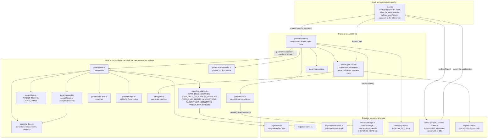

# Design: parent-screen

## 1. Overview

This design covers the grown-ups' screen of **Foamtom: The Haunted Mirror**: an adult gate
(hold a button for 3 seconds), facts worked out from the sessions stored on the device, one
allowed nudge, a plain disclosure that is always visible, and a "Clear all data" button.

The screen reports facts and nothing else. Since 21 Nov 2026 the camera checks only a moving
hand near the mouth (`REQUIRE_SIDE_MATCH` and `REQUIRE_LEVEL_MATCH` are both `false`), so no
sentence on this screen says which side or which teeth were brushed, and none says a zone "was
missed". Every number and sentence comes from one pure function, `parentView`. The screen only
paints what it returns (requirement 13.1).

This spec reuses, and does not redefine: `BrushingSignal`, `SignalSource`, `SessionResult`,
`ZoneResult`, `ZoneId`, the tick rule, every constant in `src/logic/constants.ts`, the storage
schema `foamtom:v1`, `computeVerifiedTime` (`src/logic/stats.ts`), `computeMonsterBook`,
`createStorage`, `DISPLAY_TEXT.back`, and the `VisibilitySource` type of `game-loop.ts`. It
changes no game rule, number, stored value, schema or existing test (requirement 15).

**Key design decisions (each marked "Design choice" where it appears):**

- **New text table, not `DISPLAY_TEXT`.** The parent text lives in a new pure table,
  `src/ui/parent-text.ts`. `tests/display-text.test.ts` pins the exact key set of
  `DISPLAY_TEXT`, and `mirror-and-screens` task 36 extends it for its own `grown-ups` row, so
  this spec adds nothing to that file. The existing "Back" line is reused from it (row 4).
- **`parentView` lives in `src/ui/`, not `src/logic/`.** It imports the text table, and
  nothing under `src/logic/` may import from `src/ui/`. It imports only from `src/logic/` and
  `src/ui/` pure files (requirement 13.3).
- **The screen is a pure model plus a thin painter**, the same split `mirror-and-screens` uses.
  The project has no DOM test library, so decisions (gate, screen phases, clearing) are pure
  functions with named tests, and the painters are checked by source scan and by hand.
- **The gate clock and the frame callback are injected.** The existing guard test
  `tests/mirror-screens-guards.test.ts` fails if `requestAnimationFrame`, `setInterval` or
  `setTimeout` appears (even in a comment) in any file under `src/` except `main.ts` and
  `src/tracking/camera-source.ts`, and this spec may not change that test. So the gate takes a
  `FrameScheduler` and a clock as inputs, and the one `requestAnimationFrame` adapter lives in
  `main.ts`, as the existing scheduler adapter does (requirements 2.6, 12.6).
- **No `Date` in the date maths.** Day arithmetic works on `YYYY-MM-DD` strings with integer
  calendar maths (requirement 3.6). It cannot depend on the time zone of the machine.
- **Only one existing file needs a code change in `src/`**: `src/storage/storage.ts` (the list
  of stored keys, requirement 9.3) and `main.ts` (wiring). One more edit, a `<link>` line in
  `index.html`, needs Dr. Yatin's approval (section 3.1).
- **Every design element carries its requirement's mark.** All fifteen requirements are
  marked **needed for the video**. None is "later". Section 1.2 gives the build order inside
  that set, so the task list builds the pieces the video shows first.

### 1.1 Build marks

Marks come from the requirements' priority table. Every module, behaviour section, test and
table row below carries the mark of the requirements it meets.

| Req | Subject | Mark |
|-----|---------|------|
| 1 | Entry handler and screen shape | needed for the video |
| 2 | Adult gate | needed for the video |
| 3 | Sessions per day, last 7 days | needed for the video |
| 4 | Time with the game, camera saw brushing, timer only | needed for the video |
| 5 | Where brushing was seen least | needed for the video |
| 6 | Too little data | needed for the video |
| 7 | The nudge | needed for the video |
| 8 | Plain disclosure | needed for the video |
| 9 | Clear all data | needed for the video |
| 10 | Wording limits | needed for the video |
| 11 | Display-only text and approval | needed for the video |
| 12 | Comfort and access | needed for the video |
| 13 | `parentView` is pure | needed for the video |
| 14 | Tests | needed for the video |
| 15 | Nothing else changes | needed for the video |

### 1.2 Build order for the 4 Dec video, and the entry-control dependency

Everything is needed for the video, so the order below follows what depends on what. A task
list should keep this order, so that the parts the video shows are the first to exist.

| Stage | What | Depends on | Why this order |
|-------|------|-----------|----------------|
| A | Pure core: `calendar-days`, `parent-constants`, `parent-text`, `parent-accept`, `parent-zone-fact`, `parent-nudge`, `parent-view`, with tests | nothing | The facts, nudge and disclosure are what the video shows. They can be tested with no DOM. |
| B | Storage key list and `clearAllData` | stage A text table (row 24) | "Clear all data" must be correct before a painter can call it. |
| C | Pure gate and screen model: `adult-gate`, `parent-screen-model` | stage A, B | The painters need these. |
| D | Painters and styles: `parent-gate-view`, `parent-screen`, `parent-screen.css`, `index.html` link | stage C, and Dr. Yatin's approval of the link (section 3.1) | The visible screen. |
| E | Wiring in `main.ts`: build the screen, define the one open handler, pass it to the title screen | stage D, and **`mirror-and-screens` tasks 36 to 38** | Nothing opens the screen until the title-screen control exists (section 5.1). |

**Dependency on `mirror-and-screens` tasks 36 to 38.** Those tasks (the `Grown-ups` name, the
`parent` title control, and the control on the title panel with `onOpenParent` on
`SessionScreenHandlers`) are marked **later** in that spec, but this spec is **needed for the
video**. A parent screen that cannot be opened cannot be filmed. Those three tasks must be
moved up to "needed for the video" and built before stage E. This spec does not build, mock or
bypass the control (requirement 1.1), and adds no URL flag or hidden key that opens the screen.

Stages A to D do not depend on tasks 36 to 38. Only stage E does, and stage E may be done by
this spec's tasks (section 5.1): it is one wiring task that edits `main.ts` only.

---

## 2. Architecture



**Data flow.** `main.ts` builds the screen once, with the storage, a `today` reader, a
monotonic clock, the frame adapter and the visibility adapter it already has. The title
control calls `openParent`. `openParent` hides the title screen and calls `parent.open()`.
`open()` reads the sessions through `loadSessions()`, calls `parentView(sessions,
PARENT_VIEW_CONSTANTS, today)` once, keeps the result in the screen model, and shows only the
gate. When the gate passes, the painter builds the facts, the disclosure and the clear button
from that result. Back calls `parent.close()` and then `screen.showStart()`.

**Nothing under `src/logic/` changes or imports from `src/ui/`, `src/tracking/`,
`src/storage/` or `src/audio/`.** The parent files import nothing from `src/tracking/` or
`src/audio/`, so the screen cannot start the camera or make a sound (requirement 1.4).

---

## 3. Module list

One concept per file, kebab-case (`structure.md`). **New** files are added by this spec.
Every row carries a mark (section 1.1); all are needed for the video.

| Module | Status | Mark | Responsibility | Req |
|--------|--------|------|----------------|-----|
| `src/ui/calendar-days.ts` | new, pure | needed for the video | `parseDate(s)`, `daysFromCivil`, `civilFromDays`, `weekdayIndex`, `windowDates(today, n)`, `formatDayRow` inputs. Integer calendar maths on `YYYY-MM-DD`. No `Date`. | 3.1, 3.2, 3.6, 13.2 |
| `src/ui/parent-constants.ts` | new, pure | needed for the video | `GATE_HOLD_SECONDS` (3), `ZONE_FACT_MIN_CAMERA_SESSIONS` (3), `NUDGE_MIN_NIGHTS` (2), `WINDOW_DAYS` (7), `PARENT_VIEW_CONSTANTS` (built from the core constants), `PARENT_TAP_TARGETS`. | 2.1, 5.3, 6.2, 7.3, 12.1, 13.2 |
| `src/ui/parent-text.ts` | new, pure | needed for the video | `PARENT_TEXT`: every approved line and template of this screen (section 6), `ZONE_NAMES`, `WEEKDAY_NAMES`, `MONTH_NAMES`, `JOIN`, `fill(template, values)`. | 5.6, 10, 11, 13.4 |
| `src/ui/parent-accept.ts` | new, pure | needed for the video | `acceptSession(value, constants)`, `acceptedSessions(values, constants)`: the skip rule for odd stored data. | 13.7, 14.15 |
| `src/ui/parent-zone-fact.ts` | new, pure | needed for the video | `zoneFact(windowCameraSessions, constants)`: the sentence or line for "where brushing was seen least". | 5, 6.2, 6.3 |
| `src/ui/parent-nudge.ts` | new, pure | needed for the video | `nightsPerZone(windowSessions, constants)`, `nudge(nights, constants)`. | 7 |
| `src/ui/parent-view.ts` | new, pure | needed for the video | `parentView(sessions, constants, today)`; the types of section 4. Composes the files above and calls `computeVerifiedTime`. | 1.6, 3, 4, 6, 8, 13 |
| `src/ui/adult-gate.ts` | new, pure | needed for the video | `GateState`, `GATE_START`, `gatePress`, `gateRelease`, `gateCancel`, `gateAdvance`, `gateProgress`. | 2.1 to 2.7, 14.11 |
| `src/ui/parent-screen-model.ts` | new, pure | needed for the video | `ParentScreenState` and its pure steps: `openScreen`, `withGate`, `askToClear`, `keepData`, `afterClear`, `closeScreen`. | 1.2, 1.6, 2.2, 9.2, 9.4, 9.5, 9.6 |
| `src/ui/parent-clear.ts` | new | needed for the video | `clearAllData(storage)` returns `'cleared'` or `'failed'`; `clearNotice(outcome)` returns the row 24 text or `null`. No DOM. | 9.3 to 9.5 |
| `src/ui/parent-gate-view.ts` | new, DOM | needed for the video | The gate button: pointer and keyboard events, visibility reset, frame callbacks, progress mark. Takes a clock and a `FrameScheduler`. | 2 |
| `src/ui/parent-screen.ts` | new, DOM | needed for the video | `createParentScreen(deps)` returns `{ open(), close() }`. Builds the header, the gate, and after the gate the facts, the disclosure and the clear controls. Paints `parentView`; decides nothing. | 1, 3 to 9, 12 |
| `src/ui/parent-screen.css` | new | needed for the video | Plain layout, focus marks, gate ring and steps, reduced-motion steps. No `url(`, no `@font-face`, no `infinite`. | 1.7, 2.5, 12 |
| `tests/fixtures/parent-sessions.ts` | new (test helper) | needed for the video | `sessionArb`, `oddSessionArb`, `todayArb`, `fakeBackend`. See section 8. | 14 |

### 3.1 Changes to existing files

Requirement 15.3 allows the storage key list and `main.ts`. Anything else is listed here for
Dr. Yatin to approve before it is built.

| File | Change | Behaviour change? | Approval |
|------|--------|-------------------|----------|
| `src/storage/storage.ts` | Add `export const STORED_KEYS: readonly string[] = [STORAGE_KEY]`. `clearAll()` loops over it, one `try/catch` per key. `STORAGE_KEY`, `saveSession`, `loadSessions` and the types are unchanged. | None today: the list holds one key, so `clearAll` removes the same key. | Allowed by 15.3 |
| `src/main.ts` | Wiring only: build the parent screen, a `FrameScheduler` adapter around `requestAnimationFrame`, `openParent`, and pass `onOpenParent: openParent`. The existing scheduler adapter, the loop and every other handler are not touched. | None | Allowed by 15.3 |
| `index.html` | One line `<link rel="stylesheet" href="/src/ui/parent-screen.css" />`, in the same form as the four that exist. The CSP is not touched. The reason it is a link and not an `import` in TypeScript: `style-src 'self'` in the CSP blocks the `<style>` elements that Vite injects in development. | None | **Confirmed by Dr. Yatin, 22 Nov 2026** (this line only; now on the allowed list of requirement 15.3) |

`mirror-and-screens` files (`title-panel.ts`, `title-model.ts`, `tap-targets.ts`,
`display-text.ts`, `session-screen.ts`, `screens.css`) are **not** edited by this spec. Tasks
36 to 38 of that spec edit them.

---

## 4. TypeScript types

`SessionResult`, `ZoneResult`, `ZoneId`, `SessionMode`, `TimeOfDay` come from
`src/logic/types.ts` and are not redefined. `VisibilitySource` comes from `src/ui/game-loop.ts`
(type import only). `Storage` is the interface of `src/storage/storage.ts` (imported as
`GameStorage` to avoid the DOM global of the same name).

```typescript
// ── src/ui/parent-constants.ts ──
const GATE_HOLD_SECONDS = 3;                       // req 2.1
const ZONE_FACT_MIN_CAMERA_SESSIONS = 3;           // req 6.2
const NUDGE_MIN_NIGHTS = 2;                        // req 7.3
const WINDOW_DAYS = 7;                             // req 3.1 (Decision Q1)

// Passed to parentView so tests can vary them (req 13.2).
interface ParentViewConstants {
  readonly ZONE_DURATION: number;
  readonly SESSION_DURATION: number;
  readonly ZONE_ORDER: readonly ZoneId[];
  readonly REQUIRE_SIDE_MATCH: boolean;
  readonly REQUIRE_LEVEL_MATCH: boolean;
  readonly ZONE_FACT_MIN_CAMERA_SESSIONS: number;
  readonly NUDGE_MIN_NIGHTS: number;
}
// PARENT_VIEW_CONSTANTS: ParentViewConstants is built once from src/logic/constants.ts and the
// two constants above. main.ts passes it; it holds no number of its own for the core values.

interface TapSize { readonly minWidthPx: number; readonly minHeightPx: number }
type ParentTapTargetId = 'gate' | 'clear' | 'confirmClear' | 'keep';   // Back reuses TAP_TARGETS.bookBack
// ── src/ui/calendar-days.ts ──
interface CivilDate { readonly year: number; readonly month: number; readonly day: number }
// parseDate('2026-11-22') -> { year: 2026, month: 11, day: 22 }; null for anything that is not a
// real calendar date in the exact form YYYY-MM-DD (so '2026-02-29' and '2026-1-1' give null).
// windowDates(today, n): the n consecutive dates ending at today, oldest first, or [] if today
// does not parse.

// ── src/ui/parent-view.ts ──
interface DayRow {
  readonly date: string;       // YYYY-MM-DD
  readonly count: number;      // accepted sessions with this date
  readonly text: string;       // row 6, e.g. "Mon 16 Nov: 2"
}
interface DurationLine { readonly seconds: number; readonly text: string }  // seconds: whole, floor
interface DurationsView {
  readonly withGame: DurationLine;      // row 7
  readonly cameraSaw: DurationLine;     // row 8
  readonly timerOnly: DurationLine;     // row 9
}
type ZoneFactKind = 'least' | 'every' | 'not-enough';
interface ZoneFact {
  readonly kind: ZoneFactKind;
  readonly zones: readonly ZoneId[];    // [] unless kind is 'least'; in ZONE_ORDER order
  readonly text: string;                // row 10, 10b, 11 or 12
}
interface Nudge { readonly zone: ZoneId; readonly nights: number; readonly text: string }   // row 14

interface ParentView {
  readonly hasSessions: boolean;             // at least one accepted session in the store
  readonly noSessionsText: string | null;    // row 13 when !hasSessions, else null
  readonly daysHeading: string | null;       // row 5 when hasSessions
  readonly days: readonly DayRow[];          // exactly 7 when hasSessions, else []
  readonly durations: DurationsView | null;  // null when !hasSessions
  readonly zoneFact: ZoneFact | null;        // null when !hasSessions
  readonly nudge: Nudge | null;              // null when none, and always null when !hasSessions
  readonly disclosure: readonly string[];    // six lines (rows 15 to 20); see 5.6 for the true-constant case
  readonly disclosureNeedsApproval: boolean; // true only if a REQUIRE_* constant is true (req 8.4)
}

declare function parentView(
  sessions: readonly unknown[],              // any stored value: odd entries are skipped (req 13.7)
  constants: ParentViewConstants,
  today: string,                             // local YYYY-MM-DD, read once by main.ts (req 13.2)
): ParentView;

// ── src/ui/adult-gate.ts ──
type HoldSource = 'pointer' | 'key';
interface GateState {
  readonly heldSince: number | null;         // clock ms at the press; null when not held
  readonly source: HoldSource | null;
  readonly passed: boolean;                  // in memory only (req 2.2)
}
interface GateProgress { readonly elapsedMs: number; readonly step: number; readonly fraction: number }
// step: whole seconds held, 0 to holdSeconds. fraction: 0 to 1. Both are 0 when not held.

// ── src/ui/parent-screen-model.ts ──
type ParentPhase = 'closed' | 'gated' | 'unlocked';
interface ParentScreenState {
  readonly phase: ParentPhase;
  readonly view: ParentView | null;          // null when closed (req 1.6)
  readonly gate: GateState;
  readonly confirming: boolean;              // the clear confirmation is showing
  readonly notice: string | null;            // row 24 text, or null
}

// ── src/ui/parent-clear.ts ──
type ClearOutcome = 'cleared' | 'failed';

// ── src/ui/parent-gate-view.ts, parent-screen.ts ──
interface FrameScheduler {                    // main.ts adapts the browser's frame callback to this
  request(callback: () => void): () => void;  // returns a function that cancels the request
}
interface ParentScreenDeps {
  readonly root: HTMLElement;
  readonly storage: Pick<GameStorage, 'loadSessions' | 'clearAll'>;
  readonly today: () => string;               // local YYYY-MM-DD; called once per open and once per re-read
  readonly now: () => number;                 // monotonic milliseconds (the gate's clock)
  readonly frames: FrameScheduler;
  readonly visibility: VisibilitySource;      // the one main.ts already has
  readonly onBack: () => void;                // main.ts: parent.close(); screen.showStart()
}
interface ParentScreen { open(): void; close(): void }
```

---

## 5. Behaviour

### 5.1 Entry handler and screen shape (req 1) — needed for the video

**One handler.** `main.ts` builds the parent screen once and defines one function:

```typescript
// main.ts, sketch (wiring only)
const parent = createParentScreen({
  root: app, storage, today: () => localDate(new Date()), now: () => performance.now(),
  frames: { request(cb) { const id = requestAnimationFrame(() => cb()); return () => cancelAnimationFrame(id); } },
  visibility,                                   // the const main.ts already has
  onBack: () => { parent.close(); screen.showStart(); },
});
function openParent(): void { screen.hide(); parent.open(); }     // the one handler
// createSessionScreen(app, { onStart, onOpenBook, onOpenParent: openParent }, ...)
```

`localDate` is the function main.ts already has, so `today` is read once per open, on the
local calendar (requirement 13.2). Like `openBook`, `openParent` is a function declaration, so
it can be passed before `parent` is built. Back mirrors the Monster Book's Back: close, then
`screen.showStart()` (requirement 1.3).

**Can this spec's tasks wire it?** Yes, with one dependency, stated plainly:

- The control itself is `mirror-and-screens` tasks 36 to 38 (not built). Task 38.1 makes
  `title-panel.ts` call an `onParentOpen` handler; task 38.2 adds an optional `onOpenParent`
  to `SessionScreenHandlers` and passes it on. This spec does not design, build or edit
  the control (requirement 1.1).
- This spec's **stage E** task may edit `main.ts` only, to build the screen and pass
  `onOpenParent: openParent`. It **cannot be done before task 38.2**: the object literal given to
  `createSessionScreen` would not type-check with an unknown property. Building the screen and
  `openParent` without passing it would leave `openParent` unused, so it is one task, not two.
- Until then stages A to D are complete and fully tested, and the screen is unreachable. That
  is the same state `mirror-and-screens` task 38.5 describes from its side.
- `main.ts` passes nothing else to the title screen about the parent, and the session screen
  and end card receive no parent handler (requirement 1.5).

**The screen never starts anything.** `parent-screen.ts`, `parent-gate-view.ts`,
`parent-view.ts` and every file they import have no import from `src/tracking/` or
`src/audio/`, no `import(`, no `getUserMedia`, no `fetch`, no `speaker` (requirements 1.4,
12.6). A source-scan test enforces this (test 17).

**Open sequence.** `parent.open()`:

1. `sessions = storage.loadSessions()` (never throws; a blocked or unreadable store gives `[]`,
   requirement 1.6).
2. `view = parentView(sessions, PARENT_VIEW_CONSTANTS, today())`. `sessions` is then dropped.
3. State `openScreen(view)`: phase `gated`, gate reset, no notice, no confirmation.
4. The painter builds the header and the gate **only**. No fact, no disclosure line and no
   clear button exists in the DOM, so a screen reader cannot reach them (requirement 1.2).
   Focus goes to the gate button.

**Close sequence.** `parent.close()` cancels the frame request, removes every listener
(including the visibility subscription), empties the screen's children, hides the section and
sets the state to `closeScreen()`. That state holds no view, a fresh gate and no notice, so
nothing from the sessions survives (requirements 1.6, 2.2).

**Layout (requirement 1.7).** One column: header (Back and the heading), then the gate, then
after the gate the contents. Headings, short lines of text, numbers, buttons. No fog, no
flicker, no monster, no sound. The only motion is the gate's progress mark (section 5.2).

### 5.2 Adult gate (req 2) — needed for the video

**Pure state machine, `adult-gate.ts` (requirements 2.1 to 2.4, 2.6, 2.7).**

```
GATE_START = { heldSince: null, source: null, passed: false }

gatePress(state, source, nowMs):
  if state.passed or state.heldSince != null: return state          # one hold at a time
  return { heldSince: nowMs, source, passed: false }

gateAdvance(state, nowMs, holdSeconds):
  if state.passed or state.heldSince == null: return state
  if max(0, nowMs - state.heldSince) >= holdSeconds * 1000: return { ...state, passed: true }
  return state

gateRelease(state, source):                  # finger up, pointer cancel or leave, key up
  if state.passed: return state
  if state.source != source: return state    # a key up cannot end a pointer hold, and the reverse
  return GATE_START                          # the hold is lost: elapsed time is forgotten

gateCancel(state):                           # focus lost, tab hidden
  return state.passed ? state : GATE_START

gateProgress(state, nowMs, holdSeconds):
  if state.heldSince == null and not state.passed: return { elapsedMs: 0, step: 0, fraction: 0 }
  elapsed = state.passed ? holdSeconds * 1000 : min(holdSeconds * 1000, max(0, nowMs - state.heldSince))
  return { elapsedMs: elapsed, step: floor(elapsed / 1000), fraction: elapsed / (holdSeconds * 1000) }
```

The state keeps no total across holds, only the start of the current one, so several short
holds can never add up to three seconds (requirement 2.4). `max(0, ...)` keeps a clock that
steps backwards from giving a negative time. The hold seconds are an argument, so tests can
try other values, and `GATE_HOLD_SECONDS` (3) is what the painter passes.

> **Design choice (release after the time is up).** When the finger is lifted, the painter
> first calls `gateAdvance(state, now())` and then `gateRelease`. A parent who holds for 3.01
> seconds and lifts before the next frame callback still passes, because the hold was unbroken
> for three seconds. `gateRelease` on a passed gate changes nothing.

**Painter, `parent-gate-view.ts` (requirements 2.3 to 2.9).**

- **Button.** One `<button type="button">` with a class `gate-button`, at least
  `PARENT_TAP_TARGETS.gate` (160 x 72, so at least 48 px). Its visible label is row 3
  ("Hold"); the instruction line (row 2) is a visible paragraph next to it. The accessible name
  is made from both with `aria-labelledby="<label id> <instruction id>"`, so no string is added
  (requirement 2.8). The gate is text with an icon (a hand-shaped glyph from the system font
  or a CSS shape) and is never spoken (requirement 2.9).
- **Pointer.** `pointerdown` (primary pointer only) releases the browser's implicit touch
  capture (`releasePointerCapture`), so that `pointerleave` fires if the finger slides off the
  button, then calls `gatePress(state, 'pointer', now())`. `pointerup`, `pointercancel` and
  `pointerleave` release. `contextmenu` is cancelled, so a long press on a phone cannot open a
  menu that would cancel the hold. The CSS sets `touch-action: none`, `user-select: none` and
  `-webkit-touch-callout: none` on the button.
- **Keyboard (the accessible path, requirement 2.7).** `keydown` of Space or Enter, ignoring
  auto-repeat (`event.repeat`), presses with source `key` and cancels the browser's click.
  `keyup` of the same keys releases. A visible `:focus-visible` outline is in the CSS.
  Nothing else is added (Decision Q12: no second gate). A screen reader's "activate" command
  sends a click, not a held key, so a screen-reader user holds the key as a keyboard user does.
- **Lost focus and hidden tab.** `blur` and a `VisibilitySource` change to hidden call
  `gateCancel` (requirement 2.4).
- **Clock and frames (requirement 2.6).** The painter reads `deps.now()` for every press and
  every frame, never `event.timeStamp`, so there is one clock and a fake clock controls
  everything. While held it asks `deps.frames.request(...)` for a callback; each callback
  runs `gateAdvance`, paints the progress, and requests the next one until the hold ends or
  passes. When `passed` becomes true the painter cancels the frame request, calls the screen's
  `onPassed`, and the screen model moves to `unlocked`. Neither `setInterval` nor `setTimeout`
  appears in any file of this spec, and the frame callback itself exists only in `main.ts`.
- **Progress mark (requirement 2.5).** Colour is not the only signal. The button holds a ring
  and three small dots. The painter writes `data-step` (0 to 3) on the button and
  `--gate-fraction` (0 to 1) with `style.setProperty`. In CSS:
  - **Motion allowed:** the ring fills clockwise from 0 to a full circle as `--gate-fraction`
    rises, and the dots fill from hollow to solid one by one as `data-step` rises.
  - **`prefers-reduced-motion: reduce`:** a CSS media query hides the smooth ring and shows only
    the dots, which change in three whole steps (still shown, requirement 2.5).
  - The mark only ever grows while a hold lasts and resets to empty on release. Nothing blinks,
    so nothing can flash at three times a second or more.
  - The mark is shapes (a fill and a count of solid dots), so a grayscale or colour-blind view
    still shows it. It carries no text, so it adds no line to the approval table.

**What the gate does not do.** It stores nothing (no `localStorage`, no cookie), has no PIN or
password, and shows no error or message on an early release (requirements 2.2, 2.4). It is
forgotten when the screen closes because the state returns to `GATE_START` (requirement 2.2).

### 5.3 The window, and which stored sessions count (req 3, 13.7) — needed for the video

**Window (requirements 3.1, 3.6).** `windowDates(today, WINDOW_DAYS)` returns the seven dates
from six days before `today` up to `today`, oldest first, using integer maths:

```
parseDate(s):    exactly YYYY-MM-DD, month 1..12, day 1..daysInMonth(year, month); else null
daysFromCivil(y, m, d):  days since 1970-01-01 (the standard proleptic Gregorian algorithm,
                         integers only: era = floor(y' / 400), yoe, doy, doe)
civilFromDays(n):        the inverse
windowDates(today, n):   p = parseDate(today); if null -> []
                         base = daysFromCivil(p); return [base - (n-1) .. base].map(civilFromDays -> string)
weekdayIndex(days):      ((days + 4) mod 7 + 7) mod 7      # 0 = Sunday; 1970-01-01 was a Thursday
```

No `Date`, no `Intl`, no clock, no time zone: the same `today` gives the same rows on any
machine. A known anchor in the tests: 2026-11-16 is a Monday (it matches the approved example
"Mon 16 Nov: 2").

**Which stored sessions count: `acceptSession` (requirement 13.7, Decisions Q11, N4).**
`parentView` takes `readonly unknown[]`, because `loadSessions()` checks only the top level of
each stored session. A value is **accepted** only if all of these hold, and is otherwise
skipped. A skipped session counts nowhere: not in a day row, not in a duration, not in the
zone fact, not in the nights, not toward "has sessions".

1. It is a plain object, and `date` is a string that `parseDate` accepts.
2. `timeOfDay` is `morning`, `night` or `neither`; `mode` is `camera` or `timer-only`.
3. `startedAt` is a finite number; `monstersEarned` is an array of strings (a missing field is
   a skip, requirement 13.7).
4. `durationSeconds` is a whole number from 0 to `SESSION_DURATION`.
5. `zoneResults` is an array with one entry per zone of `ZONE_ORDER`, each `zoneId` present
   once, and each entry has `monsterId` (string), `verified` (boolean), `monsterOutcome` (one of
   the three), and `secondsBrushed` and `secondsUntracked` as whole numbers from 0 to
   `ZONE_DURATION`.
6. The sum of `secondsBrushed + secondsUntracked` over all its zone results is at most
   `durationSeconds` (Decision N4).

> **Readings of requirement 13.7** (the design's reading; see section 10). Whole numbers and
> "one entry per zone, each once" are what make the ceilings of requirement 4.4 true for every
> accepted session: with four entries of at most 30, no session can report more than 120
> seconds of brushing. Whole numbers also keep sums exact, so the output cannot depend on the
> order of the sessions (requirement 13.5). `durationSeconds` above `SESSION_DURATION` is
> treated as out of range, because the constant is passed in for this purpose (requirement
> 13.2).

`parentView` applies `acceptedSessions`, then `windowSessions = accepted.filter(date in window)`.
The window is a `Set` of the seven date strings.

### 5.4 The facts (req 3 to 6) — needed for the video

`parentView` builds these in this order. Every sentence comes from `PARENT_TEXT` with only
numbers, dates and zone names filled in (requirement 13.4).

**No sessions (requirement 6.1).** If no session is accepted (or `today` does not parse),
`hasSessions` is false, `noSessionsText` is row 13 ("No sessions yet."), and `daysHeading`,
`days`, `durations`, `zoneFact` and `nudge` are empty or `null`. The disclosure is still
returned. A store holding only skipped sessions gives this view.

**Day rows (requirements 3.1 to 3.5).** When `hasSessions`, `daysHeading` is row 5 and `days`
has exactly seven entries, one per date of the window, oldest first. `count` is the number of
**accepted** sessions with that `date`, whatever their mode and time of day. A day with none has
`count` 0 and the text "…: 0", not a blank. Sessions dated after today, or before the seventh
day, appear in no row. The row text is row 6: `<weekday> <day> <month>: <n>`, built with
`WEEKDAY_NAMES`, `MONTH_NAMES` (three-letter English names, like "Mon" and "Nov" in the
approved example) and the day number without a leading zero. A row carries no streak, total,
target, rating word or colour (requirement 3.5).

> **Consequence of the requirements.** If sessions exist but none is in the seven days, the
> screen shows seven rows of 0, three durations of "0 min 0 s", and row 12 for the zone fact.
> That is what requirements 3.3, 4.1 and 6.1 say, because "no sessions" means none stored.

**Durations (requirement 4).** Over `windowSessions`:

```
withGame   = floor( Σ durationSeconds )                         of all window sessions
cameraSaw  = computeVerifiedTime(windowSessions)                # unchanged, from stats.ts (4.2)
timerOnly  = floor( Σ durationSeconds )                         of the window sessions with mode 'timer-only'
```

`computeVerifiedTime` already counts `secondsBrushed` of verified zones of camera-mode sessions
only, so timer-only sessions and unverified zones add 0 (requirement 4.3). No fourth line, no
remainder, no percentage, no comparison (requirements 4.1, 4.6). Each is shown as whole minutes
and seconds, `m = floor(total / 60)`, `s = total mod 60` (requirement 4.5); the rows are
rows 7, 8 and 9. The ceilings of requirement 4.4 follow from acceptance: each verified zone
contributes at most 30, a camera session at most four zones, and the sum of brushed and
untracked seconds is at most that session's `durationSeconds`.

> **Design choice.** The totals are floored, not each session. With whole-number seconds the
> two are equal. Flooring keeps "camera saw" plus "timer only" at or below "time with the game"
> even if a stored value were not whole.

**Zone fact (requirements 5, 6.2, 6.3), `zoneFact(...)`.** From the camera-mode accepted
sessions of the window only (requirement 5.1):

```
cameraSessions = windowSessions where mode == 'camera'
if cameraSessions.length < ZONE_FACT_MIN_CAMERA_SESSIONS:  return { kind: 'not-enough', text: row 12 }   # 5.5, 6.2
for each zone z:  n[z] = count of verified results;  sum[z] = Σ max(0, ZONE_DURATION - brushed - untracked)
if Σ n == 0:                                              return { kind: 'not-enough', text: row 12 }   # 5.8
best = the largest average sum[z] / n[z] among zones with n[z] > 0, compared exactly by cross-multiplying
if best == 0:                                             return { kind: 'every',      text: row 11 }   # 5.4
zones = every zone with an average equal to best, in ZONE_ORDER order
if one zone:  row 10  "Brushing was seen least during the <zone> turn."                                 # 5.3
else:         row 10b "Brushing was seen least during the <zones> turns."   (names joined by JOIN)
```

The measure is the same one `src/logic/stats.ts` uses (`max(0, ZONE_DURATION - secondsBrushed -
secondsUntracked)`, averaged over verified results), computed here over the window because
`zoneMostMissed` takes all sessions and `stats.ts` is not changed (requirement 5.2). Timer-only
sessions and unverified results never enter `n` or `sum` (requirement 5.1). A zone with no
verified result is never named (requirement 6.3), and 0 is never shown as a finding.

**Joining names (row 10b, Decision N5).** `JOIN` holds the two pieces, `', '` and `' and '`.
Names are in `ZONE_ORDER` order. Two names: `a and b`. Three: `a, b and c`. Four: `a, b, c and d`.
No comma before "and". The approved examples are pinned by test 5.

Zone names are `upper-right`, `upper-left`, `lower-left`, `lower-right` (`ZONE_NAMES`, row 25),
and the template puts the hyphen-ed name directly before the word "turn" (requirement 5.6). The
words "missed", "skipped" and "not brushed" appear in no template (requirement 10.4).

**Too little data lines (requirement 6).** Rows 12 and 13 do not blame, urge or advise
(requirement 6.4). They are the only lines in their cases.

### 5.5 The nudge (req 7) — needed for the video

`nightsPerZone(windowSessions, constants)` and `nudge(nights, constants)`.

```
for each accepted session s in the window with mode 'camera' and timeOfDay 'night':
  for each zone result zr of s with zr.verified:                      # unverified neither counts nor blocks (7.2, 7.4)
      cell = byZone[zr.zoneId][s.date]   (create if missing)
      cell.sawBrushing = cell.sawBrushing OR (zr.secondsBrushed > 0)
nights[z] = number of dates d where cell[z][d] exists AND NOT cell.sawBrushing
```

- A day is a night for a zone only if at least one qualifying night session has a **verified**
  result for it, **and** every such result has `secondsBrushed === 0`. One night session that
  saw brushing in that zone blocks the day. A day whose night sessions are all unverified for
  the zone never counts (requirement 7.2, Decision N2).
- Untracked seconds do not make a night. A session with untracked seconds and `secondsBrushed`
  above 0 never gives a night.
- Two night sessions on one date give at most one night, because the unit is the date.
- Timer-only sessions and unverified results are never read (requirement 7.4).

```
nudge(nights):
  top = max over ZONE_ORDER of nights[z]
  if top < NUDGE_MIN_NIGHTS: return null
  zone = the first zone in ZONE_ORDER with nights[zone] == top           # tie goes to ZONE_ORDER
  return { zone, nights: top, text: row 14 filled with ZONE_NAMES[zone] and top }
```

`top` is at least 2, so "nights" is always plural (Decision Q8). Row 14 is the sentence
Dr. Yatin approved on 22 Nov 2026 (`dental-rules.md`): only the zone name and the number
change. The nudge has no minimum number of camera sessions (requirement 7.5, Decision N1), so
it can appear while the zone fact says "Not enough camera sessions yet." It is computed
separately from the zone fact and may name a different zone (requirements 5.7, 7.6). With no
sessions it is `null`, and after "Clear all data" it is `null` because the view is rebuilt
from no sessions. The painter draws it as a plain paragraph: no icon, bell, badge, colour or
sound (requirement 7.8), and the screen is behind the gate, so the child does not see it.

### 5.6 Plain disclosure (req 8) — needed for the video

`parentView.disclosure` is the six lines of rows 15 to 20, in that order, in **every** data
state (no sessions, too little data, enough data, after clearing). The painter draws them as a
list inside the unlocked screen, not collapsed and not behind a tap (requirement 8.1). The
lines are copied from the approved table and `parentView` never rewords them (requirement
8.3). The original line 6 (the `REQUIRE_LEVEL_MATCH` condition) is not in the table and not in
the code (requirement 8.2). The disclosure contains no number: it does not state 15, 20, 36 or
9 (requirement 8.5).

**When a `REQUIRE_*` constant is true (requirement 8.4).** Line 3 is true only while both
`REQUIRE_SIDE_MATCH` and `REQUIRE_LEVEL_MATCH` are `false`. If either passed-in constant is
`true`, `parentView` leaves line 3 out of `disclosure` and sets `disclosureNeedsApproval` to
`true`, so a false line is never shown. Test 8 also reads the real constants in
`src/logic/constants.ts` and fails if either is `true`, with the message that Dr. Yatin must
approve new wording for line 3. The build therefore fails loudly before a false line can ship;
the omitted line is only a second safety.

> **Design choice.** The alternative, always returning line 3, would show a false sentence
> whenever a constant is flipped and no one reads the test output. Leaving it out and failing
> the test shows the problem and shows nothing false.

### 5.7 Clear all data (req 9) — needed for the video

**Stored keys (requirement 9.3).** `src/storage/storage.ts` gets `STORED_KEYS`
(`[STORAGE_KEY]`, that is `['foamtom:v1']`), and `clearAll()` removes every key in it, each in
its own `try/catch`, so one failing key does not stop the others. `saveSession` keeps writing
`STORAGE_KEY`. Storing and clearing therefore read one list. The existing storage tests are
not touched and pass, because with one key the behaviour is identical. A guard test (test 14)
fails if any file under `src/` calls `setItem` with a key outside `STORED_KEYS`.

**`clearAllData(storage)` (requirements 9.4, 9.5).**

```
clearAllData(storage):
  try { storage.clearAll() } catch { }            # clearAll does not throw; this is a second net
  try { remaining = storage.loadSessions().length } catch { remaining = 0 }
  return remaining > 0 ? 'failed' : 'cleared'

clearNotice(outcome): outcome == 'failed' ? PARENT_TEXT['clear-failed'].text  (row 24) : null
```

**Screen flow, as `parent-screen-model.ts` steps:**

1. The "Clear all data" button (row 21) calls `askToClear`. The state gets `confirming: true`.
   **Nothing is removed.** The painter shows one confirmation: the question (row 22) and two
   buttons, "Clear all data" (row 21, the clearing button) and "Keep" (row 23). Focus goes to
   "Keep", the safe default.
2. "Keep" calls `keepData`: `confirming: false`, nothing removed, focus back on the clear button.
3. The clearing button calls the screen's clear handler once. There is no second confirmation
   (requirement 9.2): it runs `clearAllData(storage)`, then reads the sessions again, builds a new
   view with `parentView(...)` and the same `today`, and calls `afterClear(state, outcome,
   newView)`, which sets `confirming: false`, `view: newView` and `notice: clearNotice(outcome)`.
4. **Cleared:** the new view has no accepted session, so the painter shows row 13 ("No sessions
   yet."), no nudge, and the disclosure (requirement 9.4). **Failed:** sessions can still be
   read, so the new view still shows them, and the painter shows row 24 ("The data on this
   phone could not be cleared.") instead of any claim of clearing (requirement 9.5).

**Nothing else keeps a copy (requirement 9.4).** The Monster Book reads `loadSessions()` every
time it opens, and kind proximity and rare eligibility are worked out from `loadSessions()`
every time a session starts (core requirement 14.7). No file keeps sessions in memory. Test 13
checks these through the real functions on an emptied backend (`computeMonsterBook`,
`computeMissScores`, `isRareEligibleForNewSession`).

**Before the gate (requirement 9.6).** The clear button and the confirmation are built only
after the gate passes, so they are not in the DOM, not reachable by keyboard and not read by a
screen reader before then. `askToClear` does nothing unless the phase is `unlocked`.

### 5.8 Screen structure, comfort and access (req 12) — needed for the video

```
section.screen.parent                       (hidden while closed)
  header.parent__header
    button.icon-button.parent__back         icon + "Back" (DISPLAY_TEXT.back), size TAP_TARGETS.bookBack
    h1#parent-title[tabindex=-1]            row 1 "Grown-ups"
  section.parent-gate[aria-labelledby=gate-instruction]      removed after the gate passes
    p#gate-instruction                      row 2
    button.gate-button[aria-labelledby="gate-label gate-instruction"]
      span.gate__ring, span.gate__dot x3, span#gate-label row 3
  div.parent-content                        built only after the gate passes
    section.parent-facts[aria-labelledby=days-heading]       only if the view hasSessions
      h2#days-heading                       row 5
      ul.parent-days > li x7                row 6 each
      p x3                                  rows 7, 8, 9
      p                                     the zone fact (row 10, 10b, 11 or 12)
      p                                     the nudge (row 14), only if present
    p.parent-empty                          row 13, only if !hasSessions
    p.parent-notice[role=status]            row 24, only after a failed clear
    section.parent-disclosure[aria-labelledby=parent-title]  six list items
    section.parent-clear
      button.parent-clear__button           row 21 + icon
      div.parent-clear__confirm[role=group] row 22, "Clear all data" (row 21), "Keep" (row 23); only while confirming
```

- **Targets (requirement 12.1).** Every button has a `min-width` and `min-height` from
  `PARENT_TAP_TARGETS` (gate 160 x 72, clear 160 x 56, confirm-clear 96 x 48, keep 96 x 48) or
  `TAP_TARGETS.bookBack` (96 x 48) for Back. All are at least 48 x 48. The painter applies them
  with `style.minWidth` and `style.minHeight` (a CSS property write, allowed by the CSP).
- **Portrait, one hand, landscape, desktop (requirement 12.2).** One column that scrolls
  vertically (`overflow-y: auto`). Back is in the header and "Clear all data" is the last
  control, both reachable by scroll and by keyboard. At 360 px width nothing needs sideways
  scrolling. The layout is checked by hand (manual M2).
- **Colour and contrast (requirement 12.3).** `parent-screen.css` defines `--parent-fg` and
  `--parent-bg` as 6-digit hex colours; test 15 requires a ratio of at least 4.5. Nothing is
  rated by colour: day rows, durations, the nudge and the disclosure are plain text.
- **Keyboard and headings (requirement 12.4).** Every control is a `<button>` with a
  `:focus-visible` outline. After the gate passes, focus moves to `h1` so a screen reader starts
  at the top. `h1` is row 1 and `h2` is row 5; the gate, the facts and the disclosure are
  `<section>` landmarks named from approved lines already on the screen (the instruction line,
  the days heading and the `h1`), so a screen-reader user can move between them without a
  single new word (see the note in section 10).
- **Flash and motion (requirements 12.5, 2.5).** The only moving thing is the gate progress
  mark. The CSS has no `animation` and no `infinite`, and the reduced-motion media query turns
  the ring into steps.
- **No timers (requirement 12.6).** Section 5.2; test 17 scans every new file.

### 5.9 Wording and text (req 10, 11) — needed for the video

All text is **display-only**: shown, never spoken, never in `src/audio/lines.ts` (requirement
11.1; the core wording guard bans "camera" there). It lives in `PARENT_TEXT`, a new table in
`src/ui/parent-text.ts`, with one row per approved line (section 6). The code holds no other
parent-facing string except the numbers, dates, weekday and month names and zone names that
templates fill in (requirement 11.4). A new test covers the table (requirement 11.2), so no
existing test is changed.

```typescript
// src/ui/parent-text.ts (shape)
interface ParentTextRow { readonly id: ParentTextId; readonly row: string; readonly text: string }
// `row` is the number in "Lines for Dr. Yatin to approve": '1', '2', ..., '10b', ..., '25'.
// `text` may hold {placeholders}: {weekday} {day} {month} {n} {m} {s} {zone} {zones}.
fill(text, values)        // replaces each {name}; throws in tests if a placeholder is unfilled
```

The wording limits are enforced by test 10 (banned stems, urging phrases, digit runs, link
characters) over the whole table and over every sentence `parentView` returns for generated
sessions, plus a template check that each returned sentence is one of the approved templates
with only allowed fills (requirements 10.1 to 10.6, 14.7).

### 5.10 Privacy, storage, network, timers (req 1.4, 12.6, 15) — needed for the video

- Reads sessions only through `loadSessions()`. Writes nothing except through
  `storage.clearAll()`. No frame, landmark or measurement is read, stored or logged.
- No network call, no cookie, no `console`, no third-party file, no ``, no font, no
  `url(`. Styles are one same-origin stylesheet plus `element.style` and `setProperty`.
- No `setInterval` or `setTimeout` in any file of this spec. The frame callback is injected, and
  its only adapter is in `main.ts`. `src/ui/game-loop.ts` stays the only module that owns a
  timer.
- The gate holds its state in memory only. Closing the screen resets it.

---

## 6. Wording: every line, and where it lives

Every row of "Lines for Dr. Yatin to approve" is approved (22 Nov 2026) and is used word for
word. This design adds **no** parent-facing text. "Shown" means visible; nothing is spoken.

| Row | Text (as approved) | Code id in `PARENT_TEXT` | Shown by |
|-----|--------------------|--------------------------|----------|
| 1 | Grown-ups | `heading` | `parent-screen.ts`, `h1` |
| 2 | Hold the button for 3 seconds. | `gate-instruction` | `parent-gate-view.ts`, instruction line |
| 3 | Hold | `gate-label` | `parent-gate-view.ts`, button label |
| 4 | Back | `DISPLAY_TEXT.back` (existing, not duplicated) | `parent-screen.ts`, Back |
| 5 | Sessions in the last 7 days | `days-heading` | `parent-screen.ts`, `h2` |
| 6 | `<weekday> <day> <month>`: `<n>` | `day-row` = `{weekday} {day} {month}: {n}` | `parentView.days[i].text` |
| 7 | Time with the game: `<m>` min `<s>` s | `time-game` | `parentView.durations.withGame.text` |
| 8 | Of that, the camera saw brushing: `<m>` min `<s>` s | `time-camera` | `durations.cameraSaw.text` |
| 9 | Timer only, not checked by the camera: `<m>` min `<s>` s | `time-timer` | `durations.timerOnly.text` |
| 10 | Brushing was seen least during the `<zone>` turn. | `zone-least-one` | `zoneFact.text` |
| 10b | Brushing was seen least during the upper-left and lower-left turns. (three: …upper-right, upper-left and lower-left turns.) | `zone-least-many` = `Brushing was seen least during the {zones} turns.` and `JOIN` | `zoneFact.text` |
| 11 | Brushing was seen in every turn. | `zone-every` | `zoneFact.text` |
| 12 | Not enough camera sessions yet. | `zone-not-enough` | `zoneFact.text` |
| 13 | No sessions yet. | `no-sessions` | `parentView.noSessionsText` |
| 14 | During the `<zone>` turn, brushing was not seen on `<n>` nights. Try brushing it first tonight. | `nudge` | `parentView.nudge.text` |
| 15 | The camera picture stays on this phone. It is never saved or sent. | `disclosure-1` | `parentView.disclosure[0]` |
| 16 | Brushing times and the Monster Book are saved on this phone only, until you press Clear all data. | `disclosure-2` | `disclosure[1]` |
| 17 | The camera sees a moving hand near the mouth. It cannot see the brush, the teeth, or which part of the mouth is being brushed. | `disclosure-3` | `disclosure[2]` |
| 18 | In camera sessions, monsters get weaker in turns where brushing was often not seen. | `disclosure-4` | `disclosure[3]` |
| 19 | A monster that is nearly beaten when the time is up counts as beaten. | `disclosure-5` | `disclosure[4]` |
| 20 | Every monster your child meets goes into the Monster Book, beaten or not. | `disclosure-6` | `disclosure[5]` |
| 21 | Clear all data | `clear-button` | `parent-screen.ts`, the button and the clearing button of the confirmation |
| 22 | Clear all data from this phone? It cannot be undone. | `clear-confirm` | `parent-screen.ts`, confirmation |
| 23 | Keep | `clear-keep` | `parent-screen.ts`, confirmation |
| 24 | The data on this phone could not be cleared. | `clear-failed` | `parent-screen.ts`, notice (via `clearNotice`) |
| 25 | upper-right, upper-left, lower-left, lower-right | `ZONE_NAMES` | fills rows 10, 10b, 14 |

The title screen keeps its own privacy line ("The camera stays on this phone. Nothing is
saved or sent."), which is `DISPLAY_TEXT.privacy` and not part of this table.

Weekday and month names (`Mon`, `Nov`, …) and the day number are the date parts that row 6
fills in (requirement 11.4: "numbers, dates"). They are not sentences.

---

## 7. Error handling

| Condition | Behaviour | Req |
|-----------|-----------|-----|
| `localStorage` blocked or unreadable | `loadSessions()` returns `[]`; the screen shows row 13 and the disclosure; no error message | 1.6, 6.1 |
| Stored session with a bad number, a missing field, wrong zones, or zone seconds above its duration | Skipped everywhere; the rest is shown as if it were not stored | 13.7, 14.15 |
| Store holds only skipped sessions | Row 13, as for no sessions | 13.7, 6.1 |
| `today` does not parse as a calendar date | `parentView` returns the no-sessions view and does not throw; `main.ts` always passes a valid date, so this is a safety net | 13.2 |
| Sessions exist but none in the last 7 days | Seven rows of 0, three durations of "0 min 0 s", row 12 for the zone fact | 3.3, 4.1, 6.2 |
| Gate hold ends early (finger up, pointer cancelled or leaves, key up, focus lost, tab hidden) | Hold resets to zero; no message; short holds never add up | 2.4 |
| Long press opens a context menu or selects text | `contextmenu` cancelled; `touch-action: none` and `user-select: none` on the button | 2.4 |
| Clock steps backwards during a hold | `max(0, …)` gives zero elapsed time; no early pass | 2.6 |
| The browser has no frame callback | `main.ts` adapter has nothing to call; the gate cannot pass and Back still works. Not expected in any browser the game supports | 2.6 |
| A key and a pointer are used together | One hold at a time; a key up cannot end a pointer hold, nor the reverse | 2.3, 2.4 |
| Screen reader "activate" (a click, no hold) | The gate does not open; the keyboard hold is the accessible path | 2.7 |
| Tab hidden while the screen is open and unlocked | The gate stays passed for this opening; closing the screen resets it. Facts are read at open, not again | 2.2 |
| `removeItem` throws, or the key stays | `clearAllData` returns `'failed'` when sessions can still be read; row 24 is shown, no claim of clearing | 9.5 |
| Clearing works but another tab saves a session at once | The re-read finds it and the screen reports `'failed'` honestly; nothing claims more than is true | 9.5 |
| A `REQUIRE_*` constant is `true` | Line 3 left out, `disclosureNeedsApproval` true, test 8 fails | 8.4 |
| Back pressed before the gate | Back is always shown; it closes the screen and returns to the title screen | 1.2, 1.3 |
| Parent screen opened with a session not running | The only way in is the title control; no session, camera or sound is active | 1.4, 1.5 |

---

## 8. Testing strategy

Tests live in `/tests/`, with Vitest and fast-check. Every decision made from data is a pure
function with a named test. The project has no DOM library and this spec adds none, so the
painters (`parent-gate-view.ts`, `parent-screen.ts`) are checked by source scan and by hand,
and what they paint is decided by pure models, as in `mirror-and-screens`.

**Helpers.** The requirements name an existing `sessionResultArb`, but no shared arbitrary
exists: each test file builds its own (`tests/stats.test.ts` says "no shared helper file"). This
spec needs the same generators in several files, so it adds one fixture file,
`tests/fixtures/parent-sessions.ts` (the folder `tests/fixtures/` exists):

- `sessionArb(todayDates)`: a valid `SessionResult` with an arbitrary `mode`, `timeOfDay`,
  `verified` flags (not tied to untracked seconds, so the properties do not lean on core rule
  9.3), seconds from 0 to 30 per zone with brushed plus untracked at most 30, exactly four zone
  results in `ZONE_ORDER`, `durationSeconds` 120, and a `date` drawn from the window, the days
  just outside it, and a future day.
- `oddSessionArb`: a session with one defect chosen from: a second count below 0 or above 30, a
  missing field, a negative `durationSeconds`, zone seconds summing above `durationSeconds`, a
  repeated or missing zone, a bad date, a non-whole number; plus values that are not objects.
- `todayArb`: dates around month ends, a leap day and a year end.
- `fakeBackend()`: a `Map`-backed `StorageBackend`, with switches to make `getItem`, `setItem`
  or `removeItem` throw.
- A fake clock and a fake `FrameScheduler` that run queued callbacks when the test says so.

The oracles used by tests 3, 4 and 5 are written separately from the code under test, with
plain loops over days and zones, and never call `parentView`.

| # | Test name | File | Req | Input | Assertion |
|---|---|---|---|---|---|
| 1 | `calendarDays` | `calendar-days.test.ts` | 3.1, 3.6, 13.2 | Dates over several years, leap days, month and year ends, invalid strings | `daysFromCivil` and `civilFromDays` are inverses; `windowDates(today, 7)` is 7 consecutive dates ending at `today`, oldest first; 2026-11-16 is a Monday; `'2026-02-29'`, `'2026-13-01'`, `'2026-1-1'`, `''` give `null` and `[]`; the file has no `Date`, `Intl`, `toLocale` or `getTimezoneOffset` |
| 2 | `parentViewSevenDays` | `parent-view.test.ts` | 3.1 to 3.6, 14.4 | Any valid sessions, any `today` | Exactly 7 rows, consecutive, ending today; each `count` equals the number of stored sessions with that date, of any mode or time of day; a day with none shows count 0 and a text ending ": 0"; sessions outside the 7 days appear in no row, duration, zone fact or night; with no sessions there are no rows; no row text holds a rating word |
| 3 | `parentViewTimeFacts` | `parent-view.test.ts` | 4.1 to 4.6, 14.1 | Any valid sessions | `withGame`, `cameraSaw` and `timerOnly` equal an independent sum over the window's sessions; `cameraSaw` equals `computeVerifiedTime` of the window; `cameraSaw` is at most 30 per verified zone result, at most 120 per camera session and at most `withGame`; `cameraSaw + timerOnly <= withGame`; the text is "`m` min `s` s" with `s` from 0 to 59; three durations and nothing else |
| 4 | `parentViewTimerAndUnverifiedNeverCount` | `parent-view.test.ts` | 4.3, 5.1, 7.4, 14.2 | Any sessions; then the same plus any number of timer-only sessions; then with any zone result set to unverified | Adding timer-only sessions never raises `cameraSaw`, never changes the zone fact, never makes a nudge appear; setting a zone result to unverified never raises `cameraSaw` and never creates a nudge or a named zone from that result |
| 5 | `parentViewZoneFact` | `parent-zone-fact.test.ts` | 5.1 to 5.8, 6.2, 6.3, 14.5, 14.6 | Any sessions, and hand-built ties | Fewer than 3 camera sessions in the window gives row 12 and no zone; 3 or more camera sessions with no verified result gives row 12 and no zone; 3 or more with every verified result seen fully gives row 11 and no zone; otherwise the named zones are exactly those with the highest average of unseen seconds (an independent oracle), in `ZONE_ORDER` order; one highest positive zone equals `zoneMostMissed` over the window's sessions; ties give the approved forms for two ("upper-left and lower-left"), three ("upper-right, upper-left and lower-left") and four zones, "and" before the last name, no comma before "and"; a zone whose average is 0 is never named; timer-only sessions and unverified results never change it; text never holds "missed", "skipped" or "not brushed" |
| 6 | `parentViewNudge` | `parent-nudge.test.ts` | 7.1 to 7.8, 14.3 | Any sessions, with several night sessions per day | When a nudge is returned: its zone and `nights` equal an independent count by rule 7.2; `nights >= NUDGE_MIN_NIGHTS`; the zone has the most nights, a tie going to the first in `ZONE_ORDER`; the text equals the approved sentence with only the zone name and the number replaced. When no zone has 2 nights, none is returned. Two night sessions on one day give at most one night. A day where any verified night session has `secondsBrushed > 0` for the zone never counts for it. An unverified night session neither counts nor blocks; a day with only unverified night sessions for the zone never counts. A session with untracked seconds and `secondsBrushed > 0` never makes a night. Morning and `neither` sessions, timer-only sessions and days outside the window never count. The nudge appears or not whatever the number of camera sessions in the window. It is `null` with no sessions |
| 7 | `parentViewTooLittleData` | `parent-view.test.ts` | 6.1 to 6.4, 14.5 | Empty store; only skipped sessions; invalid `today`; sessions all outside the window | With no accepted session: `noSessionsText` is row 13, and `days`, `durations`, `zoneFact`, `nudge` are empty or `null`, and the disclosure is still returned. Sessions outside the window: seven rows of 0 and row 12. None of the "too little data" lines contains "brush more", "try again" or "keep going" |
| 8 | `parentViewDisclosure` | `parent-view.test.ts` | 8.1 to 8.5, 14.8 | Every data state; constants with both `REQUIRE_*` false; one true; the real `src/logic/constants.ts` | With both false: exactly the six approved lines in order, no seventh, in every state including after a clear; no digits 15, 20, 36 or 9 as numbers in any line; line 3 equals the approved text. With either `true`: line 3 is absent and `disclosureNeedsApproval` is true. **A guard fails if the real `REQUIRE_SIDE_MATCH` or `REQUIRE_LEVEL_MATCH` is `true`**, with the message that Dr. Yatin must approve new wording for line 3 |
| 9 | `parentViewOddData` | `parent-view.test.ts` | 13.5, 13.7, 14.15 | Any mix of valid sessions, `oddSessionArb` entries and non-objects; the same list shuffled | The result equals the result for the valid sessions alone; the shuffled list gives the same result; the ceilings of test 3 hold for the whole mix; `parentView` never throws for any JSON value in the list; the same inputs always give the same result |
| 10 | `parentTextPinned` | `parent-text.test.ts` | 10.1 to 10.6, 11.1 to 11.4, 13.4, 14.7 | `PARENT_TEXT`, `ZONE_NAMES`, every sentence returned by `parentView` over generated sessions, `src/audio/lines.ts` | The table equals the approved strings of rows 1, 2, 3, 5 to 14, 15 to 24 exactly (copied into the test), row 25 names are the four approved names, and each row has its row number; no row id is in `lines.ts`; no word or word stem (case-insensitive) risk, danger, disease, decay, cavity (so also cavity-free), prevent, cure, guarantee, diagnos, clinic, doctor, missed, skipped; none of again, streak, "keep going", "brush more", "you should", "don't forget" (urging); no run of 7 or more digits, no `@`, `www` or `http`; every sentence from `parentView` matches one approved template with only a number, a date part or a zone name filled in; the matcher flags "was missed" and "prevents" and "risky" and passes the nudge |
| 11 | `adultGate` | `adult-gate.test.ts` | 2.1 to 2.4, 2.6, 2.7, 14.11 | Fake clock; any sequence of press, release, cancel and advance events with non-decreasing times | `GATE_HOLD_SECONDS` is 3; the gate passes exactly when one unbroken hold of at least 3000 ms has been advanced past; a hold of 2999 ms does not pass; a release at 3001 ms after `gateAdvance` passes; an early release resets to `GATE_START`; several short holds never pass; a key up does not end a pointer hold and a pointer up does not end a key hold; Space and Enter holds behave as a pointer hold; after `passed`, release and cancel change nothing; a clock that moves backwards never passes; the state holds no total across holds; the gate file has no storage or clock reads |
| 12 | `gateProgressMark` | `adult-gate.test.ts` | 2.5 | Fake clock, any hold length | `step` is 0 to 3 and never falls while a hold lasts; `fraction` is 0 to 1 and never falls while a hold lasts; both are 0 when not held; `step` equals `floor(elapsed / 1000)`. `parent-screen.css` has no `animation`, no `infinite`, has a `prefers-reduced-motion: reduce` block that shows the steps, and the gate is built from shapes with no text |
| 13 | `clearAllData` | `parent-clear.test.ts` | 9.2 to 9.5, 14.9 | `createStorage` over a Map-backed fake backend, with sessions saved | Before confirmation nothing is removed (the model's `askToClear` and `keepData` call nothing). After `clearAllData`: `loadSessions()` is empty, the backend holds no key, `parentView` of the loaded sessions has `noSessionsText` row 13 and no nudge, `computeMonsterBook` is empty, `computeMissScores` are all 0, and `isRareEligibleForNewSession([], 'night')` is false. A backend whose `removeItem` throws but whose `getItem` works gives `'failed'` and `clearNotice` returns row 24; a backend that throws everywhere does not throw and gives `'cleared'` (nothing is readable); `clearNotice('cleared')` is `null` |
| 14 | `storedKeysGuard` | `storage-keys.test.ts` | 9.3, 14.10 | Every file under `src/`; the fake backend | `STORED_KEYS` is the one list and holds `STORAGE_KEY`; every `.setItem(` call under `src/` writes a key that is a string literal or an exported constant whose value is in `STORED_KEYS`; no file under `src/` outside `storage.ts` and `main.ts` mentions `localStorage`; with every key in `STORED_KEYS` pre-filled, `clearAll()` leaves the backend empty; `storage.test.ts` is not edited and still passes |
| 15 | `parentScreenModel` | `parent-screen-model.test.ts` | 1.2, 1.6, 2.2, 9.2, 9.4, 9.5, 9.6 | Any sequence of model steps | `openScreen` gives phase `gated` and a fresh gate; the model shows contents only in phase `unlocked`; `closeScreen` returns a state with no view, a fresh gate, no notice and no confirmation, whatever came before; `askToClear` does nothing unless `unlocked`; `afterClear` clears `confirming` and sets `notice` only for `'failed'`; reopening always starts gated |
| 16 | `parentCss` | `parent-css.test.ts` | 1.7, 2.5, 2.8, 12.1 to 12.5 | `parent-screen.css`, `PARENT_TAP_TARGETS` | Every `PARENT_TAP_TARGETS` entry and `TAP_TARGETS.bookBack` is at least 48 x 48; `--parent-fg` and `--parent-bg` are 6-digit hex with a contrast ratio of at least 4.5; every interactive class (`gate-button`, `parent__back`, `parent-clear__button`, the two confirmation buttons) has a `:focus-visible` rule; the gate button sets `touch-action: none` and `user-select: none`; no `@font-face`, no `url(`, no `<style`, no `infinite`, no `animation` |
| 17 | `parentScreenSourceGuards` | `parent-screen-guards.test.ts` | 1.4, 1.5, 2.2, 2.6, 2.9, 11.1, 12.6, 14.12, 14.13 | The source of every new `.ts` and `.css` file of this spec | None contains `setInterval`, `setTimeout`, `requestAnimationFrame`, `requestVideoFrameCallback`, `import(`, `getUserMedia`, `fetch(`, `localStorage`, `setItem`, `document.cookie`, `console.`, `<style`, `style=`, `innerHTML`, `<img`; none imports from `src/tracking/` or `src/audio/`, or from `lines.ts`; the pure files have no `document`, `window`, `Date`, `performance`, `Math.random`; nothing under `src/logic/` imports a file of this spec; `parent-screen.ts` builds the contents only inside the function that runs after the gate passes (the contents are not created in the opening code); the gate button, Back, the clear button and both confirmation buttons are created with a `PARENT_TAP_TARGETS` or `bookBack` size and an `aria-label` or `aria-labelledby` or visible label; no `Speaker` or `speaker` name appears; the existing privacy and tracking guards still pass over every new file |
| 18 | `parentMainWiring` | `parent-main-wiring.test.ts` | 1.1, 1.3, 1.5 | Source of `main.ts`, `session-screen.ts`, `end-card.ts` | Runs only if `session-screen.ts` declares `onOpenParent` (after `mirror-and-screens` task 38.2), otherwise it is skipped. Then: `main.ts` calls `createParentScreen` once; passes one `onOpenParent`; `parent.open()` is called only inside `openParent`; Back calls `parent.close()` and `screen.showStart()`; `end-card.ts` and the session panel code have no `onOpenParent` |
| 19 | `existingSuite` | all existing tests | 14.14, 15.1, 15.2 | Every existing test | All pass unchanged. In particular `storage`, `stats`, `display-text`, `new-text-guard`, `lines`, `existing-lines-pinned`, `privacy-guard`, `tracking-source-rules` (it scans the new files for left/right ternaries; none is written), `mirror-screens-guards`, `csp`, `build-output` |

**Manual checks (what to look at):**

| # | Check | What to look at |
|---|-------|-----------------|
| M1 | Gate on a phone | Touch and hold the button: the ring fills and the dots fill one by one; at 3 s the contents appear. Lift at 2 s: the mark empties, nothing is said. Slide the finger off the button while holding: the mark empties. A long press opens no menu and selects no text. Three 1-second holds do not open it |
| M2 | Layout | Portrait at 360 x 640: reach Back and "Clear all data" with one hand and scrolling; no sideways scroll. Rotate the phone and open on a laptop: still usable |
| M3 | Keyboard and screen reader | Desktop: Tab to the gate, hold Space for 3 s and again with Enter: it opens; focus is visible; focus then lands on the heading. With a screen reader: before the gate, only "Grown-ups", the instruction, the gate and Back are read, no fact, no disclosure line and no clear button; after, headings and named sections can be jumped between |
| M4 | Network, camera, sound | Open the screen with the Network panel open: no request. The camera light stays off. No sound plays and nothing is spoken |
| M5 | Clear all data, for real | DevTools, Application, Local Storage: `foamtom:v1` is there before. Press "Clear all data", then "Keep": nothing changes. Press it again and clear: the key is gone, the screen shows "No sessions yet." and the six disclosure lines, the Monster Book shows twelve silhouettes, and the title screen still works |
| M6 | Wording read-through | Put the screen next to "Lines for Dr. Yatin to approve": every line matches. The nudge matches `dental-rules.md` word for word. No line says anything was "missed" |
| M7 | Entry control (needs `mirror-and-screens` 38) | The small control on the title screen opens the gate; Back returns to the title screen; the control is not on the session screen or the end card |
| M8 | Colour and motion | View the gate in grayscale: the progress is still clear. Turn on reduce-motion in the device settings: the ring is replaced by three steps |
| M9 | Video data | To film the nudge, use real sessions on Dr. Yatin's phone, or type a `foamtom:v1` value into DevTools. The build contains no demo hook, because a hook would be a way round the gate and a stored-data path (requirement 1.1) |

---

## 9. Requirement → design element → test

Every row is **needed for the video**; the mark column keeps the requirement's tag next to its
design element. "Test" is a number of section 8; "manual" names the check (M1 to M9) and what
to look at.

| Req | Mark | Design element | Test |
|-----|------|----------------|------|
| 1.1 | needed for the video | One `openParent` handler built in `main.ts`, passed as `onOpenParent`; the control is `mirror-and-screens` 36 to 38 (5.1, 1.2) | 18; manual M7 (control opens the gate) |
| 1.2 | needed for the video | Phase `gated` builds only the gate and Back; contents built after the pass (5.1, 5.8) | 15, 17; manual M3 (screen reader reads no fact before the gate) |
| 1.3 | needed for the video | Back: icon, "Back" (`DISPLAY_TEXT.back`), `aria-label`, `onBack` from `main.ts` (5.1, 5.8) | 17, 18; manual M7 |
| 1.4 | needed for the video | No import of `src/tracking/` or `src/audio/`, no `import(`, no request (5.1, 5.10) | 17; manual M4 (no request, camera light off, silence) |
| 1.5 | needed for the video | Only the title control carries the handler; none passed to the end card or session panel (5.1) | 18; manual M7 (not on session screen or end card) |
| 1.6 | needed for the video | `loadSessions()` at open; `closeScreen` drops the view; a failed read gives `[]` (5.1, 5.7, 7) | 15, 7; manual M5 |
| 1.7 | needed for the video | Plain headings, lines, numbers, buttons; no animation but the gate mark (5.1, 5.8) | 16; manual M2 |
| 2.1 | needed for the video | One `gate-button`; `GATE_HOLD_SECONDS` = 3 (5.2, `parent-constants.ts`) | 11 |
| 2.2 | needed for the video | Gate state in memory only; `closeScreen` resets it; no storage call (5.2, 5.1) | 11, 15, 17 |
| 2.3 | needed for the video | `gateAdvance` passes at 3000 ms of one unbroken hold; the screen model moves to `unlocked` (5.2) | 11, 15; manual M1 |
| 2.4 | needed for the video | `gateRelease`, `gateCancel`, pointer leave and cancel, blur, hidden tab reset the hold; no message; no totals (5.2) | 11; manual M1 (lift early, slide off) |
| 2.5 | needed for the video | Ring and three dots from shapes; `data-step`, `--gate-fraction`; reduced-motion steps; only grows (5.2) | 12, 16; manual M8 |
| 2.6 | needed for the video | Injected clock and `FrameScheduler`; adapter in `main.ts`; no `setInterval` or `setTimeout` (5.2, 1) | 11, 17 |
| 2.7 | needed for the video | Space and Enter hold, `:focus-visible`; one gate only (5.2) | 11, 16; manual M3 (Space, Enter) |
| 2.8 | needed for the video | `PARENT_TAP_TARGETS.gate` 160 x 72; `aria-labelledby` label + instruction (5.2) | 16, 17; manual M3 |
| 2.9 | needed for the video | Text and icon only; no `speaker`, no audio import (5.2) | 17; manual M4 (silence) |
| 3.1 | needed for the video | `windowDates(today, 7)`; `windowSessions` filter (5.3) | 1, 2 |
| 3.2 | needed for the video | Seven `DayRow`s, oldest first, from row 6 (5.4) | 2 |
| 3.3 | needed for the video | Count of accepted sessions per date, any mode or time; 0 shown; outside days excluded (5.4) | 2 |
| 3.4 | needed for the video | `days` is `[]` when `!hasSessions` (5.4) | 2, 7 |
| 3.5 | needed for the video | Row 6 is numbers only; no streak or rating field in `DayRow` (4, 5.4) | 2 |
| 3.6 | needed for the video | Integer calendar maths on strings; no `Date` (5.3) | 1, 17 |
| 4.1 | needed for the video | `durations` with `withGame`, `cameraSaw`, `timerOnly`, rows 7 to 9, nothing else (5.4) | 3 |
| 4.2 | needed for the video | `cameraSaw = computeVerifiedTime(windowSessions)` (5.4) | 3 |
| 4.3 | needed for the video | Timer-only appears only in `timerOnly`; unverified zones add 0 (5.4) | 4 |
| 4.4 | needed for the video | Acceptance (one entry per zone, 0 to 30, sum within duration) and floored totals (5.3, 5.4) | 3, 9 |
| 4.5 | needed for the video | Floor to whole seconds; `m` = floor(total / 60) (5.4) | 3 |
| 4.6 | needed for the video | Three rows from the table; no target, percentage, rating or comparison (5.4, 6) | 3, 10 |
| 5.1 | needed for the video | `zoneFact` reads camera sessions of the window and verified results only (5.4) | 4, 5 |
| 5.2 | needed for the video | `parentView` filters and computes; `stats.ts` unchanged; same unseen measure (5.4) | 5, 19 |
| 5.3 | needed for the video | Rows 10 and 10b; ties in `ZONE_ORDER`; `JOIN` (5.4) | 5 |
| 5.4 | needed for the video | Row 11 when the best average is 0 (5.4) | 5 |
| 5.5 | needed for the video | Row 12 below `ZONE_FACT_MIN_CAMERA_SESSIONS` (5.4) | 5, 7 |
| 5.6 | needed for the video | No "missed", "skipped", "not brushed"; hyphen before "turn"; no side claim (5.4, 5.9) | 5, 10; manual M6 |
| 5.7 | needed for the video | `zoneFact` and `nudge` are separate functions that may name different zones (5.5) | 5, 6 |
| 5.8 | needed for the video | Row 12 when 3 or more camera sessions but no verified result (5.4) | 5, 7 |
| 6.1 | needed for the video | `hasSessions` false: row 13 only, disclosure kept (5.4) | 7 |
| 6.2 | needed for the video | `ZONE_FACT_MIN_CAMERA_SESSIONS` = 3 applies to the zone fact only (5.4, 5.5) | 5, 6 |
| 6.3 | needed for the video | No zone named without verified results; 0 never shown as a finding (5.4) | 5 |
| 6.4 | needed for the video | Rows 12 and 13 hold no advice (6) | 7, 10 |
| 7.1 | needed for the video | Row 14, only zone and number filled (5.5, 6) | 6, 10; manual M6 (matches `dental-rules.md`) |
| 7.2 | needed for the video | `nightsPerZone`: verified night sessions, per date, all with 0 seconds (5.5) | 6 |
| 7.3 | needed for the video | `NUDGE_MIN_NIGHTS` = 2; most nights; tie to `ZONE_ORDER`; plural "nights" (5.5) | 6 |
| 7.4 | needed for the video | Timer-only and unverified results are never read (5.5) | 4, 6 |
| 7.5 | needed for the video | No sessions gives `null`; cleared gives `null`; no camera-session minimum (5.5, 5.7) | 6, 13 |
| 7.6 | needed for the video | Computed separately from the zone fact (5.5) | 5, 6 |
| 7.7 | needed for the video | No "missed", no side claim (5.5, 5.9) | 10; manual M6 |
| 7.8 | needed for the video | Plain paragraph, no icon, bell, badge, colour or sound; behind the gate (5.5, 5.8) | 16, 17; manual M6 |
| 8.1 | needed for the video | `parentView.disclosure`, six lines, always shown unfolded (5.6, 5.8, 6) | 8; manual M6 |
| 8.2 | needed for the video | The original line 6 is not in the table or code (5.6) | 8, 10 |
| 8.3 | needed for the video | Lines copied from the table; none reworded in code (5.6, 6) | 8, 10 |
| 8.4 | needed for the video | Line 3 left out and `disclosureNeedsApproval` when a `REQUIRE_*` is true; guard test fails (5.6) | 8 |
| 8.5 | needed for the video | Lines checked against the code on 22 Nov 2026 (requirements table); no number stated (5.6) | 8 |
| 9.1 | needed for the video | "Clear all data" button, icon, `aria-label`, 160 x 56 (5.7, 5.8) | 16, 17; manual M2 |
| 9.2 | needed for the video | `askToClear` shows one confirmation; nothing removed before the clearing button; no second step (5.7) | 13, 15; manual M5 |
| 9.3 | needed for the video | `STORED_KEYS` in `storage.ts`; `clearAll` removes every key; guard test (5.7, 3.1) | 14, 19 |
| 9.4 | needed for the video | Nothing cached; rebuilt view shows row 13, no nudge, disclosure; Book, kind proximity, rare eligibility read the store each time (5.7) | 13; manual M5 |
| 9.5 | needed for the video | `clearAllData` returns `'failed'` if sessions remain; row 24 shown (5.7, 7) | 13 |
| 9.6 | needed for the video | Clear controls built after the gate; `askToClear` needs `unlocked` (5.7, 5.8) | 15, 17; manual M3 |
| 10.1 | needed for the video | Text table holds no claim of prevention, cure or result (5.9, 6) | 10; manual M6 |
| 10.2 | needed for the video | No clinic, phone, address or registration number (5.9) | 10 |
| 10.3 | needed for the video | Banned stems (risk, danger, disease, decay, prevent, cure, …) (5.9) | 10 |
| 10.4 | needed for the video | Only "seen least", "seen in every turn", "not seen" forms; no "missed" (5.4, 5.5, 5.9) | 5, 10 |
| 10.5 | needed for the video | No streak, praise, rating or urging phrases (5.4, 5.9) | 2, 10 |
| 10.6 | needed for the video | The word "cavity" is banned on this screen (5.9) | 10 |
| 11.1 | needed for the video | `PARENT_TEXT` in `parent-text.ts`; never in `lines.ts`; shown, not spoken (5.9, 6) | 10, 17 |
| 11.2 | needed for the video | A new test covers the table; no existing test changes (5.9, 8) | 10, 19 |
| 11.3 | needed for the video | One row per line, with its approval row number (6) | 10 |
| 11.4 | needed for the video | Code holds only template fills (numbers, dates, zone names) (5.9, 6) | 10 |
| 12.1 | needed for the video | `PARENT_TAP_TARGETS` and `TAP_TARGETS.bookBack`, all at least 48 x 48 (5.8) | 16, 17; manual M2 |
| 12.2 | needed for the video | One scrolling column; Back and Clear reachable by scroll and keyboard (5.8) | 16; manual M2 (360 px portrait, landscape, desktop) |
| 12.3 | needed for the video | `--parent-fg`, `--parent-bg` contrast at least 4.5; nothing rated by colour (5.8) | 16; manual M8 (grayscale) |
| 12.4 | needed for the video | Buttons with `:focus-visible`; `h1`, `h2`, named sections (5.8) | 16; manual M3 |
| 12.5 | needed for the video | Only the gate mark moves; no `animation`; reduced-motion steps (5.2, 5.8) | 12, 16; manual M8 |
| 12.6 | needed for the video | No timer in new files; frame adapter in `main.ts` (5.2, 5.10) | 17 |
| 13.1 | needed for the video | `parentView` returns every number and sentence; the painter only paints (4, 5.4) | 2, 3, 5, 6, 7, 8 |
| 13.2 | needed for the video | `parentView(sessions, constants, today)`; `ParentViewConstants`; `today` from `main.ts` (4, 5.1) | 1, 2, 7 |
| 13.3 | needed for the video | In `src/ui/`; imports only `src/logic/` and pure `src/ui/`; `stats.ts` unchanged (2, 3) | 17, 19 |
| 13.4 | needed for the video | Templates filled with numbers, dates and zone names only (5.9, 6) | 10 |
| 13.5 | needed for the video | Whole-number sums; sets and counts, no order dependence (5.3, 5.4, 5.5) | 9 |
| 13.6 | needed for the video | `parentView` is read-only on its inputs; only `clearAll` writes (5.10) | 9, 14 |
| 13.7 | needed for the video | `acceptSession` skip rules (5.3) | 9 |
| 14.1 | needed for the video | Test 3 | 3 |
| 14.2 | needed for the video | Test 4 | 4 |
| 14.3 | needed for the video | Test 6, with an independent oracle | 6 |
| 14.4 | needed for the video | Test 2 | 2 |
| 14.5 | needed for the video | Tests 5 and 7 | 5, 7 |
| 14.6 | needed for the video | Test 5 | 5 |
| 14.7 | needed for the video | Test 10 | 10 |
| 14.8 | needed for the video | Test 8 | 8 |
| 14.9 | needed for the video | Test 13 | 13 |
| 14.10 | needed for the video | Test 14 | 14 |
| 14.11 | needed for the video | Test 11 | 11 |
| 14.12 | needed for the video | Test 17, and the existing guards over every new file | 17, 19 |
| 14.13 | needed for the video | Tests 15, 16 and 17 (source scan and models, since no DOM library exists) | 15, 16, 17; manual M3, M2 |
| 14.14 | needed for the video | The existing suite runs unchanged | 19 |
| 14.15 | needed for the video | Test 9 | 9 |
| 15.1 | needed for the video | No rule, constant, value, schema or test changed (1, 3.1) | 19 |
| 15.2 | needed for the video | No steering file, `dental-rules.md` or `lines.ts` change (3.1, 5.9) | 10, 19 |
| 15.3 | needed for the video | Only `storage.ts` key list and `main.ts`, plus the `index.html` link for approval (3.1) | 14, 19; manual: Dr. Yatin approves the `index.html` link |

---

## 10. Open questions, dependencies and readings

### Dr. Yatin to confirm

1. **One line in `index.html`: CONFIRMED by Dr. Yatin on 22 Nov 2026 (YES).** Add
   `<link rel="stylesheet" href="/src/ui/parent-screen.css" />` next to the four existing
   links (section 3.1). Requirement 15.3 now lists this one line on its allowed list. The CSP is
   not touched, and the line adds no third-party request. No other wording, number or dental
   rule is left open: every line is from the approved table, and every number (3 seconds, 3
   sessions, 2 nights, 7 days) is decided in the requirements. Nothing is waiting for him.

### Dependency to resolve (not a dental decision)

- **`mirror-and-screens` tasks 36 to 38 are marked "later"; this spec is "needed for the
  video".** The parent screen cannot be opened without them (section 1.2, 5.1). They should be
  moved up so that stage E can be built before 4 Dec 2026. This spec does not edit those files.
  **Decided by Dr. Yatin on 22 Nov 2026:** `mirror-and-screens` tasks 36 to 38 (the entry
  control) are built BEFORE this spec's wiring task (stage E), ahead of that spec's other
  later tasks.

### Gaps found in existing files (requirement "Out of scope" asks for these to be listed)

- `src/storage/storage.ts` has no list of stored keys. Requirement 9.3 asks for one; section
  3.1 adds it. The behaviour does not change.
- `loadSessions()` checks only the top level of each stored session (`zoneResults` entries
  need only be objects). `parentView` therefore checks every field itself (section 5.3). The
  storage module is not changed for this.
- `stats.ts` has no function for "most unseen turn over a date window" and `zoneMostMissed`
  returns the first zone even when every average is 0. `parentView` computes its own fact
  (requirement 5.2) and uses `zoneMostMissed` only as a test oracle in the one case where it
  applies (test 5).
- The context for this design mentioned `src/logic/storage*`. There is no such file: storage
  is `src/storage/storage.ts`. The design uses that file. The context also mentioned an
  existing `sessionResultArb`; no shared arbitrary exists, so the fixture file of section 8 is
  new.
- The existing `mirror-screens-guards` test fails on the words `requestAnimationFrame`,
  `setInterval` and `setTimeout` in any `src/` file except `main.ts` and `camera-source.ts`,
  comments included. This spec cannot edit it, so the frame callback adapter is in `main.ts`
  and no new file may even mention those words.

### Readings of the requirements (design choices, not Dr. Yatin's)

These are the design's reading where a requirement is silent. Each can be changed without
touching a dental rule.

- **R1. Whole numbers and exact zones in `acceptSession`** (requirement 13.7): seconds must be
  whole numbers; `zoneResults` must hold the four zones once each; `durationSeconds` is at most
  `SESSION_DURATION`. Needed to make requirements 4.4 and 13.5 true for every accepted session.
- **R2. Date row format** (row 6): English three-letter weekday and month names, the day number
  without a leading zero ("Tue 3 Nov: 1"), after the one approved example "Mon 16 Nov: 2".
- **R3. Headings** (requirement 12.4): the screen has a real `h1` (row 1) and `h2` (row 5), and
  the gate and the disclosure are named `<section>` landmarks that take their names from lines
  already on the screen. A visible heading for the disclosure would be a new line and would
  need a new approved row; none was asked for.
- **R4. Sessions exist but none in the last 7 days** shows seven rows of 0 and zero durations,
  as requirements 3.3 and 6.1 read literally.
- **R5. Line 3 left out when a constant is `true`** (requirement 8.4), with a failing guard
  test, instead of showing a line that would be false.
- **R6. The gate stays open if the tab is hidden and shown again** within one opening of the
  screen; closing resets it (requirement 2.2 says it resets when the screen closes).
