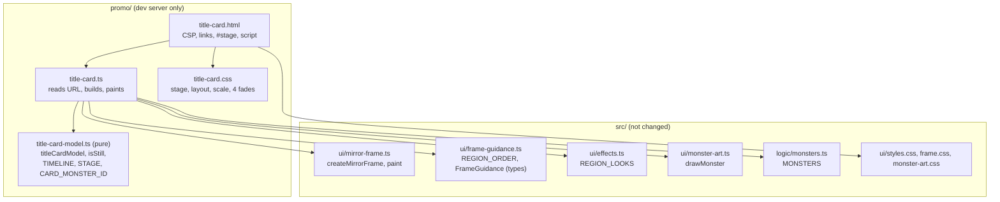

# Design: video-title-card

## 1. Overview

One developer-only page draws a start card and an end card at 1920 x 1080 for the demo video.
The page reuses, and does not change, three things from `mirror-and-screens`: `createMirrorFrame()`
(`src/ui/mirror-frame.ts`), `drawMonster()` (`src/ui/monster-art.ts`) and the stylesheets
`styles.css`, `frame.css` and `monster-art.css`. It serves from `npm run dev` only, like
`debug/tracking-debug.html`, and is never in the build.

**Key decisions**

- **Pure model, thin page.** `promo/title-card-model.ts` holds the card text, the timeline
  table and two small functions. It has no DOM. The page paints what the model returns
  (same split as `title-model.ts` and `title-panel.ts`).
- **CSS does the animation.** Four `opacity` fades with delays taken from the model's timeline
  table. The page writes the delays as `--tc-*` variables. No `requestAnimationFrame`, no
  timer, no `Math.random`.
- **Holding still comes from not writing `--cycle-*`.** `frame.css` and `monster-art.css` take
  the duration of every repeating animation from a `--cycle-*` variable that the game's
  `effects-host.ts` writes. The page does not call the effects host, so each of those
  declarations is invalid at computed-value time and the animation is `none`. The frame's own
  one-shot fade (`frame-fade-in` on `.mirror-frame`, which has a literal 600 ms) is switched
  off by the page's stylesheet.
- **`?still=1` is the final frame by construction.** It adds one class that sets
  `animation: none` on everything. Every animation's last keyframe equals the element's
  normal style, so the still picture and the end of the animation are the same.
- **Lights.** The page builds a `FrameGuidance` with four `active` regions from `REGION_ORDER`
  and `REGION_LOOKS.active` (Decision 3) and gives it to `frame.paint()`. `frameGuidance()` is
  not called.

### 1.1 Files

| File | Status | What |
|------|--------|------|
| `promo/title-card-model.ts` | new, pure | `titleCardModel`, `isStill`, `TIMELINE`, `STAGE`, `CARD_MONSTER_ID`. No DOM, no clock, no randomness. |
| `promo/title-card.html` | new | Page shell: CSP meta, `<title>` with the marker, four stylesheet links, `<div id="stage">`, one module script. |
| `promo/title-card.ts` | new | Reads the URL, builds the frame, the monster and the text lines, sets the `--tc-*` variables and classes. |
| `promo/title-card.css` | new | Black page, stage, layout, scale, four fades, `--still` rule. |
| `tsconfig.json` | one line | `"promo"` added to `include`. |
| `tests/title-card-model.test.ts` | new | Text, card choice, wording, timeline, `isStill`, monster id. |
| `tests/title-card-dist.test.ts` | new | Real build into a temp folder: no promo file in it. Also the `vite.config.ts`, `index.html` and `src/` mention checks. |
| `tests/title-card-page.test.ts` | new | Source scan of the four page files. |

Not changed: everything else, including `vite.config.ts`, `index.html`, `src/**`, `debug/**`,
`package.json`, `README.md` and every existing test.

`structure.md` does not list `promo/`. The new folder sits beside `debug/` and holds
developer material only; no steering file is edited (requirement 10.1).

---

## 2. Architecture



**Data flow.** On load, `title-card.ts` reads `location.search`, calls
`titleCardModel(params.get('card'))` and `isStill(params.get('still'))`, adds classes to the
stage, writes the `--tc-*` variables from `TIMELINE`, builds the frame, the monster and the
text lines, and stops. Nothing runs afterwards. No timer, no listener.

Nothing under `src/` imports from `promo/`. `promo/` imports from `src/ui/` and
`src/logic/monsters.ts` only, never from `src/tracking/`, `src/storage/` or `src/audio/`.

---

## 3. TypeScript types and tables

```typescript
// ── promo/title-card-model.ts ──
export type CardId = 'start' | 'end';
export type CardLineRole = 'title' | 'subtitle' | 'tagline' | 'credit' | 'address';

export interface CardLine {
  readonly role: CardLineRole;   // picks the CSS class: title-card__line--<role>
  readonly text: string;
}

export interface TitleCardModel {
  readonly card: CardId;
  readonly lines: readonly CardLine[];
}

export const STAGE = { widthPx: 1920, heightPx: 1080 } as const;

/** Id looked up in MONSTERS by the page (requirement 7.1). */
export const CARD_MONSTER_ID = 'plaque-puff';

export type StepId = 'mirror' | 'lights' | 'monster' | 'text';
export interface Step { readonly id: StepId; readonly startMs: number; readonly durationMs: number }
/** Requirement 8.1. Contiguous, in order, 4000 ms in all. */
export const TIMELINE: readonly Step[] = [
  { id: 'mirror',  startMs: 0,    durationMs: 1000 },
  { id: 'lights',  startMs: 1000, durationMs: 1000 },
  { id: 'monster', startMs: 2000, durationMs: 1000 },
  { id: 'text',    startMs: 3000, durationMs: 1000 },
];

export function titleCardModel(card: string | null | undefined): TitleCardModel;
export function isStill(value: string | null | undefined): boolean;   // true only for '1'
```

```
titleCardModel(card):
  id = (card === 'end') ? 'end' : 'start'        // exact, case-sensitive; everything else is start
  return id == 'end' ? END_CARD : START_CARD     // two frozen constants, same object every call
```

Card text (requirements 5.1, 5.2). The middle dot is written `\u00B7` in the source so no editor
can change it:

| Card | Role | Text |
|------|------|------|
| start | title | `FOAMTOM` |
| start | subtitle | `The Haunted Mirror` |
| end | title | `FOAMTOM` |
| end | tagline | `Free \u00B7 in your phone's browser` |
| end | credit | `Built with Kiro` |
| end | address | `github.com/yateen01-oralsurgeonn/Foamtom` |

The apostrophe is the plain ASCII `'`, as in the requirement.

---

## 4. Behaviour

### 4.1 The page (`title-card.ts`)

```
params   = new URLSearchParams(location.search)
model    = titleCardModel(params.get('card'))
still    = isStill(params.get('still'))

stage    = byId('stage')
stage.classList.add('title-card', `title-card--${model.card}`)
if still: stage.classList.add('title-card--still')

for step in TIMELINE:                          // requirement 8.1, one table
  stage.style.setProperty(`--tc-${step.id}-delay`,    `${step.startMs}ms`)
  stage.style.setProperty(`--tc-${step.id}-duration`, `${step.durationMs}ms`)

lit      = fullyLit()                          // section 4.2
frame    = createMirrorFrame(); frame.paint(lit)

def      = MONSTERS.find(m => m.id === CARD_MONSTER_ID)
if !def: throw new Error('monster missing')    // requirement 7.4
monsterBox = div.title-card__monster ; monsterBox.append(drawMonster(def))
frame.glass.append(monsterBox)

mirrorBox = div.title-card__mirror ; mirrorBox.append(frame.element)

textBox  = div.title-card__text
for line in model.lines: p.title-card__line.title-card__line--<role>, textContent = line.text

stage.append(mirrorBox, textBox)
```

The page sets text only with `textContent`, creates no `<a>`, writes no `--cycle-*` variable,
and does not read `matchMedia` (requirement 8.7).

> **Design choice (variables from the table):** the delays come from `TIMELINE` through `--tc-*`
> variables, so the test on the table and the CSS cannot drift apart. The alternative, literal
> times in the CSS with a test that parses them, repeats each number twice. Not chosen.

### 4.2 The lit frame

```typescript
// Built in title-card.ts. frameGuidance() is not called and not changed (Decision 3).
function fullyLit(): FrameGuidance {
  return {
    regions: REGION_ORDER.map((region) => ({ region, level: 'active', look: REGION_LOOKS.active })),
    activeRegion: null,     // no single zone: the whole mirror is awake
    flickering: false,      // no frame-region--flicker class: nothing repeats (8.2)
  };
}
```

`REGION_LOOKS.active` today is glow opacity 0.9, glow size 72 px, flame on, flicker amplitude
0.20 (`mirror-and-screens` design 5.1). The page reads the table and does not copy the numbers.
`paint()` sets `frame-region--active`, the three glow variables and shows the flame.

### 4.3 What is animated, and why the end state is the static state

All four fades are `opacity` only, `ease-out`, with `animation-fill-mode: both`, and use
`var(--tc-<id>-duration)` and `var(--tc-<id>-delay)`.

| Step | Selector | Keyframes |
|------|----------|-----------|
| `mirror` | `.title-card__mirror` | `0%` opacity 0, `100%` opacity 1 |
| `lights` | `.title-card .frame-glow` | from opacity 0 to `var(--glow-opacity)` (the value `paint()` wrote) |
| `lights` | `.title-card .frame-flame` | from opacity 0 to 1 |
| `monster` | `.title-card__monster` | `0%` opacity 0, `100%` opacity 1 |
| `text` | `.title-card__text` | `0%` opacity 0, `100%` opacity 1 |

Before its delay an element sits at its first keyframe (fill mode `both`), so the stage is
black until step 1 and each later part is hidden until its turn. The unlit candle sticks are
part of the mirror and appear at step 1.

The static style of each of those elements is opacity 1, or `var(--glow-opacity)` for a glow.
Each final keyframe is that same value, so "after step 4" and `?still=1` are the same picture.

`?still=1`:

```css
.title-card--still,
.title-card--still *,
.title-card--still *::before,
.title-card--still *::after { animation: none !important; }
```

**Switching off everything else.**

| Thing | How it stays still |
|-------|--------------------|
| `.frame-fog::before/::after` drift (`var(--cycle-fog-drift)`) | Variable not written, the declaration is invalid at computed-value time, the animation is `none`. |
| `.frame-region--flicker` glow and flame flicker | `flickering: false`, the class is never added. The `--cycle-*` variables are also unset. |
| `.smoke__puff` drift | No smoke is drawn. Variable not written. |
| `.mirror-frame { animation: frame-fade-in 600ms }` | `.title-card .mirror-frame { animation: none; }` in `title-card.css` (higher specificity, loaded later). |
| `.frame-glow { transition: opacity 400ms }` | Harmless: nothing changes the glow's opacity after `paint()`. |
| `.monster { transition: transform 0.4s }` | Harmless: nothing changes the monster's transform. |

A test (source scan) checks that no file in `promo/` writes `--cycle-`.

### 4.4 Layout (starting values)

All sizes are in the page's stylesheet, in px, for a 1920 x 1080 stage. They are **starting
values** that Dr. Yatin tunes by eye (task 3) and are not dental or game numbers. Frame
natural size: 480 px wide (`min(100%, 480px)`), 32 px ring, 3 px border.

| Part | Rule | Result |
|------|------|--------|
| Page | `html, body { margin: 0; background: #000; overflow: hidden; }`, body is a grid with `place-items: center; min-height: 100vh` | Stage centred on black |
| Stage | `position: relative; width: 1920px; height: 1080px; background: #1c1530; overflow: hidden; flex: none` | 3.1 to 3.3 |
| Mirror wrapper | `position: absolute; top: 32px; left: calc(50% - 240px); width: 480px; transform: scale(1.2); transform-origin: top center` | Frame 576 x about 756 px, so about 70 % of the stage height, centred |
| Glass | `.title-card .mirror-frame__glass { height: 560px; display: flex; align-items: center; justify-content: center; }` | Fixed height, no camera picture |
| Monster box | `--u: 4px` (monster about 288 x 256 px before the scale) | Large, centred in the glass |
| Text block | `position: absolute; left: 0; right: 0; top: 812px; height: 236px; display: flex; flex-direction: column; align-items: center; justify-content: center; text-align: center` | Below the mirror, full stage width |
| Title line | `font-size: 84px; line-height: 96px; font-weight: 700; letter-spacing: 0.14em; color: #f4eefc` | `FOAMTOM` |
| Subtitle line | `font-size: 40px; line-height: 52px; color: #b8a6e0` | Start card |
| Tagline, credit lines | `font-size: 32px; line-height: 44px; color: #b8a6e0` | End card |
| Address line | `font-size: 32px; line-height: 44px; color: #ffd966; letter-spacing: 0.02em` | End card |
| Font | `font-family: system-ui, -apple-system, 'Segoe UI', Roboto, sans-serif` (the game's stack) | 2.3 |

The end card block is 96 + 3 x 44 = 228 px, which fits the 236 px text block. The text sits
below the glass, not over it, so the long address line is not limited to the frame's width.
`styles.css` also styles `body` and `#app`; the page does not use `#app` and its stylesheet
loads last, so its `body` rules win.

Colours are the game's own: `#1c1530` (stage and glass), `#f4eefc` (text), `#b8a6e0` (lilac of
the silhouette), `#ffd966` (the gold of the monster crests).

### 4.5 The HTML shell

```html
<!doctype html>
<html lang="en">
  <head>
    <meta charset="UTF-8" />
    <meta http-equiv="Content-Security-Policy" content="…identical to index.html…" />
    <meta name="viewport" content="width=device-width, initial-scale=1.0" />
    <title>FOAMTOM-PROMO-TITLE-CARD (developer page, not part of the game)</title>
    <link rel="stylesheet" href="/src/ui/styles.css" />
    <link rel="stylesheet" href="/src/ui/frame.css" />
    <link rel="stylesheet" href="/src/ui/monster-art.css" />
    <link rel="stylesheet" href="./title-card.css" />
  </head>
  <body>
    <div id="stage"></div>
    <script type="module" src="./title-card.ts"></script>
  </body>
</html>
```

The game's `index.html` also links `screens.css` and `parent-screen.css`; the page does not
need them. The three links to `src/ui/` use the same absolute form as `index.html`.

---

## 5. Error handling

| Condition | Behaviour | Req |
|-----------|-----------|-----|
| `card` missing, empty, wrong case or unknown | Start card | 4.1, 4.3 |
| `still` missing or not exactly `1` | Animation runs | 8.6 |
| `plaque-puff` missing from `MONSTERS` | The page throws; the stage stays empty. A developer page should fail loudly, not draw another monster | 7.4 |
| `#stage` missing | The page throws (same helper as `debug/tracking-debug.ts`) | 1.1 |
| Viewport smaller than 1920 x 1080 | The stage keeps its size and is cut off; scroll bars are hidden. The recording window must be 1920 x 1080 | 3.1, 3.2 |

---

## 6. Testing strategy

The project has no DOM library and this spec adds none. The pure model is unit tested, and
the page is checked by source scan and by eye (same approach as `title-panel.ts`,
`monster-book-screen.ts` and `debug/`). Tests are in `/tests/`, use Vitest and fast-check, and
read files with `node:fs` like the existing guard tests. No existing test is edited.

Existing guards that scan `debug/` or `src/` do not scan `promo/`, so `title-card-page.test.ts`
carries the rules for it.

| # | Test name | File | Req | Assertion |
|---|-----------|------|-----|-----------|
| 1 | `startCardText` | `title-card-model.test.ts` | 5.1, 9.1 | `titleCardModel('start')` is `card: 'start'` with exactly two lines: `FOAMTOM` (title) and `The Haunted Mirror` (subtitle) |
| 2 | `endCardText` | same | 5.2, 9.1 | `titleCardModel('end')` is `card: 'end'` with exactly four lines, in order: `FOAMTOM`, `Free · in your phone's browser` (written in the test with `\u00B7`), `Built with Kiro`, `github.com/yateen01-oralsurgeonn/Foamtom` |
| 3 | `unknownCardIsStart` | same | 4.1, 4.3, 9.2 | `null`, `undefined`, `''`, `'END'`, `'Start '`, `'end '`; and for any generated string that is neither `start` nor `end`, the result equals `titleCardModel('start')` |
| 4 | `cardWording` | same | 5.4, 9.3 | For every line of both cards, lower-cased: no word that begins with `clinic`, `registr`, `cure`, `prevent` or `guarantee` (regex `(^\|[^a-z])(clinic\|registr\|cure\|prevent\|guarantee)`); the matcher passes `FOAMTOM` and `Built with Kiro`, and flags `Prevents cavities`, `Registration no. 1`, `cure`, `Guaranteed`, `Our clinic`; no line except the address holds `yatin`, `shinde` or `dr.`; no line has a digit run of 7 or more, `@` or `http` |
| 5 | `onlyTheApprovedLines` | same | 5.1, 5.2, 5.5 | The start card has 2 lines and the end card 4; every `role` is one of the five; no line is empty or has leading or trailing space |
| 6 | `timelineTable` | same | 8.1, 9.4 | Four steps in the order mirror, lights, monster, text; each starts where the previous ends; durations are 1000 ms; the first starts at 0 and the last ends at 4000 ms |
| 7 | `isStillOnlyForOne` | same | 8.6, 9.4 | `isStill('1')` true; false for `null`, `undefined`, `''`, `'0'`, `'true'`, `'01'`, `'1 '` and for any generated string other than `'1'` |
| 8 | `stageSize` | same | 3.1 | `STAGE` is 1920 x 1080 |
| 9 | `cardMonsterExists` | same | 7.1 | `CARD_MONSTER_ID` is `plaque-puff`; `MONSTERS` has exactly one entry with that id; it is `common`; `MONSTER_LOOKS` has a row for it |
| 10 | `distHasNoPromoPage` | `title-card-dist.test.ts` | 1.3, 9.5 | One `vite build` into a temp folder (the way `build-output.test.ts` does it). No built file has `promo` or `title-card` in its path; no built file holds `FOAMTOM-PROMO-TITLE-CARD`. The folder is removed afterwards |
| 11 | `buildInputUnchanged` | same | 1.3, 1.4, 9.5 | `vite.config.ts` has `input: 'index.html'` and does not contain `promo`; `index.html`, every file under `src/` and `vite.config.ts` do not contain `promo/title-card` or `title-card.html` |
| 12 | `pageIsDevOnlyAndSafe` | `title-card-page.test.ts` | 1.5, 2.1 to 2.5 | The four page files exist. The HTML has the CSP `content` equal to that of `index.html`; its `<title>` holds the marker; it has no `style=`, no `<style`, no inline `<script>` (every script has `src`), no `data:`, no `http://` or `https://`, no `@font-face`. The CSS has no `url(`, no `@font-face`, no `@import`. The TS has none of `fetch`, `XMLHttpRequest`, `WebSocket`, `sendBeacon`, `localStorage`, `sessionStorage`, `document.cookie`, `getUserMedia`, `console`, `innerHTML`, `import(`; its imports are `./title-card-model`, `../src/ui/mirror-frame`, `../src/ui/frame-guidance`, `../src/ui/effects`, `../src/ui/monster-art` and `../src/logic/monsters` (type imports allowed) and nothing from `tracking`, `storage` or `audio` |
| 13 | `pageIsStillAndDeterministic` | same | 8.2 to 8.5, 8.7 | No promo file contains `--cycle-`, `Math.random`, `requestAnimationFrame`, `setTimeout`, `setInterval`, `matchMedia`, `prefers-reduced-motion`, `infinite` or `animationend`; the CSS sets `.title-card .mirror-frame` to `animation: none`; the CSS has the `--still` rule with `animation: none`; every `animation` declaration in the CSS other than `none` takes its time from `var(--tc-`; the only animated property in the CSS keyframes is `opacity` |
| 14 | `pageBuildsFromGameParts` | same | 6.1 to 6.4, 7.1, 7.2, 5.3, 5.5 | `title-card.ts` calls `createMirrorFrame(` and `drawMonster(`, uses `MONSTERS` and `CARD_MONSTER_ID`, appends the monster into `frame.glass`, calls `.paint(`, builds its guidance from `REGION_ORDER` and `REGION_LOOKS.active`, does not contain `frameGuidance(`, does not contain `'a'` as an element tag (`createElement('a')`), does not contain `FOAMTOM`, `Haunted`, `Kiro` or `github` (every text comes from the model); the CSS sets a fixed glass height |
| 15 | `existingSuite` | all tests | 9.7, 10.1 | `npm run test:run` passes with no existing test edited. `git status` shows only the files named in section 1.1 |

**Helpers.** None shared. `listFiles` is copied into the dist test (a few lines, as
`build-output.test.ts` does). `fast-check` is used in tests 3 and 7.

**Manual check** (task 3, left for Dr. Yatin; see `tasks.md`):

| # | What to look at |
|---|-----------------|
| M1 | Both cards at 1920 x 1080: the mirror is centred and fills most of the height, all four candles lit, one friendly monster in the glass, the text below, nothing cut off |
| M2 | The animation: black, the mirror fades up, the lights come on, the monster, then the text, about 4 s; then nothing moves for at least 10 s |
| M3 | `?card=end&still=1` and `?card=start&still=1` look identical to the end of the animation |
| M4 | Wrong values (`?card=banana`) show the start card |
| M5 | Network panel: only same-origin requests; console: no errors |
| M6 | `npm run build` then a look in `dist/`: no `promo` folder or `title-card` file |

---

## 7. Requirements → design → tests

| Req | Design element | Test |
|-----|----------------|------|
| 1.1, 1.2 | Files (1.1), page shell (4.5) | `pageIsDevOnlyAndSafe`; M1 |
| 1.3 | Not in the build input (1) | `distHasNoPromoPage`, `buildInputUnchanged` |
| 1.4 | Nothing links to the page (1.1) | `buildInputUnchanged` |
| 1.5 | `<title>` marker (4.5) | `pageIsDevOnlyAndSafe`, `distHasNoPromoPage` |
| 2.1 to 2.5 | HTML shell, imports (2, 4.1, 4.5) | `pageIsDevOnlyAndSafe` |
| 3.1 to 3.3 | `STAGE`, layout table (3, 4.4) | `stageSize`; M1 |
| 4.1 to 4.4 | `titleCardModel` (3), page reads once (4.1) | `unknownCardIsStart`, `startCardText`, `endCardText`; M4 |
| 5.1, 5.2 | Card text table (3) | `startCardText`, `endCardText`, `onlyTheApprovedLines` |
| 5.3 | `<p>` with `textContent`, no `<a>` (4.1) | `pageBuildsFromGameParts` |
| 5.4 | Wording (3) | `cardWording` |
| 5.5 | Text only in the model (3, 4.1) | `onlyTheApprovedLines`, `pageBuildsFromGameParts` |
| 6.1 | `createMirrorFrame()`, no edits (1.1, 4.1) | `pageBuildsFromGameParts`; `existingSuite` |
| 6.2 | `fullyLit()` (4.2) | `pageBuildsFromGameParts` |
| 6.3, 6.4 | Scale and fixed glass (4.4) | `pageBuildsFromGameParts` (glass height); M1 |
| 7.1 to 7.4 | Monster lookup and glass slot (4.1, 5) | `cardMonsterExists`, `pageBuildsFromGameParts`; M1 |
| 8.1 | `TIMELINE`, four fades (3, 4.3) | `timelineTable`, `pageIsStillAndDeterministic`; M2 |
| 8.2, 8.3 | `--cycle-*` unset, `flickering: false` (4.2, 4.3) | `pageIsStillAndDeterministic`; M2 |
| 8.4 | `.mirror-frame { animation: none }` (4.3) | `pageIsStillAndDeterministic`; M2 |
| 8.5 | CSS animations only (1, 4.3) | `pageIsStillAndDeterministic` |
| 8.6 | `isStill`, `--still` class (3, 4.3) | `isStillOnlyForOne`, `pageIsStillAndDeterministic`; M3 |
| 8.7 | No `matchMedia` (4.1) | `pageIsStillAndDeterministic` |
| 9.1 to 9.7 | This section | the tests above |
| 10.1 to 10.3 | Files table (1.1) | `existingSuite`; `buildInputUnchanged` |
| 11.1, 11.2 | `tasks.md` task 3 | M1 to M6 |

---

## 8. Open items

None for Dr. Yatin's six answers. The layout numbers in section 4.4 (scale 1.2, glass height
560 px, `--u` 4 px, font sizes, text block position) are starting values chosen so both cards
fit at 1920 x 1080. They are drawing choices and can be tuned after the check by eye.


---

## 9. Share card (requirement 12, added 28 Nov 2026)

**Model (`promo/title-card-model.ts`).** `CardId` becomes `'start' | 'end' | 'share'`. One more
frozen constant:

| Card | Role | Text |
|------|------|------|
| share | title | `Foamtom` |
| share | subtitle | `The 2-minute toothbrushing game` |

`titleCardModel(card)` returns the share card only for the exact string `'share'`, the end card
only for `'end'`, and the start card for everything else. `SHARE_STAGE = { widthPx: 1200,
heightPx: 630 }` is added next to `STAGE`; `STAGE`, `TIMELINE`, `isStill`, the start card and the
end card are not touched.

**Page (`promo/title-card.ts`).** For the share card only: the stage gets `title-card--share`
(as it gets `title-card--<card>` today); the monster is drawn inside a tooth
(`drawToothWithMonster(def)` from `src/ui/howto-icons.ts`, which calls `drawMonster` for the
entry looked up in `MONSTERS`); and a `div.title-card__brush` holding `drawToothbrush()` is
added. For `start` and `end` the page does exactly what it does today. The text lines still
come from the model.

**Styles (`promo/title-card.css`, new rules only, all under `.title-card--share`).**

| Part | Starting value |
|------|----------------|
| stage | 1200 x 630 |
| mirror wrapper | `left: 70px; top: 50px; width: 480px; transform: none` |
| glass | height 470 px; the tooth is `--icon: 330px` |
| brush | `left: 640px; top: 40px; --icon: 210px`; fades in with the text step |
| text block | `left: 620px; right: 40px; top: 250px; text-align: left; align-items: flex-start` |
| title | 120 px, weight 800, colour `#f4eefc`, `letter-spacing: 0.02em` |
| subtitle | 54 px, weight 700, line height 64 px, colour `#ffd966` |

The existing `.title-card--still` rule already sets `animation: none !important` on the stage and
everything in it, so `&still=1` needs no new rule. The page links `/src/ui/screens.css` for
the tooth and brush drawings (their rules are at the end of that file, mirror-and-screens
design 5.5.1).

**Tests.**

| # | Test name | File | Assertion |
|---|-----------|------|-----------|
| 16 | `shareCardText` | `title-card-model.test.ts` | `titleCardModel('share')` is `card: 'share'` with exactly `Foamtom` (title) and `The 2-minute toothbrushing game` (subtitle); `SHARE_STAGE` is 1200 x 630; `STAGE` is still 1920 x 1080 |
| 17 | `shareCardIsOnlyForShare` | same | `'Share'`, `'share '`, `'shared'` and generated strings give the start card; `'start'` and `'end'` give the same cards as before |
| 18 | `shareCardWording` | same | the share lines pass the same banned-word, name and digit checks as test 4 |
| 19 | `sharePageParts` | `title-card-page.test.ts` | `title-card.ts` mentions `drawToothWithMonster(` and `drawToothbrush(`; the CSS has a `.title-card--share` stage of 1200 x 630 and a title of at least 100 px and a subtitle of at least 48 px; no `url(` |
